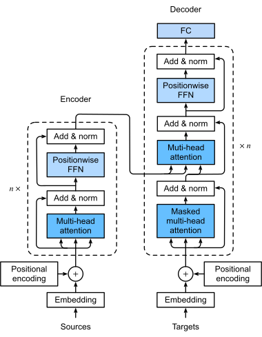

# Transformer 总体结构与自回归生成

- 学习日期：2026-10-08。
- 每日概览：[topics_by_date](topics_by_date.md)。
- 学习索引：[工作能力提升与实践手册](../index-2026-10-08.md)。

先建立整体图景：输入、各层模块、causal 可见性与输出预测。位置表示与损失函数另见同日专题。

**训练流程前置（2026-10-22 补充）**：本篇讲模型内部结构，不是从语料到成品模型的训练总图。先建立训练阶段、能力域和团队工作的关系，可读[现代 LLM 训练流水线总览](2026-10-22_01_llm_training_pipeline_and_capability_map.md)；不改变本篇原学习日期。

图示来源：Aston Zhang、Zachary C. Lipton、Mu Li、Alexander J. Smola 的《Dive into Deep Learning》，按 [CC BY-SA 4.0](https://creativecommons.org/licenses/by-sa/4.0/) 使用（[项目许可](https://github.com/d2l-ai/d2l-en/blob/master/LICENSE)）。图片未修改，各图附原始章节链接。

## 1. 前置知识：Transformer 总体结构

先不要记 Q、K、V。先回答一个更基础的问题：**一段文字进入模型后，经历了什么，模型又如何预测下一个 token？**

### 1.1. 从文字到下一个 token

以一个现代自回归、Decoder-only 语言模型为例：

```text
输入文字
   ↓
Tokenizer：文字变成 token ID 序列
   ↓
Token Embedding：每个 ID 查表得到一个向量
   ↓
位置处理：让模型利用 token 的顺序
   ↓
Transformer Block 1
   ↓
Transformer Block 2
   ↓
……重复 L 层……
   ↓
最终归一化（常见于现代 pre-norm 模型）
   ↓
输出投影 / LM Head：隐藏向量变成词表上的分数
   ↓
Softmax：分数变成概率
   ↓
解码策略：选择下一个 token
```

这里的 **Transformer Block** 是反复堆叠的基本层。多层结构让模型不断更新各位置的表示；不同层可以学习不同的信息组合，但不是人为规定“第一层只学语法、第二层只学语义”。

如果输入有 $n$ 个 token，每个隐藏向量有 $d_{\text{model}}$ 个分量，那么进入各层的隐藏状态通常是：

$$
X \in \mathbb{R}^{n \times d_{\text{model}}}
$$

可以把它想成一张表：每行对应一个 token，每列是一个特征维度。经过一个 block 后，表的形状通常不变，但每行的内容发生变化。

### 1.2. 一个 Transformer Block 内部有什么？

先看现代 Decoder-only 模型中常见的 **pre-norm** 结构，也就是先归一化，再进入子模块：

```text
输入隐藏状态 X
   │
   ├─────────────── 残差支路 ───────────────┐
   ↓                                       │
Norm                                       │
   ↓                                       │
Causal Self-Attention                      │
   ↓                                       │
相加：注意力输出 + X ←──────────────────────┘
   │
   ├─────────────── 残差支路 ───────────────┐
   ↓                                       │
Norm                                       │
   ↓                                       │
FFN / MLP                                  │
   ↓                                       │
相加：FFN 输出 + 上一次相加结果 ←────────────┘
   ↓
本层输出，送入下一个 block
```

本节先把注意力当作一个黑盒：**让每个位置从允许访问的上下文中获取信息**。MHA 就是这个黑盒的一种具体实现，不是整个 Transformer。

| 模块 | 核心职责 | 是否直接混合不同 token 的信息？ |
|---|---|---|
| Self-Attention | 根据上下文动态汇总其他位置的信息 | 是，但受 mask 限制 |
| FFN / MLP | 对每个位置的向量做非线性特征变换 | 否，通常各位置独立计算、共享参数 |
| 残差连接 | 将子模块输出叠加到原来的隐藏状态，提供直接的信息与梯度路径 | 本身不会 |
| Norm | 调整每个位置的特征尺度，帮助稳定训练 | 常见 LayerNorm / RMSNorm 不会 |

最重要的区分是：

> **Attention 做跨位置的信息交互；FFN 做每个位置内部的特征变换。**

FFN 虽然不直接读取其他位置，但它的输入已经经过 Attention，因此仍可以处理包含上下文信息的向量。

#### 1.2.1. Causal Self-Attention 中的 causal 是什么意思？

**Causal 直译为“因果的”，在这里指注意力只能读取当前位置及之前的位置，不能读取未来位置。** 它是信息访问方向的限制，不代表模型在做因果推断。

例如输入序列是“我、喜欢、学习”：

| 正在计算的位置 | 可以读取 | 不可以读取 |
|---|---|---|
| 我 | 我 | 喜欢、学习 |
| 喜欢 | 我、喜欢 | 学习 |
| 学习 | 我、喜欢、学习 | 无 |

每个位置通常可以读取自己，不是只能读取严格位于自己之前的 token。

为什么这样限制？因为自回归语言模型要根据已经给出的 token 预测下一个 token：

$$
P(t_1,\ldots,t_n)
=\prod_{i=1}^{n}P(t_i\mid t_1,\ldots,t_{i-1})
$$

在常见的右移目标训练中，“我”所在位置的输出用于预测“喜欢”，“喜欢”所在位置的输出用于预测“学习”。如果“我”所在位置的注意力可以读取后面的“喜欢”，就等于在预测时直接看到了目标，产生信息泄露。

这里没有矛盾：位置 $i$ 可以读取自己的输入 token $t_i$，因为这个位置的输出预测的是 $t_{i+1}$，不是 $t_i$。

实现时，在 softmax 之前用 **causal mask** 将未来位置的匹配分数设为 $-\infty$，使其注意力权重为零。具体矩阵与公式见 [Attention / MHA 的 causal mask 小节](2026-10-08_04_attention_mha.md)。

对比：

- **双向 self-attention**：每个位置通常可以读取前后所有非 padding 的位置，常见于 BERT 等 Encoder。
- **Causal self-attention**：只能读取当前位置与过去位置，常见于自回归 Decoder-only LLM。

“只能看过去”不等于训练必须逐 token 串行。训练时完整序列已知，可以同时计算各位置，再用 mask 屏蔽未来信息；生成时下一个 token 尚未确定，才需要逐步生成。

一句话记忆：

> **Self-attention 表示从同一序列获取信息；causal 表示获取信息时不能向未来偷看。**

#### 1.2.2. Causal mask 是训练时挡住未来，还是预测时挡住未计算位置？

**核心是第一种：训练时，完整序列已知，用 causal mask 防止各位置读取未来 token。推理时也遵守同样的可见性规则，但通常不是先建立一个与训练等宽的窗口，再遮住尚未生成的位置。**

需要区分三个阶段：

| 阶段 | 已经给出的输入 | causal 限制的作用 |
|---|---|---|
| 训练 | 一整段真实 token 序列 | 同时计算各位置，但不允许早期位置读取后面的真实 token |
| 推理 prefill | 用户提示词等已有上下文 | 通常并行处理整个提示词，各位置仍只能读取自己及之前的位置 |
| 推理 decode | 本步输入 token 与历史 KV Cache | 当前 query 通常只读取有效的历史 K、V 与当前 K、V，本来就没有未来 token 可读 |

以上描述的是标准 causal Decoder-only LLM；特殊的 prefix-LM、分块生成等架构可能采用其他可见性规则。

**训练：未来 token 存在，所以必须防止偷看。**

例如训练输入为“我、喜欢、学习”。虽然“学习”已经在输入张量里，计算“喜欢”位置时仍不能读取它，因为该位置要预测的正是“学习”。

**Prefill：整个提示词已知，也仍按 causal 规则处理。**

例如提示词有 $n$ 个 token，通常可以一次并行计算它们的隐藏状态与 K、V。最后一个提示词位置可以读取完整提示词，随后用该位置的输出预测第一个新 token；但较早的位置通常不能读取较晚的提示词位置。

**Decode：未来 token 尚未存在，往往无需额外屏蔽“未来 token”。**

使用 KV Cache、每步处理一个新 token 时，当前 query 的长度通常为 $1$。设当前有效上下文长度（含本步 token）为 $t$，则概念上的匹配分数形状为：

$$
[B,\ h,\ 1,\ t]
$$

这些 key 全部来自历史和当前位置，都是可访问的。若缓存只向注意力暴露有效条目，且没有其他访问限制，就不需要额外构造一个三角形 mask 来挡住不存在的未来位置。具体实现可能仍传入 mask、有效长度或位置元数据，由注意力内核处理。

生成流程可以理解为：

```text
处理已有提示词 → 预测新 token A
将 A 作为下一步输入，并利用历史缓存 → 预测 B
将 B 作为下一步输入，并利用历史缓存 → 预测 C
……
```

如果不用 KV Cache，也可以每步重新处理整个已有序列；此时仍需要按 causal 规则限制序列内部各位置的访问，只是会重复计算历史内容。

**那么预分配缓存里的空槽位怎么办？**

实现可能提前分配最大容量的 KV Cache，或者将不同长度的请求 padding 到统一形状。这些尚未填充或属于 padding 的槽位必须通过有效长度、索引或 mask 排除，但它们不等于“已经存在、只是尚未计算的未来 token”。

最后区分三个容易混淆的概念：

- **Causal mask**：规定时间方向，不能读取未来位置。
- **Padding / 缓存有效性限制**：排除 padding 或尚未写入的无效槽位。
- **Sliding window**：限制只能读取最近若干位置；即使某个历史位置不是未来，也可能因超出窗口而不可访问。

最大上下文长度也不意味着每次输入都必须达到该长度。模型的有效序列长度、缓存分配容量与滑动窗口大小是不同概念。

一句话总结：

> **训练是“未来已知，但不能偷看”；逐 token 推理是“未来尚不存在，只读取有效历史”。两者遵守同一自回归规则，但不一定使用相同形状的 mask。**

#### 1.2.3. 未来 token 正是要生成的内容，为什么还要“挡住未来”？

这里的“挡住”是指 **不允许 Attention 把未来 token 当作已知输入读取**，不是禁止模型输出未来 token。

例如上下文是“我、喜欢”，模型要预测下一个 token：

```text
已有输入：“我、喜欢”
   ↓
Transformer 计算已有位置的隐藏状态
   ↓
取“喜欢”位置的最终隐藏状态
   ↓
LM Head 对词表里的所有候选 token 打分
   ↓
选择“学习”
   ↓
将“学习”追加到上下文，成为下一步的已知输入
```

**预测“学习”时，并不需要预先为它建立一个输入位置，再计算它的 Q、K、V。** 模型使用最后一个已知位置的输出，经 LM Head 预测它。

特别区分两个空间：

| 环节 | 候选对象是什么？ | 是否受 causal mask 限制？ |
|---|---|---|
| Attention | 已有序列中的输入位置，例如“我”位置、“喜欢”位置 | 是，不能读取未来输入位置 |
| LM Head / 输出概率 | 词表中的候选 token，例如“学习”“跑步”等 | 不由 causal mask 屏蔽；其他输出约束是另一回事 |

LM Head 可以对“学习”这个词表候选打分，不等于 Attention 已经读到了“学习”作为真实的下一 token。词表中的候选项也不等于序列中已经存在的输入位置。

因此：

- 单 token decode 时，真正的未来 token 尚不存在；如果注意力只读取有效缓存，就没有未来 token 需要额外遮挡。
- 训练时，真实未来 token 已经在输入张量中，所以需要 causal mask 防止泄露答案。
- 推理 prefill 或重新计算整段上下文时，较早位置不能读取较晚位置，以保持相同的 causal 计算规则；但最后一个位置可以读取完整的已有上下文。

最准确的记法是：

> **不是“不能生成未来”，而是“生成未来时，不能把未来的真实答案当作已知条件”。**

### 1.3. 为什么还需要 FFN、残差和 Norm？

**FFN：不只是“收集信息”，还需要“加工信息”。**

传统 Transformer 的 FFN 通常先把维度扩大，再经过激活函数，最后投影回原来的维度。省略 batch 维度，采用行向量约定：

$$
\operatorname{FFN}(x)
= \sigma(xW_1+b_1)W_2+b_2
$$

其中：

$$
W_1 \in \mathbb{R}^{d_{\text{model}} \times d_{\text{ff}}},
\qquad
W_2 \in \mathbb{R}^{d_{\text{ff}} \times d_{\text{model}}}
$$

$\sigma$ 是非线性激活函数。现代模型也常用 SwiGLU 等门控 FFN；后续再展开，不需要现在记它的公式。

**残差：保留旧表示，再叠加更新。**

不是每次都把输入完全替换，而是做：

$$
x_{\text{new}} = x + f(x)
$$

这给信息和梯度提供了直接路径，帮助训练深层网络；不意味着必然完全消除梯度问题。

**Norm：稳定特征尺度。**

LayerNorm 与 RMSNorm 是常见选择，一般沿每个 token 的隐藏特征维度处理。这里先理解职责，后续再推导区别。原始 Transformer 使用 post-norm，即在残差相加后归一化；现代 LLM 常见 pre-norm。两者不要混成同一种结构。


### 1.4. 原始 Transformer 与现代 LLM 是什么关系？

Transformer 是一类架构，不只对应一种模型。原始 Transformer 是 **Encoder–Decoder** 架构，常以机器翻译为例：

```text
源文本 → Embedding + 位置编码 → Encoder 堆叠 → 源文本表示
                                                    │
                                                    ↓ 作为 cross-attention 的 K、V
右移的目标序列 → Embedding + 位置编码 → Decoder 堆叠 → 输出投影
```

| 架构 | 每层主要子模块 | 常见用途 / 例子 |
|---|---|---|
| Encoder-only | 双向 self-attention + FFN | 文本表示、分类等，如 BERT |
| Decoder-only | Causal self-attention + FFN | 自回归生成，如 GPT、Llama 系列 |
| Encoder–Decoder | Encoder：self-attention + FFN；Decoder：causal self-attention + cross-attention + FFN | 翻译、序列到序列任务，如原始 Transformer、T5 |

表格省略了各子模块周围的残差与归一化。

**图 1：原始 Encoder–Decoder Transformer 的总体结构**



来源：[Dive into Deep Learning：The Transformer Architecture](https://d2l.ai/chapter_attention-mechanisms-and-transformers/transformer.html)。

读图提示：

- 左侧是 Encoder，右侧是 Decoder，框中的模块重复堆叠。
- `Add & Norm` 表示残差相加与归一化；这张图展示原始 post-norm 结构，不是第 1.2 节的现代 pre-norm 顺序。
- 右侧的第二个注意力子层读取左侧 Encoder 的输出，属于 cross-attention。
- Decoder-only LLM 通常不保留左侧 Encoder 与该 cross-attention 子层，但会保留 causal self-attention 和 FFN。不能直接把整张图当成现代 LLM 的结构。

**原始 Decoder 有两种注意力：**

1. Causal self-attention：读取已经给出的目标序列，不能看未来目标。
2. Cross-attention：用 Decoder 的表示作为 Q，读取 Encoder 的输出作为 K、V。

**现代 Decoder-only LLM 通常没有这个 Encoder，也没有读取 Encoder 输出的 cross-attention 子层。** 输入提示词和已生成内容位于同一个序列里，通过 causal self-attention 建立联系。“Decoder-only”不等于直接原样保留原始 Decoder 的全部子层。

### 1.5. 最后的隐藏向量如何变成文字？

Transformer 层输出的仍是向量，不是文字。对某个位置的最终隐藏向量 $h$，LM Head 把它映射成词表上每个 token 的分数：

$$
z = hW_{\text{vocab}} + b,
\qquad
W_{\text{vocab}} \in \mathbb{R}^{d_{\text{model}} \times |\mathcal{V}|}
$$

$|\mathcal{V}|$ 是词表大小，$z$ 是 logits。偏置是否使用取决于模型实现。

$$
p_j = \frac{e^{z_j}}{\sum_{t=1}^{|\mathcal{V}|} e^{z_t}}
$$

然后用贪心选择或采样等解码策略确定下一个 token。追加到序列后，继续预测，再把最终 token 序列解码为文字。

需要区分两处 softmax：

- **Attention 内的 softmax**：在可访问的位置之间分配信息汇总权重。
- **输出端的 softmax**：在词表 token 之间分配预测概率。

二者不是同一个分布。

训练时，常把输入与目标错开一位，例如输入序列为“我、喜欢、学习”，对应目标是“喜欢、学习、结束标记”。causal mask 使各位置不能读取未来 token，因此同一条序列的多个 next-token 预测可并行计算。

生成时，未来 token 尚未确定，需要逐步生成。KV Cache 可以复用历史位置的 K、V，避免每步重复计算它们；这是后续学习的主题，现在只需知道它是推理优化，不是另一个 Transformer 层。


### 1.6. 到这里应该建立的整体图景

先记住下面这条主线，再进入 Attention 的细节：

> **文字变成向量 → 注入位置信息 → 多层“上下文交互 + 特征加工” → 向量投影到词表 → 预测下一个 token。**

每层内部：

> **Attention 汇总上下文，FFN 加工特征，残差保留并叠加表示，Norm 帮助稳定尺度。**

接下来阅读 [Attention / MHA 讲义](2026-10-08_04_attention_mha.md)，打开“上下文交互”这个黑盒，理解 Q、K、V 与多个头。
