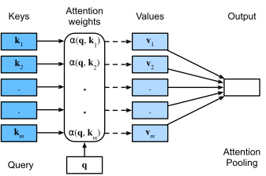
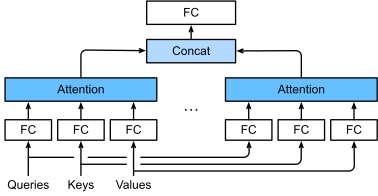

# Attention 与 MHA：计算、形状与参数量

- 学习日期：2026-10-08。
- 每日概览：[topics_by_date](topics_by_date.md)。
- 学习索引：[工作能力提升与实践手册](../index-2026-10-08.md)。

前置阅读：[Transformer 总体结构](2026-10-08_01_transformer_overview.md)。形状专项练习见 [张量与矩阵运算](2026-10-09_01_tensor_shapes.md)。

图示来源：Aston Zhang、Zachary C. Lipton、Mu Li、Alexander J. Smola 的《Dive into Deep Learning》，按 [CC BY-SA 4.0](https://creativecommons.org/licenses/by-sa/4.0/) 使用（[项目许可](https://github.com/d2l-ai/d2l-en/blob/master/LICENSE)）。图片未修改，各图附原始章节链接。

## 1. 从直觉到公式

### 1.1. Attention 在解决什么问题？

处理某个 token 时，模型需要从上下文中选择相关信息，并按相关程度汇总。

例如“这只猫没有吃鱼，因为它已经饱了”，处理“它”时，需要利用上下文判断它指向谁。Attention 提供了信息交互机制，但某一个头不一定对应人类可解释的指代规则，注意力权重也不等于因果解释。

- **Q（Query）**：当前位置用什么条件寻找信息。
- **K（Key）**：各位置提供什么匹配特征。
- **V（Value）**：匹配后实际汇总的信息。

Q、K、V 通常由输入通过不同的可学习线性投影得到，不是人工指定的标签。

这里的输入不是文字本身，而是 token 对应的向量。在第一层，它来自 embedding 等输入处理；在后续层，它是前一层传来的隐藏状态。一个 token 通常不等于一个完整的词。

为什么需要三个投影，而不是直接用输入同时做匹配和汇总？因为“如何寻找信息”“如何被匹配”“传递什么内容”是不同职责，分别投影允许模型学习不同的表示。例如，一个位置可以用与语法相关的特征参与匹配，同时传递与实体属性相关的信息。这只是理解职责的例子，不是对某个头实际功能的保证。

**图 2：Query 如何通过 Key 找到要汇总的 Value**



来源：[Dive into Deep Learning：Queries, Keys, and Values](https://d2l.ai/chapter_attention-mechanisms-and-transformers/queries-keys-values.html)。

读图提示：Query 与各 Key 匹配，产生注意力权重，然后用权重汇总对应的 Value。这里的 `Attention pooling` 是信息加权汇总，不是预测词表概率；这是一张通用注意力概念图，并未展开 causal mask 或 Transformer 的线性投影细节。

### 1.2. 单头 self-attention

先省略 batch 维度。设输入 $X$ 的形状为 $[n, d_{\text{model}}]$，其中 $n$ 是序列长度，$d_{\text{model}}$ 是每个 token 的隐藏向量维度。

**第一步：线性投影，生成 Q、K、V。**

$$
\begin{aligned}
Q &= XW_Q \\
K &= XW_K \\
V &= XW_V
\end{aligned}
$$

**第二步：匹配、归一化、汇总。**

$$
\begin{aligned}
S &= \frac{QK^{\mathsf T}}{\sqrt{d_k}} \\
A &= \operatorname{softmax}(S + M) \\
O &= AV
\end{aligned}
$$

合起来就是：

$$
\boxed{
\operatorname{Attention}(Q,K,V)
= \operatorname{softmax}\left(
\frac{QK^{\mathsf T}}{\sqrt{d_k}} + M
\right)V
}
$$

公式与形状分开看：

| 张量 | 形状 | 含义 |
|---|---|---|
| $X$ | $[n, d_{\text{model}}]$ | 输入隐藏状态 |
| $W_Q,\ W_K$ | $[d_{\text{model}}, d_k]$ | query 与 key 的投影矩阵 |
| $W_V$ | $[d_{\text{model}}, d_v]$ | value 的投影矩阵 |
| $Q,\ K$ | $[n, d_k]$ | query 与 key |
| $V$ | $[n, d_v]$ | 被汇总的信息 |
| $S,\ M,\ A$ | $[n, n]$ | 匹配分数、mask、注意力权重 |
| $O$ | $[n, d_v]$ | 注意力输出 |

其中：

- $S_{ij}$ 表示第 $i$ 个 query 与第 $j$ 个 key 的匹配分数。
- softmax 沿 key 维度执行，即对每一行归一化。
- $A_{ij}$ 是第 $i$ 个位置汇总第 $j$ 个位置的 value 时使用的权重。
- $M$ 为 mask：允许访问的位置为 $0$，禁止访问的位置在数学上为 $-\infty$。

第 $i$ 个位置的输出，是所有可访问位置的 value 的加权和：

$$
O_{i,:} = \sum_{j=1}^{n} A_{ij}V_{j,:}
$$

这里的 $V_{j,:}$ 表示第 $j$ 个位置的整个 value 向量，$O_{i,:}$ 同理。

注意：softmax 作用于匹配分数，不是作用于 $V$；输出是 $V$ 的加权和。

### 1.3. 为什么除以 $\sqrt{d_k}$？

在简化假设下，$q$ 和 $k$ 各分量均值为 $0$、方差为 $1$，同一维度的 $q_r$ 与 $k_r$ 独立，各乘积项互不相关：

$$
q \cdot k = \sum_{r=1}^{d_k} q_r k_r
$$

$$
\begin{aligned}
\operatorname{Var}(q \cdot k) &= d_k \\
\operatorname{Std}(q \cdot k) &= \sqrt{d_k} \\
\operatorname{Var}\left(\frac{q \cdot k}{\sqrt{d_k}}\right) &= 1
\end{aligned}
$$

**这里是点积的方差等于 $d_k$，不是点积本身等于 $d_k$。** 点积的具体数值随 $q$、$k$ 变化；在上述假设下，它的均值为零。

下面展开方差推导。$\mathbb{E}$ 表示期望，即随机变量的平均值；方差的计算式为：

$$
\operatorname{Var}(Z)=\mathbb{E}[Z^2]-(\mathbb{E}[Z])^2
$$

先看一个维度，记 $u_r=q_rk_r$。因为 $q_r$ 与 $k_r$ 独立且均值为零：

$$
\mathbb{E}[u_r]
=\mathbb{E}[q_r]\mathbb{E}[k_r]=0
$$

每个分量的方差为 1、均值为零，因此二阶矩为：

$$
\mathbb{E}[q_r^2]
=\mathbb{E}[k_r^2]=1
$$

再次利用独立性：

$$
\mathbb{E}[u_r^2]
=\mathbb{E}[q_r^2k_r^2]
=\mathbb{E}[q_r^2]\mathbb{E}[k_r^2]=1
$$

所以每个乘积项的方差为：

$$
\operatorname{Var}(u_r)=1-0^2=1
$$

点积包含 $d_k$ 个这样的项。一般而言，求和的方差还包含协方差项：

$$
\operatorname{Var}\left(\sum_{r=1}^{d_k}u_r\right)
=\sum_{r=1}^{d_k}\operatorname{Var}(u_r)
+2\sum_{r<s}\operatorname{Cov}(u_r,u_s)
$$

在“各乘积项互不相关”的假设下，协方差为零，才得到：

$$
\boxed{
\operatorname{Var}(q\cdot k)
=\underbrace{1+\cdots+1}_{d_k\text{ 个}}=d_k
}
$$

例如 $d_k=64$ 时，点积的方差为 64，标准差为 8；这不意味着每次点积都等于 64，也不是说它一定落在某个固定区间。

最后利用 $\operatorname{Var}(cZ)=c^2\operatorname{Var}(Z)$：

$$
\operatorname{Var}\left(\frac{q\cdot k}{\sqrt{d_k}}\right)
=\frac{1}{d_k}\operatorname{Var}(q\cdot k)=1
$$

如果分量均值、方差或独立性条件不成立，这个结果不一定成立。以上不要求分量必须服从正态分布。

因此，维度增大时，未缩放的点积典型幅度会增大，容易使 softmax 过度尖锐，进入梯度较小的饱和区。缩放用于稳定分数尺度与优化。

这是一种初始化尺度下的直觉分析，不代表训练后的 Q、K 严格满足这些独立性与方差假设。

理解与解释时不要说成“防止梯度爆炸”或“保证不会数值溢出”。数值稳定的 softmax 通常还需要减去每行最大值：

$$
\operatorname{softmax}(s)_j
= \frac{\exp(s_j - m)}{\sum_t \exp(s_t - m)},
\qquad m = \max_t s_t
$$

缩放与减最大值解决的是不同问题。

### 1.4. causal mask 为什么必要？

自回归模型训练时，第 $i$ 个位置不能访问未来位置 $j>i$，否则会泄露预测目标的信息。

$$
M_{ij} =
\begin{cases}
0, & j \le i \\
-\infty, & j > i
\end{cases}
$$

三个位置的 mask 如下，行对应 query，列对应 key：

$$
M =
\begin{bmatrix}
0 & -\infty & -\infty \\
0 & 0 & -\infty \\
0 & 0 & 0
\end{bmatrix}
$$

mask 在 softmax 前加入。通常当前位置也可以访问；在常见的 next-token 训练设置下，当前位置输出用于预测下一个 token。

causal mask 与 padding mask 用途不同，可以同时使用。实现时还要处理一整行都被屏蔽的边界情况，不能直接假定 softmax 会给出有效概率。

### 1.5. 用数字完整走一遍

这里只计算一个 query 对两个位置的注意力，便于看清每一步。设 $d_k=2$，投影后得到：

$$
\begin{aligned}
q &= [\sqrt{2},\,0] \\
k_1 &= [1,\,0], & v_1 &= [2,\,0] \\
k_2 &= [0,\,1], & v_2 &= [0,\,4]
\end{aligned}
$$

**第一步：匹配。**

$$
\begin{aligned}
q \cdot k_1 &= \sqrt{2} \\
q \cdot k_2 &= 0
\end{aligned}
$$

**第二步：缩放。** 除以 $\sqrt{d_k}=\sqrt{2}$，得到分数 $[1,\,0]$。

**第三步：转成权重。** 暂时不加 mask：

$$
\begin{aligned}
a_1 &= \frac{e^1}{e^1 + e^0} \approx 0.7311 \\
a_2 &= \frac{e^0}{e^1 + e^0} \approx 0.2689
\end{aligned}
$$

**第四步：汇总 value。**

$$
\begin{aligned}
o &= a_1v_1 + a_2v_2 \\
  &\approx 0.7311[2,\,0] + 0.2689[0,\,4] \\
  &\approx [1.4621,\,1.0758]
\end{aligned}
$$

注意：输出并不是“选中第一个 token”，而是两个 value 的加权组合。此例中输出更偏向 v1，但仍包含 v2 的信息。

如果第二个位置是不可访问的未来位置，mask 将分数改为 $[1,\,-\infty]$，softmax 得到 $[1,\,0]$，输出就变成 $[2,\,0]$。这说明 mask 控制的是允许获取哪些位置的信息。

## 2. MHA：多头如何组合？

### 2.1. 为什么不只用一个头？

单头对每个 query 产生一组权重，按这组权重汇总所有 value。多头则能针对同一个位置产生多组不同的权重，各自汇总信息。

例如某个位置可能同时需要结合主语的信息和相邻词的信息。多个头允许这些信息交互在不同子空间中分别进行，再合并回一个向量；但不是人为指定“头 1 找主语、头 2 找相邻词”，也不是头越多效果就一定越好。

**图 3：多头注意力的并行分支、拼接与输出投影**



来源：[Dive into Deep Learning：Multi-Head Attention](https://d2l.ai/chapter_attention-mechanisms-and-transformers/multihead-attention.html)。

读图提示：

1. 从下往上看，每个头分别对输入的 Q、K、V 做自己的 `Linear` 投影；self-attention 中这三路输入来自同一段隐藏状态。
2. 各头分别执行 `Attention pooling`，产生自己的输出。
3. `Concat` 拼接的是各头计算后的输出，不是将不同 token 拼成一个向量。
4. 最上面的 `Linear` 是输出投影 $W_O$，负责混合各头结果并映射到所需宽度。

这张图展示数学上的多分支；工程上可以合并投影矩阵、批量计算，不需要真的逐头串行执行。图中头输出的拼接，也不要与后面“把投影权重矩阵按列拼接”混淆：两者发生在不同阶段。

### 2.2. 数学定义与形状

标准 MHA 通常设置 $h$ 个头，每头维度为：

$$
d_{\text{head}} = \frac{d_{\text{model}}}{h}
$$

每个头具有不同的 Q、K、V 投影。用上标 $(i)$ 表示第 $i$ 个头：

$$
\operatorname{head}_i
= \operatorname{Attention}\left(
XW_Q^{(i)},\,XW_K^{(i)},\,XW_V^{(i)}
\right)
$$

将各头输出拼接，再进行输出投影：

$$
Y = \operatorname{Concat}\left(
\operatorname{head}_1,\ldots,\operatorname{head}_h
\right)W_O
$$

各头能够在不同的表示子空间学习不同的信息交互模式，但不保证每个头都有独立、明确的语义分工。

常见批量实现的形状，其中 $B$ 是 batch size：

| 张量或阶段 | 形状 |
|---|---|
| 输入 $X$ | $[B, n, d_{\text{model}}]$ |
| 拆头后的 $Q,\ K,\ V$ | $[B, h, n, d_{\text{head}}]$ |
| 匹配分数 | $[B, h, n, n]$ |
| 每头输出 | $[B, h, n, d_{\text{head}}]$ |
| 拼接后的输出 | $[B, n, d_{\text{model}}]$ |
| 输出投影后的 $Y$ | $[B, n, d_{\text{model}}]$ |

**这里的 batch 是什么？**

Batch 指一次一起处理的一组样本，$B$ 是这组样本的数量（batch size）。在最简单的文本训练场景中，每条样本是一段 token 序列。

例如一次处理两条序列，假设经过 tokenizer 后分别为：

```text
样本 0：[我, 喜欢, 学习]
样本 1：[今天, 天气, 很好]
```

这只是 token 划分示意，实际 tokenizer 不一定按这些词切分。此时 $B=2$、$n=3$。若使用 $h=8$ 个头，每头维度为 $d_{\text{head}}=64$，拆头后的 Q、K、V 形状为：

$$
[B,h,n,d_{\text{head}}]=[2,8,3,64]
$$

| 维度 | 本例取值 | 表示什么？ |
|---|---|---|
| $B$ | 2 | 有几条样本 |
| $h$ | 8 | 每条样本使用几个注意力头 |
| $n$ | 3 | 每条样本有几个 token 位置 |
| $d_{\text{head}}$ | 64 | 每个头中，每个位置的向量有几个分量 |

例如 $Q_{0,2,1,:}$ 表示：第 0 条样本、第 2 个注意力头、第 1 个 token 位置的整个 query 向量，共 64 个分量。这里索引从 0 开始。

**Batch 维度不是让不同样本彼此关注。** 标准批量注意力分别计算各样本、各头的匹配：

$$
[B,h,n,d_{\text{head}}]
\times
[B,h,d_{\text{head}},n]
\longrightarrow
[B,h,n,n]
$$

第 0 条样本的 query 不会因此匹配第 1 条样本的 key。Batch 主要用于高效并行计算；参数在样本之间共享，但上下文信息不因此混合。

如果序列长度不同，常用 padding 补成统一长度，此时 $n$ 是张量中的补齐长度，需排除 padding 位置。实际训练也可能使用 packing，把多段文本放入一条训练序列；样本边界与可见性需要按具体训练设计处理。

推理时，单条请求可以有 $B=1$；服务端也可以把多条请求放在同一个计算批次中。上表描述的是常见逻辑形状，优化实现的物理存储不一定完全如此。

**推理时怎么会有多个样本？**

从单个用户的视角，一次普通生成请求通常只有一条上下文，$B=1$。从模型服务的视角，同一时刻可能有多条独立请求，例如：

```text
用户 A：“解释 Transformer”
用户 B：“帮我翻译这句话”
用户 C：“写一封邮件”
           ↓
服务端调度器将请求放入同一个计算批次
           ↓
GPU 批量执行模型
           ↓
分别返回各请求的结果
```

这些请求使用同一份模型参数，但分别保存上下文、KV Cache 与生成状态。批处理不会让 A 的注意力读取 B 的内容。

两种常见来源：

- **离线批量推理**：用户或程序一次提交多条文本，例如同时翻译多条句子。
- **在线服务批处理**：不同用户或程序并发请求，调度器将合适的请求合批。调度需要权衡吞吐量与等待延迟，不是任何时候都必须等待更多请求。

在逐 token decode 时，若本步有 3 条请求，每条请求通常都输入 1 个 token，那么当前 Q 的逻辑形状可为：

$$
[3,h,1,d_{\text{head}}]
$$

这不代表每条请求的历史只有 1 个 token；历史 K、V 在各自缓存中。各请求历史长度可以不同，实现可通过 padding 与有效长度、打包布局或分页缓存等方式处理，不要求所有请求具有相同的实际长度。

**Continuous batching（连续批处理）**允许调度器在生成过程中移除已完成请求，并加入新请求，因此每一步参与计算的请求集合可以变化。它不是让不同请求共享上下文，而是提高 GPU 利用率的一种调度方式。

实际推理引擎也可能混合调度 prefill 与 decode，或按总 token 数组织底层张量，因此上面的 $B$ 维度是帮助理解的逻辑表示，不保证物理张量总按同一种形状存储。

一句话记忆：

> **B 数样本，h 数头，n 数位置，d_head 数每个位置在每个头里的特征分量。推理时的多条样本，通常来自多条独立请求，而不是把一条句子的 token 当成多个样本。**

例如 $d_{\text{model}}=512$、$h=8$，则每头维度为 $64$，缩放因子为 $\sqrt{64}=8$。

固定 $d_{\text{model}}$ 时，标准 MHA 是拆分表示维度，不是给每个头都分配完整的 $d_{\text{model}}$。忽略偏置，Q/K/V 和输出投影的参数量合计通常为 $4d_{\text{model}}^2$，不会仅因为头数增加就线性增加。

**为什么投影参数量是 $4d_{\text{model}}^2$？**

这里统计的是一层标准 MHA 的可训练投影矩阵元素，不是计算出来的 Q、K、V 的元素，也不是整个 Transformer block 的参数量。

设 $d=d_{\text{model}}$，采用标准设置 $h d_{\text{head}}=d$。把各头的投影合并成大矩阵：

$$
W_Q,\ W_K,\ W_V,\ W_O\in\mathbb{R}^{d\times d}
$$

一个 $d\times d$ 矩阵有 $d^2$ 个可训练参数，因此：

| 投影 | 输入宽度 | 输出宽度 | 权重参数量 |
|---|---|---|---|
| $W_Q$ | $d$ | 全部 query 头合计 $d$ | $d^2$ |
| $W_K$ | $d$ | 全部 key 头合计 $d$ | $d^2$ |
| $W_V$ | $d$ | 全部 value 头合计 $d$ | $d^2$ |
| $W_O$ | 拼接后的 $d$ | $d$ | $d^2$ |

$$
N_{\text{weights}}=d^2+d^2+d^2+d^2=4d^2
$$

**“把各头的投影合并成大矩阵”是什么意思？**

这里只合并同一种投影，例如将所有头的 Q 投影矩阵按列拼接。不是把矩阵相加，不是令各头的参数相同，也不是混合不同头的注意力权重。

以 $d=4$、$h=2$、每头 2 维为例，两个头各有一个 Q 投影矩阵：

$$
W_Q^{(1)},W_Q^{(2)}\in\mathbb{R}^{4\times2}
$$

分别计算时，对一个 token 的完整 4 维输入 $x$：

$$
q^{(1)}=xW_Q^{(1)}\in\mathbb{R}^{2},
\qquad
q^{(2)}=xW_Q^{(2)}\in\mathbb{R}^{2}
$$

将两个权重矩阵按列拼接为：

$$
W_Q=
\left[\ W_Q^{(1)}\ \middle|\ W_Q^{(2)}\ \right]
\in\mathbb{R}^{4\times4}
$$

矩阵乘法满足：

$$
xW_Q
=x\left[\ W_Q^{(1)}\ \middle|\ W_Q^{(2)}\ \right]
=\left[\ xW_Q^{(1)}\ \middle|\ xW_Q^{(2)}\ \right]
=\left[\ q^{(1)}\ \middle|\ q^{(2)}\ \right]
$$

因此一个大矩阵乘法就同时算出了两个头的 query；之后把结果的前 2 维、后 2 维分别整理为两个头即可。K、V 也可以各自做同样的操作。

如果两个头算出的 query 分别为 $[1,2]$ 和 $[3,4]$，合并投影得到的就是 $[1,2,3,4]$；reshape 后恢复为两个头的向量。reshape 不会学习新参数，也不是求平均。

图解：

```text
分别计算：
                 ┌→ 4×2 的 W_Q^(1) → 头 1 的 2 维 query
完整的 4 维输入 x ┤
                 └→ 4×2 的 W_Q^(2) → 头 2 的 2 维 query

合并计算：
完整的 4 维输入 x
       ↓
4×4 的 W_Q = [头 1 的两列 | 头 2 的两列]
       ↓
[头 1 的 2 维 query | 头 2 的 2 维 query]
       ↓ reshape
两个头，各自 2 维
```

**这只是计算组织方式改变，数学结果和参数量不变。** 两个 $4\times2$ 矩阵共 16 个权重，拼成一个 $4\times4$ 矩阵后仍有 16 个权重。工程上合并计算便于高效执行大矩阵乘法，但拆头后各头仍分别计算自己的注意力。

**按头计算也得到相同结果。** 每个头从完整的 $d$ 维输入投影到 $d/h$ 维，所以：

$$
W_Q^{(i)}\in\mathbb{R}^{d\times(d/h)}
$$

全部 $h$ 个头的 query 投影参数量为：

$$
h\times d\times\frac{d}{h}=d^2
$$

K、V 同理，各占 $d^2$。注意每个头的输入宽度仍为 $d$，不能误写成每个头只有 $(d/h)\times(d/h)$ 个投影参数。

例如 $d=512$、$h=8$，每头维度为 64：

$$
\begin{aligned}
\text{一个头的 Q 投影} &: 512\times64=32{,}768 \\
\text{全部头的 Q 投影} &: 8\times32{,}768=262{,}144=512^2 \\
\text{四个投影合计} &: 4\times512^2=1{,}048{,}576
\end{aligned}
$$

如果四个投影都有偏置，每个合并投影的偏置长度为 $d$，总参数量还要加 $4d$。如果工程上将 Q、K、V 融合为一个 $d\times3d$ 的矩阵，参数量仍是 $3d^2$，再加输出投影的 $d^2$，没有因为融合而减少。

边界条件：

- $4d^2$ 是上述标准 MHA 设置下的权重参数量；GQA / MQA 的 K、V 总投影宽度较小，或独立设置 head dimension 时，应按实际矩阵形状重新计算。
- Batch size 与序列长度会影响激活大小和计算量，但不会让这四个矩阵的参数量随之增加，因为不同样本、位置共享它们。
- Attention 的 softmax、矩阵相乘、拆头和拼接操作本身没有额外可训练参数；FFN、Norm 等其他模块的参数不计入这里。

**为什么要关心参数量不随头数增加？FFN 会变吗？**

这是为了理解设计取舍，不是模型必须遵守的目标。前面 $4d^2$ 指的是 Q、K、V 三个输入投影与一个输出投影的合计；单独的输出投影 $W_O$ 在标准设置下只有 $d^2$ 个权重。

在固定 $d$ 时，增加头数 $h$、同时减小每头维度 $d/h$，标准 MHA 的投影权重总量不变。说明多头不是简单地复制 $h$ 个完整宽度的注意力模块，而是在同一总投影宽度下组织多个不同的注意力分布。

这个比较有两层意义：

- 不应认为“头数变为两倍，投影参数就变为两倍”；也不应认为“减少头数必然让模型权重更小”。
- 不应把改变头数后的效果差异直接归因于参数量增加。头数变化仍会改变每头的表示宽度与注意力分布，效果并非一定变好。

**FFN 通常不随头数变化，你的理解基本正确。** 但它不在每个头内部，而是在合并输出后的完整隐藏向量上工作：

```text
多头各自计算
   ↓
拼接 + W_O 输出投影
   ↓
残差 / 归一化（具体顺序取决于架构）
   ↓
完整 d_model 维向量进入 FFN
```

常规 FFN 的两个权重矩阵为：

$$
W_1\in\mathbb{R}^{d\times d_{\text{ff}}},
\qquad
W_2\in\mathbb{R}^{d_{\text{ff}}\times d}
$$

忽略偏置，参数量为：

$$
N_{\text{FFN}}=2d\,d_{\text{ff}}
$$

这个公式没有头数 $h$。只改变 $h$，保持 $d$、$d_{\text{ff}}$ 和 FFN 类型不变，FFN 的形状与参数量就不变；每一层通常有自己的 FFN 参数，但同一层的不同 token 共享它。

例如 $d=512$、$d_{\text{ff}}=2048$，无论用 8 个头还是 16 个头：

$$
N_{\text{FFN}}=2\times512\times2048=2{,}097{,}152
$$

SwiGLU 等常见门控 FFN 通常包含三个投影，忽略偏置时为 $3d\,d_{\text{ff}}$；MoE 还要按专家与路由器结构统计。它们不能直接套用上述两矩阵公式，但也不因 MHA 拆头操作本身而改变。

最后，**参数量不变不等于显存与速度完全不变**。显式保存的注意力分数形状为 $[B,h,n,n]$，元素数量随 $h$ 增加；固定总宽度时主要注意力矩阵乘法的理论计算量不因 $h$ 而线性增加，但 softmax 开销、内核效率和中间存储可能变化。具体还取决于是否使用 FlashAttention 等实现。

#### 2.2.1. 每一层的输入、输出都是固定的 $d_{\text{model}}$ 吗？

**标准、固定宽度的 Transformer 通常是这样：每层之间传递的每个 token 隐藏向量都保持 $d_{\text{model}}$ 维。** 省略 KV Cache 等实现细节，整个 block 的形状为：

$$
[B,n,d_{\text{model}}]
\ \longrightarrow\
\operatorname{TransformerBlock}
\ \longrightarrow\
[B,n,d_{\text{model}}]
$$

序列里的每个 token 都保留自己的向量，并不是把全部 token 拼成一个 $d_{\text{model}}$ 维向量。维度固定也不意味着内容固定：各层不断更新向量的数值，通常使用不同的参数。

**层间接口固定，不代表内部所有张量的维度都固定。**

| 位置 | 每个 token 的表示宽度 |
|---|---|
| 进入 block | $d_{\text{model}}$ |
| 标准 MHA 每个头的输出 | $d_{\text{head}}=d_{\text{model}}/h$ |
| 标准 MHA 的 $h$ 个头拼接后 | $h d_{\text{head}}=d_{\text{model}}$ |
| MHA 输出投影后 | $d_{\text{model}}$ |
| FFN 中间层 | $d_{\text{ff}}$，通常大于 $d_{\text{model}}$ |
| FFN 最后投影后 | $d_{\text{model}}$ |
| 离开 block | $d_{\text{model}}$ |

例如 $d_{\text{model}}=512$、$h=8$、$d_{\text{ff}}=2048$：

```text
本层输入：每个 token 512 维
   ↓
MHA：8 个头，每头输出 64 维
   ↓
拼接：8 × 64 = 512 维
   ↓
输出投影 + 残差：512 维
   ↓
FFN：512 → 2048 → 512 维
   ↓
残差相加：512 维
   ↓
下一层输入：每个 token 512 维
```

这里不展开归一化与激活；它们不改变这一示例的层间宽度。

保持宽度方便层与层堆叠，也方便残差相加：在没有额外残差投影的情况下，$X+f(X)$ 要求两者形状相同。

**需要注意两个边界：**

1. **拼接宽度并非数学上必须等于 $d_{\text{model}}$。** 若每个头的 value 输出维度为 $d_v$，拼接宽度为 $h d_v$。通过以下输出投影，仍可回到残差所需的宽度：

   $$
   W_O\in\mathbb{R}^{(h d_v)\times d_{\text{model}}}
   $$

   本讲义前面的形状表采用的是标准等宽设置。部分现代架构会单独设置 head dimension；更一般地，应以输出投影后的宽度判断是否与残差接口一致。

2. **最终 LM Head 不是普通 Transformer block。** 它把每个位置的最终隐藏向量从 $d_{\text{model}}$ 维映射到词表大小 $|\mathcal V|$，产生 logits。因此并非整个模型的每个阶段都保持 $d_{\text{model}}$ 维。

一句话总结：

> **标准 Transformer 的层间隐藏宽度通常固定，模块内部可以改变维度，再投影回原来的宽度；最后输出到词表时则改变为词表大小。**

#### 2.2.2. 固定宽度主要是为了残差吗？Transformer 是否先变宽、后来才引入残差？

**方便残差直接相加是重要原因，但不是唯一原因。** 固定宽度也让各层有统一接口，便于堆叠与实现。它是常见的架构选择，不是 Attention 本身强制要求的数学规则。

还要区分两个约束：

- **局部约束**：若直接做 $X+F(X)$，同一条残差连接两端必须形状兼容。
- **全局设计**：所有 block 都使用同一个 $d_{\text{model}}$，是比局部约束更强的选择，并非残差连接必然要求。

例如完全可以让一个 512 维 block 后接一个变宽投影，再接一个 768 维 block：

```text
512 维 block（内部残差相加）
   ↓
宽度投影：512 → 768
   ↓
768 维 block（内部残差相加）
```

或者让变宽模块本身使用投影残差。若输入宽度为 $d_{\text{in}}$，主分支输出宽度为 $d_{\text{out}}$，则：

$$
Y=F(X)+XW_{\text{skip}},
\qquad
W_{\text{skip}}\in
\mathbb{R}^{d_{\text{in}}\times d_{\text{out}}}
$$

两条支路都变成 $d_{\text{out}}$ 维后再相加，就没有维度冲突。这样的 skip 分支是可学习投影，不再是原样传递输入的 identity shortcut。

**历史上不是“Transformer 先没有残差，后来才加入”。** 2017 年原始 Transformer 从一开始就对注意力与 FFN 子层使用残差连接和 LayerNorm，并采用固定的 $d_{\text{model}}$。残差网络思想更早已在其他架构中出现。

所以不能把“无残差、层间变宽的 Transformer”当作原始 Transformer 的标准前身。后续 Transformer 变体可以改变宽度、层数或序列长度，但这些是新的架构设计选择。

已有的分层视觉 Transformer（例如 Swin）可以在阶段切换处通过 patch merging 减少 token 数、增加特征宽度，同时在各阶段内部保留残差。这里 **token 数变化** 与 **隐藏向量宽度变化** 是两个不同维度；也不能据此推断主流 Decoder-only LLM 都采用分层变宽结构。

一句话总结：

> **直接残差要求局部形状匹配，不要求整个模型永远等宽；原始 Transformer 从诞生时就有残差，并不是先有变宽版本再加入残差。**

### 2.3. “拆头”不等于直接切分原始输入

以 $d_{\text{model}}=4$、$h=2$、$d_{\text{head}}=2$ 为例：

1. 每个位置先用整个 4 维输入做可学习投影，得到 4 维 Q；K、V 同理。
2. 将投影后的 Q 分为两个 2 维头，将 K、V 也按对应方式拆头。
3. 两个头分别计算注意力，彼此不在 softmax 阶段混合。
4. 将每个位置的两个 2 维头输出拼接成 4 维。
5. 通过 $W_O$ 做输出投影，混合来自不同头的信息。

工程上常用一个大矩阵一次性计算全部头的 Q，再 reshape 和 transpose；数学上等价于各头分别使用自己的 $W_Q^{(i)}$。每个头的投影仍然可以利用完整输入，而不是只能看到原始输入的某几个维度。

例如某位置的两个头输出分别为 $[1,\,2]$ 和 $[3,\,4]$：

$$
\begin{aligned}
\operatorname{Concat}([1,\,2], [3,\,4]) &= [1,\,2,\,3,\,4] \\
Y &= [1,\,2,\,3,\,4]W_O
\end{aligned}
$$

拼接不是求和或平均；$W_O$ 是可学习矩阵，负责进一步组合多头结果。

### 2.4. Self-attention、cross-attention 与 Transformer

- **Self-attention**：Q、K、V 来自同一段隐藏状态，建立这段序列内部的信息交互。
- **Cross-attention**：Q 来自一段隐藏状态，K、V 来自另一段。例如传统编码器—解码器 Transformer 中，解码器向编码器输出获取信息。此时分数矩阵形状为 $[n_{\text{query}}, n_{\text{key}}]$，不一定是方阵。
- **MHA**：描述“多头”的结构，既可用于 self-attention，也可用于 cross-attention；“多头”和“是否来自同一序列”是两种不同的划分。

MHA 不是整个 Transformer 层。一个层通常还包含归一化、残差连接与前馈网络。常见 pre-norm 形式可以概括为：

$$
\begin{aligned}
H &= X + \operatorname{MHA}(\operatorname{Norm}(X)) \\
Z &= H + \operatorname{FFN}(\operatorname{Norm}(H))
\end{aligned}
$$

这里省略 dropout 等细节。不同架构的归一化位置可能不同，但应记住：注意力负责跨位置的信息交互，前馈网络通常对每个位置分别进行特征变换，残差连接保留并叠加原有信息。

## 3. 工程取舍与失败模式

- 标准实现会显式构造 $[B, h, n, n]$ 的分数/权重矩阵，长序列时占用大量内存。
- 在标准 MHA、Q/K/V 每头等宽的设置下，注意力矩阵乘法的计算量为 $\mathcal{O}(Bn^2d_{\text{model}})$，不含线性投影。
- FlashAttention 可避免将完整注意力矩阵写入显存，但精确稠密注意力的计算量仍然随序列长度呈二次增长；后续单独学习。
- 常见错误：softmax 维度错误、忘记 causal mask、拆头后维度顺序错误、将 QK 的匹配和 V 的汇总混淆。

## 4. 核心原理总结

> Self-attention 将输入投影成 Q、K、V，用 $QK^{\mathsf T}$ 计算位置之间的相关性，除以 $\sqrt{d_k}$ 稳定分数尺度，再加上 mask 并沿 key 维度执行 softmax，最后对 V 加权求和。MHA 在多个表示子空间分别执行注意力，再拼接并进行输出投影。自回归模型通过 causal mask 防止未来信息泄露；标准实现的注意力矩阵大小随序列长度二次增长，是长上下文的重要成本来源。

## 5. 自测与实践

以下题目供阅读后自行检查，可选，不预先标记通过：

1. 为什么 Attention 要除以 $\sqrt{d_k}$，而不是 $d_k$？
2. Q、K 为 $[4, 8, 16, 64]$ 时，$QK^{\mathsf T}$ 的形状是什么？softmax 沿哪一维？
3. $d_{\text{model}}=768$、$h=12$ 时，每头维度与缩放因子是多少？
4. 某 query 对两个 key 的缩放后分数为 $[0,\,0]$，对应 value 为 $[2,\,0]$ 与 $[0,\,4]$，注意力输出是多少？
5. 如果屏蔽第二个 key，上题输出如何变化？
6. 为什么标准 MHA 增加头数，不一定增加投影参数量？

实践待办：手写数值稳定的 softmax 与单头 causal attention，验证每行权重和为 1、未来位置权重为 0、输出形状正确。编程语言与实现方式届时确认。

<details>
<summary>自测参考答案（建议先自行思考）</summary>

1. 简化假设下点积方差为 $d_k$，除以 $\sqrt{d_k}$ 后方差为 $1$；若除以 $d_k$，方差则为 $\frac{1}{d_k}$，随着维度增加，分数趋于集中，softmax 容易接近均匀分布。
2. K 仅交换最后两个维度得到 $[4, 8, 64, 16]$，分数矩阵为 $[4, 8, 16, 16]$。softmax 沿最后一维，即 key 维度执行，不沿 head 维度。
3. 每头维度为 $\frac{768}{12}=64$，缩放因子为 $\sqrt{64}=8$。
4. 两个分数相同，权重均为 $0.5$，输出为 $[1,\,2]$。
5. 权重变成 $[1,\,0]$，输出为 $[2,\,0]$。
6. 在固定 $d_{\text{model}}$、每头维度为 $\frac{d_{\text{model}}}{h}$ 的标准设置下，各头投影宽度之和不变。三个输入投影和一个输出投影的总参数量仍约为 $4d_{\text{model}}^2$，忽略偏置。

</details>
