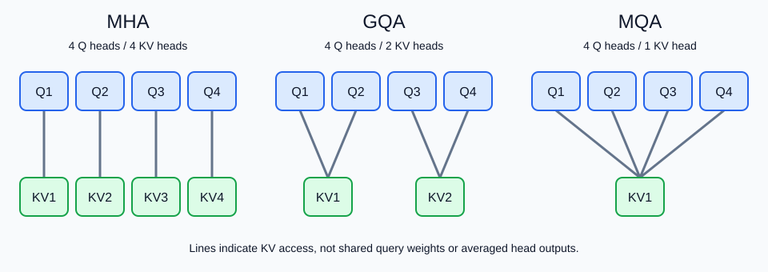

# KV Cache 与 MHA / MQA / GQA

- 学习日期：2026-10-09。
- 每日概览：[topics_by_date](topics_by_date.md)。
- 学习索引：[工作能力提升与实践手册](../index-2026-10-08.md)。

前置阅读：[张量形状](2026-10-09_01_tensor_shapes.md)与 [Attention / MHA](2026-10-08_04_attention_mha.md)。本轮 KV Cache 学习已告一段落；保留答疑与可选复习，不标记为已完全掌握。Infra 以机制、基础算例与资料入口为主。

## 1. 先回顾：预测下一个 token 时做了什么？

已有输入为“我、喜欢”，模型处理这两个位置，使用“喜欢”位置的最终隐藏向量，经 LM Head 预测下一个 token，比如“学习”。

下一步输入“学习”，再预测后续 token。问题是：如果每一步都把完整历史重新送进模型，很多计算会反复执行。

```text
不缓存：
处理 [我, 喜欢]             → 预测“学习”
处理 [我, 喜欢, 学习]       → 预测“结束标记”

使用缓存：
处理 [我, 喜欢]，保存各层 KV → 预测“学习”
只处理新输入 [学习]，
同时读取各层历史 KV         → 预测“结束标记”
```

这里的 token 划分只是示意。缓存的是向量，不是把历史文字变成数据库查询结果。

### 1.1. 最终隐藏状态如何从 $[n,d_{\text{model}}]$ 变成词表分数？

先忽略 batch。完整前缀经过 Transformer blocks 和适用的最终归一化后，隐藏状态通常为：

$$
H\in\mathbb R^{n\times d_{\text{model}}}
$$

每行是一个位置的隐藏向量。LM Head 是一个可学习的线性投影：

$$
W_{\text{vocab}}\in
\mathbb R^{d_{\text{model}}\times d_{\text{vocab}}}
$$

其中 $d_{\text{vocab}}=|\mathcal V|$ 是词表大小，不是隐藏向量维度。

**对所有位置投影：**

$$
\underbrace{H}_{n\times d_{\text{model}}}
\underbrace{W_{\text{vocab}}}_{d_{\text{model}}\times d_{\text{vocab}}}
=\underbrace{Z}_{n\times d_{\text{vocab}}}
$$

模型可按实现选择是否加词表偏置，偏置在各行复用。每行是该位置用于预测下一个 token 的 logits；不是将 $n$ 行求和、平均或拼接后再预测。

训练时，对有效目标位置分别计算交叉熵。例如输入 $t_1,\ldots,t_n$ 时，位置 $i$ 的 logits 对应下一个 token 的预测；最后一行是否计入训练损失取决于是否提供相应目标。

**生成下一个 token 时，只需要最后一个已知位置：**

$$
\underbrace{H_{n-1:n,:}}_{1\times d_{\text{model}}}
\underbrace{W_{\text{vocab}}}_{d_{\text{model}}\times d_{\text{vocab}}}
=\underbrace{z_{\text{next}}}_{1\times d_{\text{vocab}}}
$$

这里使用从 0 开始的索引。去掉单行轴，得到长度为 $d_{\text{vocab}}$ 的向量，再沿词表维度 softmax 或执行相应解码策略。每个分量是一个候选 token 的分数。

例如 $n=3$、$d_{\text{model}}=4$、$d_{\text{vocab}}=10$：

```text
完整隐藏状态：3×4
    ↓ 取最后一行
最后位置向量：1×4
    ↓ 乘以 4×10 的词表投影矩阵
候选 token 分数：1×10
    ↓ 概率与选择策略
选出一个 token ID
```

最后一行的表示已通过各层注意力读取允许访问的历史，不是只含最后一个 token 的独立 embedding。

实际推理可以只计算最后位置的 LM Head，不必先为全部历史位置算 logits 再丢弃。使用 KV Cache 的单 token decode 时，本步新算出的最终隐藏状态通常本来就是 $[B,1,d_{\text{model}}]$，投影后为 $[B,1,d_{\text{vocab}}]$；不会重新输出全部历史位置的隐藏状态。

## 2. KV Cache：缓存什么，为什么可以复用？

### 2.1. 每个注意力层各自保存历史 K、V

一个位置进入某层时，由该层输入隐藏状态投影出 Q、K、V：

- 当前 Q：寻找本位置需要的信息。
- 历史 K：供当前 Q 匹配。
- 历史 V：供当前注意力权重汇总。

标准生成后续位置时，不需要重新使用过去的 Q；过去的 K、V 却会反复被新位置读取，因此通常只缓存 K、V。

**每层的 K、V 不同，需要每层分别缓存。** 不是第一层算一份 KV，后面所有层共用它。模型权重也不是 KV Cache：权重属于模型，缓存属于具体上下文的计算状态。

### 2.2. 为什么后来追加 token，不会使历史 KV 失效？

在标准 causal Transformer 中，历史位置只能读取自己和更早的位置。追加新 token 时，新 token 不在历史位置的可见范围内，因此不改变历史位置原本的计算结果。

**新 token 仍要做 self-attention，缓存不是跳过这一步。**

刚预测出 $t_i$ 后，将它作为下一步输入，用来预测 $t_{i+1}$。每一层都需要计算新位置的 Q、K、V，再用新 Q 匹配位置 $1$ 到 $i$ 的 K，并汇总对应 V。历史 K、V 从缓存读取，当前位置的 K、V 是新算出的。

需要区分两个方向：

- 新位置 $i$ 读取历史位置 $1,\ldots,i-1$：允许，而且必须进行相应计算。
- 历史位置 $j<i$ 反过来读取新位置 $i$：causal mask 不允许，因此历史表示无需更新。

例如先有 $t_1,t_2$，后来输入新生成的 $t_3$。下表的行是 query，列是 key：

| query / key | $k_1$ | $k_2$ | $k_3$ |
|---|---|---|---|
| $q_1$ | 原来可读 | 屏蔽 | 屏蔽 |
| $q_2$ | 原来可读 | 原来可读 | 屏蔽 |
| $q_3$ | **本步新算匹配** | **本步新算匹配** | **本步新算匹配** |

前两行的有效分数与 softmax 归一化范围都没变；新列对它们是屏蔽的。因此不需要重算前两行，只计算最后一行。

历史 $k_1,k_2$ 固定，不代表新位置读取它们的权重固定。新 $q_3$ 会产生新的匹配分数与权重；**缓存保存 K、V，不是保存一套对所有未来 query 都通用的注意力权重**。

在这一层得到新位置的 attention 输出后，还要经过输出投影、残差、FFN 等，形成下一层的新位置输入。下一层再次计算新位置的 Q、K、V，读取该层的历史缓存；最后才由 LM Head 预测 $t_4$。

可以逐层理解：

1. 历史位置的输入 embedding 和位置编号没有变化。
2. 第一层历史位置看不到新增的未来位置，因此它们的表示不变。
3. 第二层接收相同的历史输入，仍看不到未来，历史表示也不变。
4. 依此类推，各层历史 K、V 都能复用。

这依赖相同模型、前缀、位置规则和推理配置；修改前缀或模型后，不能随意复用旧缓存。默认推理时 dropout 已关闭。缓存也不是对任意双向注意力都成立：若历史位置能看到后来追加的 token，其表示就可能变化。

### 2.3. 一步 decode 如何用缓存？

设位置 $t$ 是本步新输入。每层计算当前 $q_t,k_t,v_t$，把当前 KV 纳入有效缓存：

$$
K_{\le t}=[K_{<t};k_t],
\qquad V_{\le t}=[V_{<t};v_t]
$$

分号表示沿 token 位置维度追加，不是沿特征维度把向量加宽。

对于一个头，本步输出为：

$$
o_t=
\operatorname{softmax}\left(
\frac{q_tK_{\le t}^{\mathsf T}}{\sqrt{d_{\text{head}}}}
\right)V_{\le t}
$$

此式只展示可访问的有效条目；padding、窗口等额外限制需要另外处理。若只暴露有效历史与当前位置，没有未来 token 需要屏蔽。

在采用 RoPE 的常见实现中，缓存的是已经按各自位置旋转后的 K，以及 V；新 Q 也按当前正确位置旋转。不能将位置编号每步重新从零开始。

### 2.4. Prefill 与 decode

| 阶段 | 处理什么 | 产生什么 |
|---|---|---|
| Prefill | 整段已有提示词，通常并行处理 | 各层提示词 KV，以及用于预测第一个新 token 的输出 |
| Decode | 通常每步输入一个刚生成的 token | 当前 token 的各层 KV，以及下一个 token 的预测 |

“生成第一个 token”后，它通常要等下一次 forward 才作为输入产生自己的 KV。不要把“预测出一个 token”与“该 token 已经过所有层并写入缓存”当成同一件事。

**KV Cache 不是免费加速：**

- 避免重复计算历史位置的投影、FFN 等。
- 当前 Q 仍需要读取可访问的历史 K、V；全上下文 decode 的注意力工作随历史长度增长。
- 缓存持续占用内存，长上下文和多请求并发时尤为明显。
- 常规并行 next-token 训练通常不使用这种逐步生成缓存；特殊训练方案另论。

## 3. 为什么引入 MQA / GQA？

昨天的标准 MHA 中，每个 query 头都有对应的 key 头与 value 头。随着上下文增长，每个头的历史 KV 都要存下来。

MQA / GQA 的思路是：**保留多个不同的 query 头，但让它们共享部分 K、V 头，减少缓存与读取量。**



读图提示：

- 蓝色 Q 框表示不同 query 头；绿色 KV 框表示一对 key / value 头，不是把 K 和 V 合为同一个向量。
- 连线表示某个 query 头读取哪组 KV；不是共享 Q 权重，也不是将不同头输出平均。
- 图中 GQA 是两个 query 头共享一组 KV 的例子，实际组数由配置决定。

### 3.1. 三种结构

设 query 头数为 $h_q$，KV 头数为 $h_{kv}$：

| 类型 | 头数关系 | 含义 |
|---|---|---|
| MHA | $h_{kv}=h_q$ | 每个 query 头有自己的 KV 头 |
| GQA | $1<h_{kv}<h_q$ | 一组 query 头共享一组 KV 头 |
| MQA | $h_{kv}=1$ | 全部 query 头共享一组 KV 头 |

常见等分 GQA 要求 $h_q$ 能被 $h_{kv}$ 整除，每组包含 $h_q/h_{kv}$ 个 query 头。广义 GQA 也可以把 MHA 与 MQA 看作两端的特殊情况。

### 3.2. 共享 KV，为什么各头输出还可以不同？

第 $i$ 个 query 头仍有自己的 $q^{(i)}$。令 $g(i)$ 表示它所属的 KV 组：

$$
o^{(i)}=
\operatorname{softmax}\left(
\frac{q^{(i)}(K^{(g(i))})^{\mathsf T}}
{\sqrt{d_{\text{head}}}}
+M
\right)V^{(g(i))}
$$

即使两头读取相同 K、V，不同 Q 仍可以产生不同权重，得到不同输出。

例如共享的两个 value 为 $[2,0]$、$[0,4]$：

- 头 A 权重为 $[0.8,0.2]$，输出为 $[1.6,0.8]$。
- 头 B 权重为 $[0.2,0.8]$，输出为 $[0.4,3.2]$。

### 3.3. 哪些模块变化？

固定 $h_q$、每头维度、隐藏宽度与 FFN 配置，只减少 $h_{kv}$：

- Q 投影通常不变。
- K、V 投影的总输出宽度减小。
- 仍有 $h_q$ 个头输出，拼接宽度通常不变，输出投影也不变。
- FFN 不因 KV 头共享而变成每头一个，也通常不变。

共享是一种架构与训练选择，不能简单在已有 MHA 模型推理时删除一部分 KV 头，就认为输出保持不变。已有模型转换涉及权重处理与训练适配。

GQA 常作为表达能力与推理成本的折中；不能保证所有模型上 MQA 都明显掉点，也不能保证增加 KV 头就一定提升任务效果。以训练与实际评测为准。

### 3.4. 有研究比较 MHA、MQA、GQA 的效果吗？

有。2023 年 [GQA 原论文](https://aclanthology.org/2023.emnlp-main.298/) 的表 1 直接比较了三种结构，采用 T5.1.1 的 Large / XXL 模型，评估摘要、翻译与问答任务。

这里不是三种结构完全从零、以相同总预算训练的对照：MQA / GQA 从已有 MHA checkpoint 转换，对组内 K、V 头做平均，再进行原始预训练步数 5% 的继续预训练，之后做任务微调。5% 指额外训练步数比例，不是模型参数比例。

| T5-XXL 结构 | 论文报告的平均开发集分数 | CNN/Daily Mail ROUGE-1 | TriviaQA F1 |
|---|---|---|---|
| MHA | 47.2 | 43.8 | 81.9 |
| MQA，转换 + 5% 继续预训练 | 46.6 | 43.0 | 81.3 |
| GQA-8，转换 + 5% 继续预训练 | 47.1 | 43.5 | 81.6 |

GQA-8 指 8 个 KV 组，不是 8 个 query 头。平均分混合不同任务指标，只用于理解论文中的对照，不是“回答正确率”；平均值接近也不证明所有任务等效或差异具有统计显著性。

该实验中，GQA 的质量接近 MHA，并优于 MQA 的平均表现。论文也报告 GQA 推理效率接近 MQA，优于 MHA，但具体速度来自其 TPU、批大小与并行设置，不能直接换算成任何 GPU 服务的加速倍数。

适用范围：T5 是 Encoder–Decoder，论文将 GQA / MQA 用于 Decoder self-attention 与 cross-attention，未替换 Encoder self-attention。因此这是支持 KV 共享取舍的直接实验证据，不等于所有 Decoder-only LLM、长上下文、代码或推理任务都会得到同样结果。

应用层结论：不必认为共享 KV 一定严重损伤效果，也不要只凭 MHA / GQA 标签选择模型。应比较目标任务效果、上下文表现、延迟与成本；不同模型的数据、规模和训练方法也会影响结果。

## 4. 张量形状：Q 头与 KV 头可以不一样多

设 $B$ 为 batch size，$T$ 为有效历史长度（含当前 token），$d_h=d_{\text{head}}$。下表采用常见逻辑布局，不代表每个引擎的物理存储：

| 张量 | 单 token decode 形状 |
|---|---|
| 当前 Q | $[B,h_q,1,d_h]$ |
| 当前 K、V | 各为 $[B,h_{kv},1,d_h]$ |
| 某层缓存 K、V | 各为 $[B,h_{kv},T,d_h]$ |
| 匹配分数（全上下文） | $[B,h_q,1,T]$ |
| 各 query 头输出 | $[B,h_q,1,d_h]$ |
| 头输出拼接 | $[B,1,h_qd_h]$ |
| 输出投影后 | $[B,1,d_{\text{model}}]$ |

GQA 的矩阵计算必须按组把 query 头映射到对应 KV 头，不能直接假设两种不同头数自然可广播。高效内核能读取共享 KV 而不物理复制整份缓存；若为了实现方便显式复制，会削弱实际内存优势。

## 5. KV Cache 显存怎么算？

在各层头数相同、K/V 每头等宽、缓存 dtype 相同的简化设置下：

$$
\boxed{
S_{\text{KV}}
=2LBTh_{kv}d_hs
}
$$

| 符号 | 含义 |
|---|---|
| $2$ | K 和 V 各一份 |
| $L$ | 注意力层数 |
| $B$ | 等长度情况下的请求数 |
| $T$ | 每条请求缓存的有效 token 数 |
| $h_{kv}$ | KV 头数，不一定是 query 头数 |
| $d_h$ | 每个 KV 头的维度 |
| $s$ | 每个缓存元素的字节数，FP16 / BF16 通常为 2 |

请求长度不同时，将 $BT$ 替换为 $\sum_b T_b$，得到有效数据量。静态预分配、padding 或分页块未利用空间会使实际分配量更大。滑动窗口、不同层的结构、量化元数据也需要按实际情况统计。

### 5.1. 一个可手算的例子

设 $L=32$、$B=1$、$T=4096$、$h_q=32$、$d_h=128$，缓存采用 BF16：

| 结构 | $h_{kv}$ | 理论 KV 数据量 |
|---|---|---|
| MHA | 32 | $2{,}147{,}483{,}648$ 字节 = 2 GiB |
| GQA | 8 | $536{,}870{,}912$ 字节 = 512 MiB |
| MQA | 1 | $67{,}108{,}864$ 字节 = 64 MiB |

GQA 的缓存数据量为该 MHA 的 $8/32=1/4$；MQA 为 $1/32$。这些是教学配置，并非特指某个模型。

GiB / MiB 使用二进制单位，$1\text{ GiB}=2^{30}$ 字节。此处不包含模型权重、临时激活、工作区、分页元数据与分配碎片，不能把它当成 GPU 总显存需求。

**权重量化与 KV 量化是两回事。** 模型权重采用 INT4 不意味着 KV Cache 也只用 4 bit；应检查缓存实际 dtype。

## 6. 参数量：为什么 GQA 不再是简单的四个方阵？

设隐藏宽度为 $d$，全部 query 头总宽度为 $h_qd_h$，KV 总宽度为 $h_{kv}d_h$，忽略偏置：

$$
\begin{aligned}
W_Q&\in\mathbb{R}^{d\times(h_qd_h)}\\
W_K,W_V&\in\mathbb{R}^{d\times(h_{kv}d_h)}\\
W_O&\in\mathbb{R}^{(h_qd_h)\times d}
\end{aligned}
$$

四个权重矩阵合计：

$$
N_{\text{attn}}
=2dh_qd_h+2dh_{kv}d_h
$$

如果采用 $h_qd_h=d$：

$$
N_{\text{attn}}
=2d^2+2dh_{kv}d_h
$$

标准 MHA 中 $h_{kv}=h_q$，回到 $4d^2$。减少 KV 头会减少 K、V 参数，但 Q 和输出投影仍占参数，因此减少比例不等于缓存减少比例。

例如 $h_{kv}=h_q/4$，缓存减少到原来的 25%，但注意力投影权重是：

$$
N_{\text{attn}}=2d^2+\frac12d^2=2.5d^2
$$

是标准 MHA 的 62.5%，不是 25%。整个模型还包含 FFN 等参数，不能套用这个比例推断整个模型缩小多少。

## 7. 常见误解与知识总结

| 误解 | 更准确的说法 |
|---|---|
| KV Cache 保存的是模型知识 | 它保存某段上下文在各层算出的 K、V |
| 有缓存就不用看历史了 | 不重新算历史表示，但仍读取可访问的历史 KV |
| GQA 让多个请求共享上下文 | 同一请求内的 query 头共享 KV 头，不是请求之间混合 |
| MQA 只剩一个注意力输出 | 仍可有多个 query 头和多个不同输出 |
| 少了 KV 头，FFN 也一起变小 | FFN 是否变化取决于自己的配置 |
| 模型参数小，推理一定快 | 还受缓存访问、计算内核、并发与硬件等影响 |

可以这样概括核心机制：

> 自回归 causal 模型中，追加未来 token 不改变过去位置的表示，因此可以按层缓存历史 K、V，decode 时只计算新位置并读取缓存。长上下文与多请求会使 KV Cache 占用显著增长。MQA 让所有 query 头共享一组 KV，GQA 则按组共享，减少 KV 存储与访问需求，同时保留多个 query 头。缓存数据量取决于层数、请求长度、KV 头数、头维度与缓存精度，不能只看模型参数量。

## 8. 可选自测

1. 为什么标准生成缓存 K、V，而不需要保存历史 Q？
2. GQA 中两个 query 头读取同一份 K、V，输出为什么仍可能不同？
3. 如果只将 KV 头数从 32 改为 8，缓存数据量如何变化？FFN 必须变化吗？
4. 为什么生成 token 后，要在下一步 forward 才计算它的 KV？

<details>
<summary>参考答案</summary>

1. 当前新位置用自己的 Q 匹配历史 K 并汇总历史 V，不需要再计算过去位置的输出。
2. Q 不同，匹配分数与 softmax 权重可以不同。
3. 其他缓存配置不变时，理论有效 KV 数据量变为 1/4；FFN 不必改变。
4. 预测阶段由前一个已知位置的隐藏状态产生候选，新 token 尚未作为输入通过各层。

</details>
