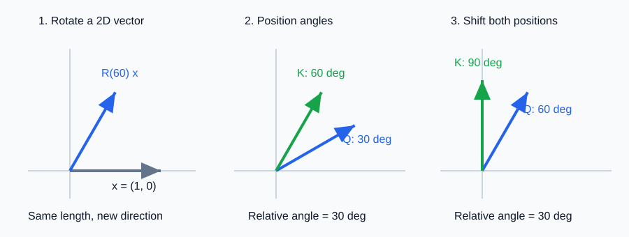

# RoPE：旋转位置编码与相对位置

- 学习日期：2026-10-09。
- 每日概览：[topics_by_date](topics_by_date.md)。
- 学习索引：[工作能力提升与实践手册](../index-2026-10-08.md)。
- 前置阅读：[位置表示入门](2026-10-08_02_position_encoding.md)、[Attention / MHA](2026-10-08_04_attention_mha.md)、[KV Cache](2026-10-09_02_kv_cache_mqa_gqa.md)。
- 状态：讲义已提供，阅读与掌握情况待反馈。

先读第 1～3 节看直觉，再读第 4 节推导；最后了解多维、缓存与应用边界。公式请在 Markdown 预览中阅读，不要求先背三角函数恒等式。图示为自绘。

## 1. RoPE 在整个模型的哪里？

RoPE（Rotary Position Embedding）不是新的 Transformer block，也不是 KV Cache 技术，而是一种让注意力利用位置的方法。

对采用 RoPE 的常见注意力层：

```text
输入隐藏状态 X：[B,n,d_model]
       ↓ 线性投影并整理成头
Q、K、V
       ↓
根据各位置编号，旋转 Q、K 的特征配对；V 通常不旋转
       ↓
旋转后的 Q 与 K 做匹配
       ↓
缩放 + mask + softmax
       ↓
汇总 V → 合并头 → 输出投影
```

关键区别：

| 方式 | 如何引入位置 |
|---|---|
| 正弦 / 可学习绝对位置 embedding | 将位置向量加到输入 embedding |
| RoPE | 将投影后的 Q、K 按位置旋转，再算点积 |

RoPE 通常作用于各层注意力中，不是只在模型入口旋转一次。它不增加 token 数、头数或隐藏宽度。

## 2. 先理解二维向量旋转

把二维向量想成平面上的箭头。旋转让箭头改变方向，但保持长度。



读图提示：

- 左图：$[1,0]$ 旋转 60° 后，指向另一个方向，长度不变。
- 中图：示意位置旋转角分别为 30° 与 60°，相差 30°。
- 右图：都增加 30° 后，相差仍为 30°。
- 为突出位置作用，中、右图假设旋转前的 Q、K 都是同方向单位向量。实际 Q、K 还包含不同的内容信息，不一定同向。

设原向量的两个分量为 $a,b$，逆时针旋转角度 $\phi$ 后：

$$
\begin{aligned}
a'&=a\cos\phi-b\sin\phi\\
b'&=a\sin\phi+b\cos\phi
\end{aligned}
$$

例如 $[1,0]$ 旋转 90°，得到 $[0,1]$；旋转 60°，得到 $[0.5,\sqrt{3}/2]$。

**旋转不是把某个分量乘以位置编号，也不是给向量追加一个角度维度。** 两个原分量按三角函数混合，仍然是两个分量：

$$
(a')^2+(b')^2=a^2+b^2
$$

位置用编号表示，旋转角度由编号决定。通常写作 $\phi=m\omega$：位置为 $m$，每增加一个位置，角度增加 $\omega$。实际公式角度使用弧度；这里的角度例子只是便于读图。

## 3. 为什么旋转能影响注意力？

点积同时取决于向量长度和方向夹角：

$$
q\cdot k=\|q\|\,\|k\|\cos\alpha
$$

其中 $\alpha$ 是两向量的夹角。

RoPE 按各自位置旋转 Q、K，使匹配不仅与内容有关，还与位置有关。

先假设旋转前 $q=k=[1,0]$，只观察位置作用：

| query 位置 $m$ | key 位置 $j$ | 每步旋转角 | 旋转后的点积 |
|---|---|---|---|
| 1 | 2 | 30° | $\cos30^\circ=\sqrt{3}/2$ |
| 4 | 5 | 30° | $\cos30^\circ=\sqrt{3}/2$ |
| 1 | 3 | 30° | $\cos60^\circ=1/2$ |

前两行都相隔 1 个位置，位置导致的相对角相同。第三行距离为 2，相对角不同。

这只是一个频率、同样内容向量的例子。**不能据此认为真实注意力分数仅由距离决定，或距离越远分数必然越小。** 余弦是周期函数，真实模型还结合多组频率与内容表示。

## 4. 为什么“按绝对位置旋转”会产生“相对位置关系”？

### 4.1 先明确行向量与列向量约定

前面讲义把 token 按行存放，用 $Q=XW_Q$。下面只分析一个二维配对，为方便写旋转矩阵，临时用 **列向量**：

$$
q=\begin{bmatrix}q_1\\q_2\end{bmatrix},
\qquad
k=\begin{bmatrix}k_1\\k_2\end{bmatrix}
$$

这只是书写约定，不意味着模型需要把所有张量布局改掉。若使用行向量，相同旋转写成 $q_{\text{row}}R(\phi)^{\mathsf T}$，得到的分量相同。

### 4.2 两个旋转合成一个相对旋转

二维旋转矩阵：

$$
R(\phi)=
\begin{bmatrix}
\cos\phi&-\sin\phi\\
\sin\phi&\cos\phi
\end{bmatrix}
$$

位置 $m$ 的 Q 和位置 $j$ 的 K 分别旋转：

$$
\widetilde q_m=R(m\omega)q_m,
\qquad
\widetilde k_j=R(j\omega)k_j
$$

它们的点积为：

$$
\begin{aligned}
\widetilde q_m^{\mathsf T}\widetilde k_j
&=q_m^{\mathsf T}R(m\omega)^{\mathsf T}R(j\omega)k_j\\
&=q_m^{\mathsf T}R(-m\omega)R(j\omega)k_j\\
&=\boxed{q_m^{\mathsf T}R((j-m)\omega)k_j}
\end{aligned}
$$

其中用了两个直觉：

1. 旋转矩阵的转置相当于反向旋转。
2. 连续旋转两次，相当于把角度相加。

最后出现的是 **$j-m$，即 key 位置与 query 位置的差**，而不是两者分别的绝对编号。

所以 RoPE 可以理解为：

> 用各自的绝对位置执行旋转，让点积中的位置作用表现为相对位移。

但分数仍包含内容向量 $q_m,k_j$。如果内容向量不变，并把两位置共同平移相同距离，标准固定频率 RoPE 的这部分点积不变；**这不意味着任意改变提示词后整个模型输出也不变**，因为内容表示、可见上下文等都可能变化。

## 5. 每个头有很多维，怎么旋转？

本节先假设一个头的全部维度采用 RoPE，维度 $d_r=d_{\text{head}}$ 为偶数。将它分成 $d_r/2$ 个二维配对：

```text
示意 8 维向量：
[x0,x1 | x2,x3 | x4,x5 | x6,x7]
   ↓       ↓       ↓       ↓
频率 ω0  频率 ω1  频率 ω2  频率 ω3
各对在位置 m 上，分别旋转 m×ωr
```

一个常见的标准频率设置为：

$$
\omega_r=\theta^{-2r/d_r},
\qquad r=0,\ldots,d_r/2-1
$$

$\theta$ 是频率基数，原始常见设置为 10000；实际模型可采用不同值与缩放方案，不要把 10000 当成所有模型的固定参数。

- 较高频率：位置增加时角度变化较快。
- 较低频率：位置增加时角度变化较慢。
- 多组频率共同提供不同尺度的位置变化信号，而不是人为规定某对专管短句、某对专管长句。

有些模型只旋转部分 head 维度，其余保持原样。配对也可能采用相邻维度，或前后半区对应维度；代码看起来不同，但可以在匹配的坐标排列下表示同样的旋转机制。**实际配对规则、权重与实现必须一致，不能任意改。**

RoPE 旋转发生在 **特征轴内**：不会把 token 位置交换，也不是上一专题的 reshape / 换轴。

## 6. 和 KV Cache、GQA 有什么关系？

### 6.1 旧 K 为什么可以直接读取？

常见实现缓存位置 $j$ 已经旋转后的 $\widetilde k_j$，以及未进行这种位置旋转的 $v_j$。

下一步只需要：

1. 用新位置 $m$ 计算并旋转新 Q、K。
2. 将新 K、V 写入缓存。
3. 用新 $\widetilde q_m$ 匹配缓存中的各 $\widetilde k_j$。

在标准固定频率规则下，旧位置 $j$ 不变，旧 K 的旋转也不变，因此不用随着新 token 追加而重新旋转整段历史。

**新 token 的位置不能每步重置为 0。** 批处理中的 padding、各请求有效长度与位置编号也应由模型 / 框架正确处理。自定义生成循环时需核对这些条件。

如果动态改变频率规则，旧 K 是否仍兼容需由具体实现处理，不能把“所有 RoPE 变体都无条件复用旧旋转结果”当成结论。

### 6.2 GQA 共享 KV 会妨碍 RoPE 吗？

通常不会。每个 query 头对自己的 Q 按当前位置旋转；共享 KV 组按 key 的位置旋转 K，组内 query 头读取同一份旋转后 K。

Q 不同，匹配仍可以不同。RoPE 是位置处理，GQA 是头共享，两者作用不同。

## 7. 应用层需要了解的长上下文边界

**能计算更大的位置编号，不代表模型在更长输入上仍然准确。**

标准 RoPE 可在数学上计算训练长度以外的角度，但训练外的相对距离与角度组合可能影响效果。长上下文扩展通常涉及频率 / 位置缩放、训练适配与效果验证。

这里只建立概要，不深入部署与底层实现：

| 方向 | 大致思路 |
|---|---|
| 位置插值 / 线性缩放 | 将更长的位置范围压缩到较熟悉的角度范围 |
| NTK-aware / 动态缩放 | 调整频率基数或频率规则 |
| YaRN、LongRoPE、模型专用缩放 | 更细致地调整不同频率或结合训练适配 |

这些不是随意改一个配置就保证无损的开关。具体支持范围应查看模型文档，而不是单凭 `rope_theta` 或标称窗口猜测。

对于 RAG / Agent，优先验证：

- 长上下文下相关证据是否被有效使用，尤其是位于中间的证据。
- 引用是否对应原文，远距离信息组合是否正确。
- 位置与长度变化是否影响任务成功率。
- 更长上下文的延迟与成本是否值得。

RoPE 不替代 causal mask：前者让匹配包含位置信息，后者决定哪些位置可以读取。它也不直接把长上下文中的信息自动压缩或总结。

## 8. 复习与可选自测

核心总结：

> RoPE 在注意力中按位置旋转 Q、K 的二维特征配对，保持维度与标准旋转下的向量长度。由于两个旋转在点积中合成为相对旋转，匹配可以体现相对位移。标准固定频率下，历史旋转后的 K 可以缓存。长上下文效果仍取决于训练、位置方案与实际评测。

可选自测：

1. RoPE 直接修改输入 embedding 吗？会增加 head 的维度吗？
2. 为什么转了两个绝对角度，最后能出现位置差？
3. 固定内容向量时，共同平移两个位置，标准 RoPE 点积怎样变化？
4. 为什么不能推断“位置越远，注意力权重必然越低”？

<details>
<summary>参考答案</summary>

1. 常见做法作用于投影后的 Q、K，不直接做输入端加法，也不增加维度。
2. 点积中出现 $R(m\omega)^{\mathsf T}R(j\omega)=R((j-m)\omega)$。
3. 在相同固定频率规则下不变，因为位置差不变。
4. 分数还依赖内容，多频率与旋转周期也影响结果；权重还依赖其他可读 key 的分数。

</details>

## 9. 资料与学习记录

- [RoFormer / RoPE 原论文](https://arxiv.org/abs/2104.09864)：二维推导与高维旋转。
- [Transformers：Rotary embeddings utilities](https://huggingface.co/docs/transformers/main/en/internal/rope_utils)：标准与缩放 RoPE 的配置、不同层类型与多模态变体；作为概要查阅入口。
- 已提供：二维旋转图、点积与相对位置推导、多维频率、缓存关系、长上下文边界。
- 阅读反馈 / 答疑：已讨论二维与高维旋转、位置编号与配对编号的区别、多频率角度与周期；用户确认本轮 RoPE 学习告一段落。
- 已验证掌握：暂无，不以讲义已创建代替掌握检查。
- 后续主题：[RMSNorm 与 LayerNorm](2026-10-09_04_rmsnorm.md)，随后学习 SwiGLU。
