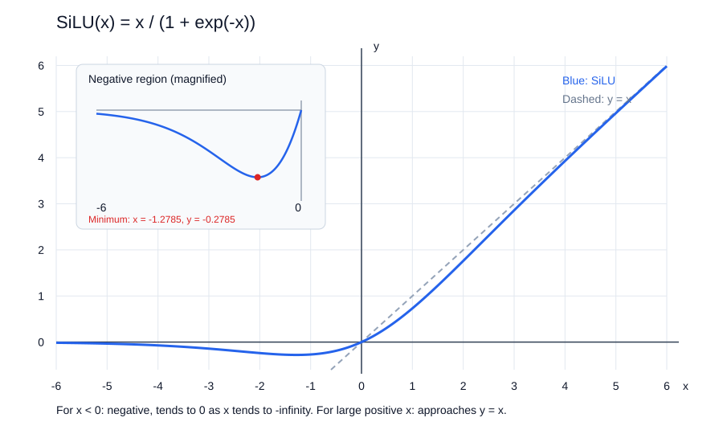

# SwiGLU：FFN 的非线性与门控

- 学习日期：2026-10-09。
- 每日概览：[topics_by_date](topics_by_date.md)。
- 前置阅读：[Transformer 总体结构](2026-10-08_01_transformer_overview.md)、[张量形状](2026-10-09_01_tensor_shapes.md)、[RMSNorm](2026-10-09_04_rmsnorm.md)。
- 相邻补充：[MoE 架构](2026-10-09_06_moe_architecture.md)，在理解单个 FFN 后学习多个专家的路由与合并；2026-10-19 补写。
- 状态：教材已提供，阅读与掌握情况待反馈。先读直觉和数值例子，自测可选。

## 1. 先定位：FFN 做什么？

Attention 获取上下文信息；FFN / MLP 则对每个位置的向量进行非线性加工。

FFN 通常对各 token 分别计算，同一层的各位置与样本共享权重，不直接混合不同 token 的信息。它接收的向量已经可以包含注意力汇总的上下文。

一个常见 pre-norm block 的第二部分：

$$
Y=H+\operatorname{FFN}(\operatorname{RMSNorm}(H))
$$

SwiGLU 是 FFN 的一种设计，不是新的注意力头，也不是归一化或位置编码。它替换的是 FFN 内部的计算方式，残差与 Norm 是外围结构。

## 2. 为什么需要非线性？

传统两矩阵 FFN：

$$
\operatorname{FFN}(x)=f(xW_1+b_1)W_2+b_2
$$

本节使用行向量约定。通常先从 $d_{\text{model}}$ 维扩展到 $d_{\text{ff}}$，经过激活函数，再投影回来。

如果去掉激活，只串联线性投影：

$$
(xW_1)W_2=x(W_1W_2)
$$

两层仍可合并成一个线性变换；加上偏置后也只是一个仿射变换。因此扩宽再缩回本身，并没有引入非线性表达能力。

常见激活包括：

| 激活 | 直觉 |
|---|---|
| ReLU | 正值保留，负值置零 |
| GELU | 根据输入值平滑地调节输出，不是硬阈值开关 |
| SiLU / Swish（参数为 1） | 输入乘以自己的 sigmoid 值 |

## 3. 先认识 SiLU

sigmoid 为：

$$
\sigma(z)=\frac{1}{1+e^{-z}}
$$

SiLU 定义为：

$$
\boxed{\operatorname{SiLU}(z)=z\,\sigma(z)}
$$



读图提示（2026-10-10 补充，自绘）：

- 蓝线是 SiLU，灰色虚线是 $y=x$；左上角单独放大负值区间。
- $x<0$ 时输出为负，向负无穷延伸时从下方趋近于 0。
- 极小值约为 $x=-1.2785$、$y=-0.2785$，所以 SiLU 并非全局单调递增。
- 曲线经过原点，原点斜率为 $1/2$；正输入很大时逐渐接近 $y=x$。

例如：

| $z$ | $\sigma(z)$ | $\operatorname{SiLU}(z)$ |
|---|---|---|
| $-2$ | 约 0.1192 | 约 -0.2384 |
| $0$ | 0.5 | 0 |
| $2$ | 约 0.8808 | 约 1.7616 |

SiLU 是平滑函数，负输入可以产生负输出，并不像 ReLU 那样将所有负值都变成零。

注意：sigmoid 的输出位于 0 与 1 之间，**SiLU 的输出不是**。SiLU 可为负，也可大于 1，不是概率。

## 4. SwiGLU：同一个输入走两条投影支路

常见 LLM 实现省略偏置，计算：

$$
\begin{aligned}
u&=xW_{\text{up}}\\
g&=\operatorname{SiLU}(xW_{\text{gate}})\\
z&=g\odot u\\
y&=zW_{\text{down}}
\end{aligned}
$$

合起来：

$$
\boxed{
\operatorname{SwiGLU}(x)
=\left[
\operatorname{SiLU}(xW_{\text{gate}})
\odot(xW_{\text{up}})
\right]W_{\text{down}}
}
$$

$\odot$ 是逐元素乘法，不是矩阵乘法。不同文献或代码可能采用不同权重命名，需看公式判断职责。

```text
完整输入 x：d_model 维
    ├→ W_up   → u：d_ff 维 ────────────┐
    │                                  × 逐元素相乘
    └→ W_gate → SiLU → g：d_ff 维 ─────┘
                                       ↓
                               z：d_ff 维
                                       ↓ W_down
                               y：d_model 维
```

读图要点：

- 两条支路都读取完整输入，不是把原始特征切成两半。
- 两条支路有不同权重，输出宽度相同，才能逐元素相乘。
- 乘法结果仍是 $d_{\text{ff}}$ 维，不会变成两倍宽度。
- 最后由 down projection 回到残差所需的 $d_{\text{model}}$。

### 4.1 为什么叫“门控”？

对第 $r$ 个中间特征：

$$
z_r=g_r u_r
$$

门控支路的值由当前输入决定，可以调节另一支路各个特征的贡献，而不是所有输入都使用同一固定缩放。

但不要把它当成严格的开 / 关概率：

- $g_r$ 接近零时，该特征贡献减小。
- $g_r$ 大于 1 时，可以放大该特征。
- $g_r$ 为负时，可以改变该特征的符号。

门控也不是 MoE 路由：普通稠密 SwiGLU 通常仍计算所有中间特征，并不选择只运行某个专家。

### 4.2 一个逐元素乘法例子

假设投影后：

$$
xW_{\text{gate}}=[-2,0,2],
\qquad u=[10,20,30]
$$

则：

$$
g\approx[-0.2384,0,1.7616]
$$

$$
z=g\odot u
\approx[-2.3841,0,52.8478]
$$

接着还要乘 $W_{\text{down}}$，这才是 FFN 输出。这里的 3 维只是演示，不对应某个具体模型配置。

## 5. 形状与参数量

设 $d=d_{\text{model}}$，中间宽度为 $f=d_{\text{ff}}$：

$$
W_{\text{gate}},W_{\text{up}}\in\mathbb R^{d\times f},
\qquad
W_{\text{down}}\in\mathbb R^{f\times d}
$$

| 步骤 | 形状 |
|---|---|
| 输入 $X$ | $[B,n,d]$ |
| up 投影 | $[B,n,f]$ |
| gate 投影与 SiLU | $[B,n,f]$ |
| 逐元素乘法 | $[B,n,f]$ |
| down 投影 | $[B,n,d]$ |

忽略偏置，三个矩阵共：

$$
N_{\text{SwiGLU}}=3df
$$

传统两矩阵 FFN 的权重参数量为 $2df_{\text{plain}}$。在相同中间宽度下，SwiGLU 的权重多 50%；不能说门控完全不增加成本。

若希望两者参数预算相近，可选择：

$$
3df_{\text{SwiGLU}}=2df_{\text{plain}}
\quad\Rightarrow\quad
f_{\text{SwiGLU}}=\frac23 f_{\text{plain}}
$$

例如传统 FFN 使用 $f_{\text{plain}}=4d$，对应的预算匹配宽度约为：

$$
f_{\text{SwiGLU}}=\frac83d
$$

实际模型可能按硬件友好倍数取整，也可能采用不同预算，不必严格等于这个值。

与注意力头数 $h$ 无直接关系：只改变 MHA 的头数、保持 FFN 配置不变，SwiGLU 的参数与形状不变。

## 6. 为什么一些现代 LLM 采用它？

核心是给 FFN 提供输入依赖的特征调制。乘法将两个可学习分支结合，提供不同于单支路激活的非线性结构。

[GLU Variants Improve Transformer](https://arxiv.org/abs/2002.05202) 对门控 FFN 变体进行了实验，支持 SwiGLU / GEGLU 等作为有效选择。部分现代模型，如 Llama，采用 SwiGLU。

但需要区分：

- 有实验支持，不代表所有任务与预算下都必然更好。
- 同宽度比较和同参数预算比较，不是同一实验。
- 训练好的模型不能无损地将 ReLU / GELU FFN 临时切换为 SwiGLU；结构和参数不同，需要训练适配。

应用层通常不需要自己改模型的 FFN。算法层需要理解模型采用的结构，在训练或比较模型时区分数据、参数预算与架构因素。

## 7. 四个模块放回整体图景

| 模块 | 主要作用 |
|---|---|
| RoPE | 用位置相关旋转影响 Q/K 匹配 |
| Attention / GQA | 汇总允许访问的其他位置的信息 |
| RMSNorm | 调节每个 token 的隐藏特征尺度 |
| SwiGLU FFN | 非线性加工每个 token 的特征 |

不能把“门控”理解为对 token 的注意力权重，也不能把 gate 分支的 SiLU 理解为词表概率。

## 8. 可选自测

1. 为什么扩宽再缩回、没有非线性时，仍只是一个线性变换？
2. gate 与 up 的输出用矩阵乘法还是逐元素乘法结合？
3. gate 的值一定在 0～1 吗？
4. 固定 $d,f$，SwiGLU 有几个投影矩阵、多少权重参数？

<details>
<summary>参考答案</summary>

1. 两个线性矩阵可以合并为 $W_1W_2$；有偏置时是一个仿射变换。
2. 逐元素乘法，结果保持两支路的共同形状。
3. 不一定。sigmoid 在 0～1，但 SiLU 是输入乘 sigmoid。
4. 三个投影，忽略偏置共 $3df$ 个参数。

</details>

## 9. 资料与学习记录

- [GLU 变体论文](https://arxiv.org/abs/2002.05202)：门控 FFN 的实验与预算比较。
- [PyTorch：SiLU](https://docs.pytorch.org/docs/stable/generated/torch.nn.SiLU.html)：激活定义。
- [Transformers：Llama](https://huggingface.co/docs/transformers/model_doc/llama)：SwiGLU 等架构选择。
- 已提供：普通 FFN、SiLU、双分支图解、数字例子与参数预算。
- 阅读反馈 / 答疑：已讨论 SiLU 曲线，以及普通 FFN / SwiGLU 中激活的位置；2026-10-10 用户选择结束本轮学习并进入 SFT。
- 已验证掌握：暂无。
- 后续：[SFT 与训练数据](2026-10-10_01_sft_and_training_data.md)，Infra 不展开为专项。
