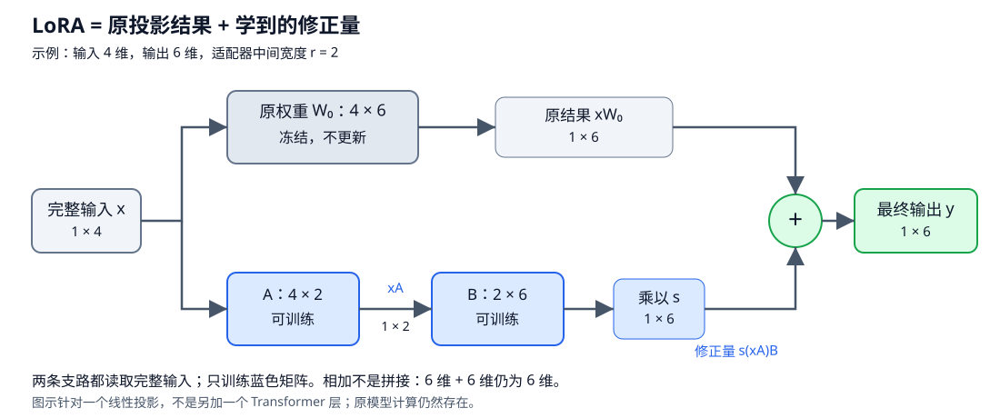

# LoRA / QLoRA：低秩更新与参数高效微调

- 学习日期：2026-10-10。
- 每日概览：[topics_by_date](topics_by_date.md)。
- 前置阅读：[SFT 与训练数据](2026-10-10_01_sft_and_training_data.md)、[张量与矩阵乘法](2026-10-09_01_tensor_shapes.md)。
- 状态：讲义已提供；先阅读、遇到疑问再讨论，自测可选，不预填掌握情况。

先看第 1～4 节，理解低秩更新；再看训练、配置与 QLoRA。数据配方和遗忘控制随后作为独立专题。

## 1. 先分清三个问题

| 问题 | 示例 |
|---|---|
| 用什么数据与目标学？ | SFT：根据示范回答计算 token 交叉熵 |
| 哪些参数怎么更新？ | 全量微调或 LoRA |
| 基础权重怎么存储与计算？ | BF16 / FP16，或量化基础权重配合 LoRA |

因此 LoRA 不是另一种交叉熵，也不是训练数据格式。它可以与 SFT、偏好优化等训练目标组合。

全量微调会更新许多原模型参数，需要为可训练参数准备梯度与优化器状态。LoRA 冻结基础权重，训练少量新增参数，降低这部分训练与保存成本。

**它不是把整个模型缩小到只剩适配器。** 基础模型仍参与前向计算，最终输出仍依赖基础权重。

## 2. 从普通线性投影到增量更新

### 2.1 先读图：原模型结果旁边，加一条“修正”支路



自绘图示，使用与下文一致的行向量约定。先只看灰色与蓝色两条路线：

1. **灰色原支路**：输入经过已有权重 W₀，算出原结果。权重冻结，但计算仍照常执行。
2. **蓝色修正支路**：同一个完整输入经过两个较小的可训练矩阵 A、B，算出修正量，再乘缩放系数 s。
3. **绿色相加处**：原结果与修正量逐元素相加；不是拼接，不是让适配器取代原模型。

图中原投影从 4 维到 6 维，适配器路线是 4 → 2 → 6；两条支路最后都是 6 维，才能相加。这里的小尺寸是便于读图，不用于展示显著的参数节省。

如果原支路输出是 $[1,2,3,4,5,6]$，修正量是 $[0.1,0,-0.2,0,0.3,0]$，则最终输出是：

$$
[1.1,2,2.8,4,5.3,6]
$$

“修正量”只表示学到的增量，不保证每次都更准确；效果要由独立评测验证。先理解“保留原结果，另外学习增量”，再读下面的矩阵公式。

### 2.2 用公式表达两条支路

本节使用行向量约定。设原权重：

$$
W_0\in\mathbb R^{d_{\text{in}}\times d_{\text{out}}}
$$

普通投影：

$$
y=xW_0
$$

微调后的有效权重可以表示为原权重加增量：

$$
W_{\text{effective}}=W_0+\Delta W
$$

全量更新允许较自由地改变这个矩阵。LoRA 的核心选择是：不直接训练与原矩阵一样大的自由增量，而用两个小矩阵的乘积表示更新。

$$
A\in\mathbb R^{d_{\text{in}}\times r},
\qquad
B\in\mathbb R^{r\times d_{\text{out}}}
$$

$$
\boxed{y=xW_0+s(xA)B}
$$

其中 $s$ 是缩放系数，原始常见设置为 $s=\alpha/r$。其他变体可能使用不同缩放规则，不要将所有 LoRA 配置视为同一个公式。

**行列约定提示：** 本节有意写成 $\Delta W=sAB$。很多论文或 PyTorch 实现采用权重形状 `[out,in]`，写成 $BA$；转置约定不同，不代表算法不同，也不能不看形状就交换乘法顺序。

## 3. “低秩”是什么？

矩阵的秩可以直观理解为独立方向的数量。这里只需记住：

$$
\operatorname{rank}(AB)\le r
$$

因为增量通过一个只有 $r$ 维的中间空间，所以它不能任意表达全部高秩矩阵。

```text
完整输入 x
    ├→ 冻结的 W0 ───────────────┐
    │                           + → 输出 y
    └→ 可训练 A → r 维 → 可训练 B → 乘 s ─┘
```

**低秩限制的是更新矩阵，不是整个模型。** $W_0+sAB$ 仍可能是满秩。LoRA 支路的瓶颈也不表示残差流永久从 d_model 维缩成 r 维。

它的动机是：某些任务适配所需的变化，可以用较低维的更新有效表达。论文中的实验支持这种做法，但不保证所有任务都只需要很小的 rank。

## 4. 用小矩阵理解形状与参数量

假设原投影从 4 维到 6 维，rank 为 2：

$$
\underbrace{x}_{1\times4}
\underbrace{A}_{4\times2}
\underbrace{B}_{2\times6}
\longrightarrow
\underbrace{\Delta y}_{1\times6}
$$

原支路同样输出 6 维，才能相加。LoRA 支路中间通常没有额外非线性激活，否则一般不能再直接合并成一个线性权重更新。

参数量：

$$
N_{\text{full matrix}}=d_{\text{in}}d_{\text{out}}
$$

$$
N_{\text{LoRA}}=r(d_{\text{in}}+d_{\text{out}})
$$

小例子中，原矩阵有 24 个参数，适配器有 20 个，减少不多。只有 r 相对输入、输出维度足够小，优势才明显。

例如一个 $4096\times4096$ 投影，rank 为 8：

| 对象 | 参数量 |
|---|---|
| 原权重矩阵 | $4096^2=16{,}777{,}216$ |
| A、B 合计 | $8(4096+4096)=65{,}536$ |

该矩阵的适配器参数量是原矩阵的 $1/256$，但原矩阵仍需加载。整个模型的比例还取决于接入多少层、哪些投影，以及是否额外训练其他模块。

## 5. 训练时发生什么？

以 LoRA SFT 为例：

1. 加载基础模型，冻结相应的原权重。
2. 在选定投影中加入 A、B。
3. 按 SFT 的示范数据计算 logits 与交叉熵。
4. 反向传播到适配器，更新允许训练的参数。
5. 独立评测目标任务与旧能力，保存适配器及必要配置。

**冻结不是完全跳过反向传播。** 不为冻结权重更新梯度 / 优化器状态，但梯度仍需经过相关计算，才能到达前面层的可训练适配器；激活与其他训练开销仍存在。

### 5.1 为什么初始化时常让一个矩阵为零？

常见标准初始化是一个矩阵随机、另一个为零，令初始 $AB=0$，有效输出一开始与基础模型一致（忽略其他配置变化）。

本节约定中若 A 随机、B 为零：B 可以先获得梯度；A 的该支路梯度初始为零，B 更新后 A 才能进一步学习。

若 A、B 都为零，乘积对两者的梯度也都为零，该普通支路无法启动学习。不同初始化变体另有设计，不要求全部照此初始化。

## 6. 在 Transformer 的哪里加入？

常见候选包括注意力的 Q、K、V、输出投影，以及 FFN 的 up / gate / down 投影。LoRA 不仅能放在 Q、V，也不是每个 head 必须单独保存一个适配器。

结合目标模块选型：

| 配置项 | 影响 |
|---|---|
| `target_modules` | 哪些投影添加 LoRA；模型实际模块名和融合投影布局不同 |
| rank `r` | 更新空间与可训练参数量；更大不保证更好 |
| `lora_alpha` | 与 rank 等一起决定更新缩放 |
| LoRA dropout | 对适配器支路加入训练正则；具体位置由实现决定 |
| 学习率 / 步数 | 更新强度与过拟合风险 |
| 额外可训练模块 | 例如任务需要保存的其他模块；影响成本与导出 |

做实验时打印实际可训练参数与匹配的模块，不要以为配置写了“Q、V”就一定接到了正确位置。

选择 r 需要结合任务、数据量、目标模块与预算，通过验证集比较；没有通用最优值。固定数据与其他设置，再对 r 或目标模块做消融，才便于归因。

## 7. 推理时必须一直保留两条支路吗？

普通未量化线性权重、适配器与基础权重兼容时，可以合并：

$$
W_{\text{merged}}=W_0+sAB
$$

推理直接用 $xW_{\text{merged}}$。这是同一个数学映射，实际浮点计算可能有小差异；推理时训练 dropout 应关闭。

也可以保留独立适配器，便于同一基础模型切换任务。适配器文件通常不能独立运行，需正确的基础模型版本、结构、tokenizer / 模板及其他保存模块。

合并减少普通 LoRA 支路的额外计算，不保证整个服务延迟不变。量化权重的合并可能需要反量化与重新量化，带来精度、格式或内存限制，不能假定所有模型都能无损直接合并。

## 8. QLoRA：量化基础权重，训练 LoRA

QLoRA 的核心路线是：**低比特保存冻结的基础模型，仍训练额外的 LoRA 参数。**

```text
量化保存的冻结 W0
         ↓ 按计算需要反量化 / 使用相应量化内核
基础投影结果 ─────────────────┐
                             + → 输出
输入 → 可训练 LoRA 支路 ──────┘
```

原论文的主要设计包括：

- **4-bit NF4**：针对近似正态分布权重设计的量化表示，不等同于普通均匀 INT4。
- **Double quantization**：进一步量化量化常数，降低存储开销。
- **Paged optimizers**：用于管理部分优化器内存峰值；此处仅了解用途，不展开 Infra 实现。

重要区别：

| 对象 | 常见 QLoRA 路线 |
|---|---|
| 基础线性权重 | 低比特保存，冻结 |
| LoRA 参数 | 浮点可训练参数，不是一起直接训练成 4 bit |
| 实际计算精度 | 可与存储位宽不同，例如 BF16 计算 |
| 激活 / 梯度 / 优化器状态 | 仍有各自开销，不能按所有数据每项 4 bit 估算 |

因此它不是“直接更新全部 4-bit 权重”，也不是给 LoRA 再加一个新的损失函数。部分模块可能不量化，具体参数 dtype 以实际框架为准。

### 8.1 显存节省来自哪里？

- LoRA：减少需要训练的参数及相应梯度、优化器状态。
- QLoRA：进一步降低冻结基础权重的存储。
- 两者都不会消除长序列激活、反向传播与临时工作区。

不保证量化一定更快；QLoRA 的主要动机之一是降低内存门槛，速度还受内核与计算路径影响。

## 9. 效果与遗忘：不要把参数少等同于风险为零

- LoRA 可在许多任务上接近全量微调，但低秩约束也可能限制某些适配。
- QLoRA 引入量化近似，效果需评测，不保证完全等同于高精度 LoRA。
- 训练参数少仍可能过拟合，或让旧任务行为退化。
- 关闭适配器回到基础模型，不证明启用适配器时没有遗忘。

比较方法时尽量固定基础模型、数据、监督范围与生成设置，记录 r、目标模块、量化、学习率、训练预算，并同时报告目标收益与保留能力变化。

## 10. 可选自测、资料与后续

1. LoRA 限制的是基础权重的秩，还是更新的秩？
2. 一个 $d_{\text{in}}\times d_{\text{out}}$ 投影的 rank-r 适配器有多少参数？
3. 冻结基础模型是否等于不经过基础模型做反向传播？
4. QLoRA 是否直接训练所有 4-bit 基础权重？

<details>
<summary>参考答案</summary>

1. 更新的秩不超过 r；有效权重仍可能满秩。
2. 忽略其他参数，为 $r(d_{\text{in}}+d_{\text{out}})$。
3. 不是，梯度仍可能需经过冻结层的计算到达适配器。
4. 不是，通常冻结量化基础权重，训练 LoRA。

</details>

资料：

- [LoRA 原论文](https://arxiv.org/abs/2106.09685)。
- [QLoRA 原论文](https://arxiv.org/abs/2305.14314)。
- [PEFT：LoRA](https://huggingface.co/docs/peft/main/package_reference/lora)：配置、初始化与扩展。
- [Transformers：bitsandbytes](https://huggingface.co/docs/transformers/quantization/bitsandbytes)：低比特存储与计算 dtype。

记录：

- 已提供：低秩更新、形状与参数算例、冻结与梯度、模块选择、合并与量化边界。
- 阅读反馈 / 答疑：待补充。
- 已验证掌握：暂无。
- 下一专题：数据分布与混合采样，再进入遗忘诊断与缓解。
