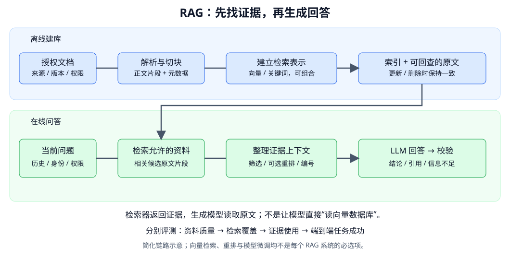

# RAG 总体链路：从找资料到有依据的回答

- 学习日期：2026-10-12。
- 每日概览：[topics_by_date](topics_by_date.md)。
- 前置阅读：[有依据问答实验设计](2026-10-10_05_grounded_qa_sft_experiment.md)、[Prompt / 上下文设计](2026-10-11_04_prompt_and_context_design.md)、[应用评测](2026-10-11_05_application_evaluation.md)。
- 状态：讲义已提供；未搭建检索服务、运行 RAG 实验或验证掌握。

先读第 1～3 节建立完整图景，再看例子、边界与评测。本节不进入数据库部署与索引算法推导，后续分别讲解析、chunking、embedding 与检索。

## 1. RAG 是什么？与你已有实验有什么区别？

RAG 是 Retrieval-Augmented Generation，检索增强生成：根据当前问题获取相关外部信息，把它作为上下文提供给生成模型。

我们之前的问答实验是：

```text
人工给定问题 + 资料片段 → LLM 回答
```

RAG 增加了“自动找资料”：

```text
问题 → 检索相关资料 → 整理证据 → LLM 回答
```

常见 RAG 不必更新生成模型权重，也不是一种新的 Transformer 层。原始论文研究了结合检索的训练模型；当前应用中的“RAG”通常泛指检索与生成组合的系统，具体训练方式不同。

**不要求必须使用向量数据库。** 关键词检索、向量检索、混合检索或结构化查询都可以为生成提供外部信息。具体系统可能将数据库工具查询单独归为 tool use，不必为术语争论忽略链路。

## 2. 总体图：离线建库与在线问答



自绘示意。读图顺序：

1. 上面：提前将文档处理成能检索、能回查的内容。
2. 下面：请求到达后找相关片段，并将原文送给生成模型。
3. 末端：检查回答、引用与不足状态，不是返回任何流畅文本就成功。

“离线”指相对于单次问答的预处理，也可以持续增量运行；“在线”指请求时执行，不要求模型一定通过互联网访问资料。

## 3. 每一步做什么？

### 3.1 文档接入与解析：让内容可以使用

来源可以是文档、网页、PDF、工单或内部知识库。

首先处理：

- 使用授权、访问权限、来源与版本。
- 正文、标题、表格、页码与结构提取。
- 扫描文件的 OCR、重复页眉和无效内容。
- 更新与删除：不能新文档入库后，旧版本仍无条件参与回答。

解析错了，后续即使检索和生成都“正常运行”，也可能得到错误事实。

### 3.2 Chunking：切成合适的检索单元

文档通常会切成片段，而不是每次返回整本手册。切块要在检索粒度、上下文完整性与成本间取舍。

例如“处理通常需要三个工作日”和“特殊情况可能延迟”若被切开，仅取前半段就可能漏掉限定条件。

每个 chunk 应能回查源文档，保留标题路径、版本、位置与权限等元数据。片段不是无来源的纯字符串。

### 3.3 建索引：建立可检索的表示

| 方式 | 直觉 | 常见特点 |
|---|---|---|
| 关键词 / BM25 | 看问题词与文档词是否匹配 | 对型号、编号、术语等精确文本有价值 |
| 向量检索 | 将问题与片段编码成向量，按相似度找候选 | 可处理部分不同措辞，但相似不等于支持答案 |
| 混合检索 | 结合不同召回方式 | 需要明确合并与排序，不直接将不同分数硬相加 |

索引是检索入口，原文可以存放在索引中或另一存储中。**生成模型通常接收的是取出的文本片段，不是 embedding 浮点数组。**

向量代表片段的检索特征，不能无损还原原文，因此仍需保留可回查的内容。

### 3.4 在线检索：当前问题能找出哪些候选？

输入包括当前问题、必要历史、用户身份与过滤条件。

例如用户说“那它周末也处理吗？”，需要消解“它”指代什么。可进行查询改写，但应检查改写有没有改掉用户需求。

必须在证据进入模型之前执行可靠的权限限制，不能先把未授权内容放进上下文，再要求模型不要泄露。多租户、版本与时间条件都可能影响允许访问的资料。

检索常返回 top-k 个候选；k 不是全行业固定数字。更多候选提高覆盖的同时，也可能增加干扰和预算。

### 3.5 筛选 / 重排与证据整理

初始候选可交给 reranker 更细地评分，或通过去重、版本规则、相关性筛选整理。重排是可选步骤，不是 RAG 的定义要求。

对于多片段答案，不能只保留“看起来最像问题”的一段；可能需要政策正文和适用条件共同支持。

送给模型的证据通常整理为：

```text
[D1] 来源：处理规则；版本：v2；段落：处理时长
申请通常需要三个工作日处理。

[D2] 来源：工作日定义；版本：v2
工作日不包括周末和法定节假日。
```

D1、D2 是本次引用标识，应能映射到源文档与段落，不一定是知识库的永久文档 ID。两段也可能来自同一文档。

若压缩或摘要证据，保留回查原文的关联并验证条件未丢失；摘要本身可能引入生成错误。

### 3.6 生成与校验

Prompt 指定问题、可用证据、引用与不足规则。模型还会使用预训练形成的语言和推理能力；加了 RAG 并不意味着它自动只依据资料。

随后校验：

- 调用是否成功、是否截断。
- 引用编号是否存在、对应原文是否支持主张。
- 是否遗漏条件或编造事实。
- 资料不足时是否合理回答已支持部分或说明不足。

相似度阈值不是“有答案 / 没答案”的可靠通用判定。需要结合证据支持评估与独立任务验证，不能用一个固定向量分数假装置信度。

## 4. 用一个完整例子串起来

以下规则为教学虚构，不是实际业务政策。

用户问题：

> 周五提交申请，周一一定完成吗？

知识库中有：

| 片段 | 内容 | 作用 |
|---|---|---|
| D1 | 通常需要三个工作日 | 处理时长证据 |
| D2 | 工作日不含周末与法定节假日 | 计时条件证据 |
| D3 | 查询进度需申请编号 | 此问题的干扰信息 |

理想链路先检索到 D1、D2，组织上下文后回答：

> 不能据此保证周一完成。资料说通常需要三个工作日，周末和法定节假日不计入。[D1][D2] 资料未说明提交当天是否计入，也没有具体节假日信息，因此不能确定完成日期。

这里的成功不只是“找到三个工作日”：

- D1 单独不够解释周末条件。
- 答案需保留“通常”，不改为保证。
- 不随意引用 D3。
- 不强行编出精确日期。

## 5. 什么时候优先用 RAG？

| 需求 | 适合考虑的方案 |
|---|---|
| 文档多、知识更新，需要引用 | RAG：检索当前授权资料 |
| 少量资料，已明确全部相关且预算允许 | 直接放上下文，未必先建索引 |
| 格式、风格或业务行为不稳定 | Prompt / schema，必要时 SFT |
| 实时订单、库存、账户状态 | 可信数据库 / API 工具查询，不能仅靠旧文档 |
| 退款、取消等外部写入 | 工具 + 权限 / 确认 / 幂等 / 事务，不靠 RAG 文本直接执行 |

RAG 与 SFT 可以组合：检索补资料，微调改善如何使用资料。微调也可能学习事实，但不提供随时更新与引用的保证。

长上下文与 RAG 也不是非此即彼：资料少时直接提供，资料多时检索选取，选取后再利用较长窗口。需比较效果与成本，不默认“窗口大就不用检索”。

### 5.1 现代 Agent 还需要 RAG 吗？

需要区分两种用语：

- 狭义的传统 RAG：预先切块、建向量 / 关键词索引，问答时检索 top-k，再生成。
- 广义检索增强：回答时从外部获取证据；Agent 可以主动搜索、读文件、查 API，多次补信息。常称为 agentic retrieval / agentic RAG，但不必把所有工具操作都归为 RAG。

典型 Agent 获取外部信息的路径：

| 信息源 | 常见获取方式 | 是否必须预先建向量库 |
|---|---|---|
| 代码仓库 | 文件列表、文本 / 符号搜索、读取定义与调用、终端命令 | 不必须 |
| 公开网络 | 搜索引擎、打开网页、浏览器操作与继续搜索 | 不由使用方必然建立；底层实现不能凭界面推断 |
| 企业知识库 | 连接器调用源系统搜索，也可用语义 / 混合检索 | 依连接器与后端实现 |
| 实时业务状态 | 数据库 / API 查询 | 不必须，常需准确条件查询 |
| 指定小文件集合 | 直接读取并选择性放入上下文 | 不必须 |

Agent 不是 RAG 的替代品；它可以决定何时检索、如何改写查询、是否继续读取，传统检索器则可以作为它的工具之一。

2026-10-12 核对的官方公开证据：

- [OpenAI file search](https://developers.openai.com/api/docs/guides/tools-file-search)明确采用上传文件的 vector store，以及语义和关键词搜索。这是可被模型调用的检索工具；不能据此说所有 Codex 请求都使用此后端。
- [OpenAI web search](https://developers.openai.com/api/docs/guides/tools-web-search)说明推理模型可主动管理搜索过程，分析结果并继续搜索。
- [Codex MCP 文档](https://developers.openai.com/codex/mcp)说明可接入第三方文档与开发工具；[云环境文档](https://developers.openai.com/codex/cloud/environments)描述代码仓库 checkout 与终端命令循环。该环境页面目前标注 legacy，不能用它代表所有当前客户端。
- [Claude Cowork 官方介绍](https://support.claude.com/en/articles/13345190-getting-started-with-cowork)描述项目中的文件、链接与记忆。公开能力不能证明其内部每项信息都经过向量索引。

名称说明：Cowork 属于 Claude / Anthropic。用户提到的“Meta 的 muse”尚未明确具体产品，本节不将它擅自替换为另一个产品，也不推测其内部检索架构。

例如代码 Agent 先搜索函数名，读取文件，再执行测试；测试报错后再查相关定义。它逐步取得新上下文，而不是必须先把整仓库塞进一个向量库。测试执行还提供环境反馈，不只是“检索知识”。

结论：**外部知识获取并未消失，而是从固定检索链路扩展成由 Agent 调度的多种信息工具。是否使用向量索引，是某条路径的实现选择，不是 Agent 是否先进的标志。**

## 6. 分层评测：错在哪里？

| 层次 | 示例问题 | 可观察的证据 |
|---|---|---|
| 源资料 | 资料本身是否包含答案、是否过期？ | 源文档、版本与标注 |
| 解析 / 切块 | 条件是否被漏掉或切碎？ | 解析文本、chunk 与原文对照 |
| 检索 / 重排 | 所需片段是否进入候选、是否被保留？ | 候选排名、过滤与重排日志 |
| 上下文组织 | 证据是否因长度预算被截掉？ | 实际发送给模型的输入 |
| 生成 | 有证据却答错、引用错或过度拒答？ | 固定证据下的生成对照 |
| 端到端 | 用户是否得到正确、有依据的结果？ | 全链路质量、延迟、成本和失败 |

可做一个诊断对照：

1. 人工确认的充分证据 → 同一个生成模型。
2. 检索实际得到的证据 → 同一个生成模型。

第一种表现好、第二种差，提示检索 / 组织链路存在问题；两者都差，需继续检查生成、任务与标注。它们不是严格因果证明，输入内容与干扰等差异还需控制。

检索的 relevance 与回答的 support 不完全相同。片段谈到了“工作日”很相关，但未必包含回答需要的条件。多片段题需检查必要证据是否联合覆盖。

评测数据、指标与汇总沿用 [应用评测讲义](2026-10-11_05_application_evaluation.md)。检索效果高不保证端到端成功，格式正确也不保证引用真实支持。

## 7. 数据与工程边界

重点关注：

- **权限**：按用户与租户限制资料，缓存和检索也不能跨权限泄露。
- **更新 / 删除**：原文、chunk、索引和缓存失效应一致。
- **证据可信度**：网页中的命令不是应用指令，警惕 prompt injection。
- **可观测性**：保存输入来源、候选、过滤与最终证据，结合隐私与保留策略。
- **失败显式化**：资料服务超时与“资料确实不包含答案”是不同状态，不将系统错误伪装成正常拒答。

本节了解应用接口与可靠性要求，不展开向量库运维、GPU 或分布式检索实现。

## 8. 最小实践路线

从小型、授权且可人工核对的文档集合开始：

1. 确认资料、版本、任务与独立评测组。
2. 解析切块，保留原文映射。
3. 做一个可解释的检索基线，例如关键词；再比较向量或混合，不一开始堆全部技术。
4. 输出候选与最终证据，人工审核典型查询。
5. 接入有依据问答 Prompt，检查引用与不足。
6. 用固定评测比较各组件与整体，分类分析错误。

现有 SFT pilot 的单证据格式需扩展为多片段列表，引用校验和评分也需相应修改，才能用于这些实验。本文没有修改该 pilot 代码或运行检索。

## 9. 可选自测、资料与进度

1. RAG 必须使用向量数据库吗？
2. 生成模型通常读取 embedding 还是原文证据？
3. 资料没召回时，改好 Prompt 能保证补齐答案吗？
4. 引用编号存在能否证明回答被支持？

<details>
<summary>参考答案</summary>

1. 不必须，检索方式可以不同。
2. 常见文本 RAG 提供原文片段及元数据。
3. 不能保证，先修资料 / 检索与信息不足处理。
4. 不能，需检查主张与对应原文的支持关系。

</details>

资料入口：

- [RAG 原论文](https://arxiv.org/abs/2005.11401)：理解参数化生成模型与非参数检索信息的结合，区别于所有现代应用实现。
- [Sentence Transformers：Retrieve & Re-Rank](https://www.sbert.net/examples/sentence_transformer/applications/retrieve_rerank/README.html)：检索与重排的入门资料。
- [应用评测教材](2026-10-11_05_application_evaluation.md)：后续实验的指标与数据规范。

记录：

- 已提供：双阶段图示、逐步职责、多证据例子、选型边界、分层归因与实践路线。
- 阅读反馈 / 答疑：待补充。
- 已验证掌握：暂无，未执行 RAG 实验。
- 下一专题：文档解析与 chunking，之后学习 embedding、BM25 与混合检索。
