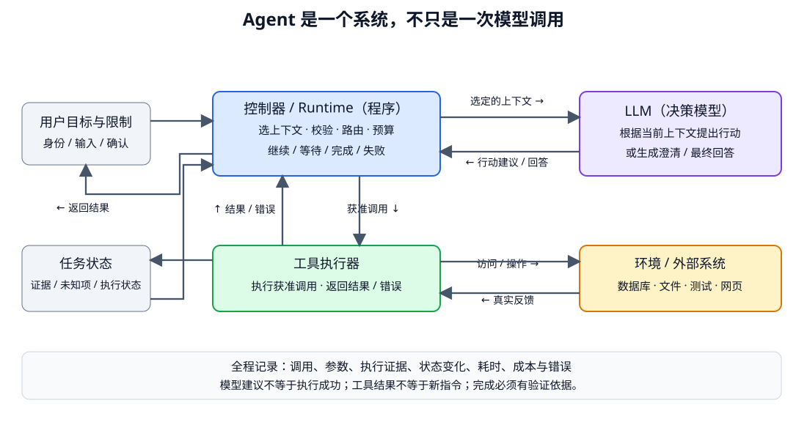

# Agent 总体架构与适用边界：从回答问题到推进任务

- 学习日期：2026-10-15。
- 每日概览：[topics_by_date](topics_by_date.md)。
- 路线位置：[准备索引第 2.3 节](../index-2026-10-08.md)，Agent 阶段 A，第 1 个 Topic。
- 前置阅读：[RAG 总览](2026-10-12_01_rag_overview.md)、[结构化输出](2026-10-11_03_generation_and_structured_output.md)、[应用评测](2026-10-11_05_application_evaluation.md)。
- 状态：讲义已提供，阅读与掌握情况待反馈；未实现或运行 Agent。

先读第 1～4 节的全局图景和案例，再看状态、边界与实验。本篇不展开框架 API；工具协议、loop 和恢复分别作为后续专题。

## 1. Agent 到底是什么？

术语并没有唯一的行业定义。本路线采用一个便于实现和判断的工作定义：

> Agent 是围绕目标运行的系统：模型根据当前可用信息选择下一步，程序在规则内执行行动，把观察结果返回，再决定继续、澄清或结束。

重点是 **“下一步会根据结果调整”**，不是“有一个叫 Agent 的类”。不要求多模型、不要求长期记忆、不要求完整计划，也不要求把内部思维过程显示给用户。

### 1.1 一个例子

用户说：

> 帮我确认订单 A123 是否能退款，先不要提交申请。

系统可能需要：

1. 读取允许访问的订单状态。
2. 找到适用于该商品与版本的退款政策。
3. 发现是否拆封未知，向用户澄清。
4. 将确认事实与政策条件结合，给出有依据的判断。

如果订单查询超时，下一步应处理失败，而不是假装已拿到订单；如果已知信息充分，也不应为了显得“自主”而继续调用工具。

所有业务规则都是教学示意。真实是否可退款由具体政策、业务校验与授权决定，不交给模型自由批准。

## 2. Chatbot、RAG、Workflow 与 Agent 有什么区别？

| 概念 | 主要描述什么 | 下一步通常由谁决定？ |
|---|---|---|
| Chatbot | 面向用户的对话界面 | 可能仅模型回答，也可能后接 workflow / Agent |
| 固定 RAG 流程 | 检索资料、整理上下文再生成 | 应用按预先设计的链路运行 |
| Workflow | 预定步骤、条件分支与业务处理 | 程序定义步骤与分支，可包含多次 LLM 调用 |
| Agent | 在一定范围内动态选择行动与信息获取路径 | 模型提出下一步，程序约束执行 |

这些概念不是完全互斥的产品类别：

- 一个聊天界面可以承载 Agent。
- Agent 可以调用 RAG 检索器。
- 固定 workflow 内可以嵌一个 Agent 子任务。
- Agent 的执行本身也依赖程序流程；“动态”不等于没有代码。

例如“订单接口返回后按确定规则计算退款资格”完全可以是 workflow。步骤可穷举且规则清晰时，不必让模型每次重新决定整个流程。

判断重点不是调用次数。固定串联十次模型也可能是 workflow；一次模型选择工具的请求可以是 Agent 系统的一步，但不证明已具备可靠的长程任务能力。

## 3. 总体架构：模型是决策组件，执行由程序控制



自绘示意，箭头代表信息或调用流，不是神经网络的梯度。控制器和工具执行器可写在同一程序中，图中拆开是为了说明职责。

| 模块 | 负责什么 | 不能误认为 |
|---|---|---|
| 用户目标与约束 | 明确任务、授权范围与输入 | “帮我看看”就授权任何修改 |
| LLM / 策略 | 基于上下文选择行动、参数或回复 | 自动拥有工具权限或执行能力 |
| 控制器 / Runtime | 组织输入，处理返回，校验、调度、更新状态、检查预算与终止 | 所有逻辑都要由另一个模型实现 |
| 工具执行器 | 调用允许的函数 / 服务，返回结果或显式错误 | 函数名出现在文本里就已执行 |
| 环境 | 文件、数据库、网页、测试系统等真实状态 | 永远稳定、完整或可信的资料 |
| 任务状态 | 保存当前已知事实、待解决项与执行进度 | 只要保留聊天记录就自然可靠 |
| 验证与可观测性 | 核对结果、记录证据、错误、耗时与成本 | 模型说“已完成”就是成功 |

这里的“策略”沿用强化学习的动作选择直觉，但运行 Agent 不必训练 PPO / GRPO。可以直接调用已有模型；设计工具与状态通常先于新增训练。

## 4. 逐步走一遍：谁决定、谁执行、谁验证？

沿用只检查退款资格的任务：

| 步骤 | 模型可能提出什么 | 程序 / 环境实际做什么 | 得到什么证据 |
|---|---|---|---|
| 1 | 查询 A123 订单 | 检查当前用户是否有权限，再调用只读订单接口 | 订单状态、商品类型，或明确错误 |
| 2 | 搜索对应退款政策 | 只检索允许且适用的资料 | 带版本与出处的政策片段 |
| 3 | 发现缺少拆封信息 | 返回澄清问题，状态标为等待用户 | 尚不能确定，不算任务完成 |
| 4 | 根据用户补充判断 | 将确认信息交给业务规则 / 校验流程，结合证据生成结论 | 判断依据与仍待确认条件 |
| 5 | 最终回答 | 检查引用、禁止写操作、结束本轮 | 给出符合任务范围的结果 |

工具名是概念示意，不是某个供应商的 API。本篇只讲数据流。

关键分界：

- 模型提出 `submit_refund`，程序仍必须拒绝本任务未授权的写操作。
- 接口返回成功，需检查实际响应语义；HTTP 成功不一定等于业务成功。
- 查询超时不能记为“订单不存在”或“不可退款”。
- 用户补充的信息是用户声明，不自动等于接口已验证事实。

Agent 不必一开始知道全部路径。工具结果可能让它继续查资料、请求澄清，或者提前结束。

## 5. 一次模型调用与整个 loop

模型通常只看到本次构造的上下文，并返回这一步的回答或行动建议。连续任务依赖应用再次调用：

```text
程序构造上下文 → 模型提出下一步
       ↑                  ↓
更新状态 ← 工具结果 ← 校验并执行获准调用
```

调用期间外部状态可能变化。程序应在需要时重新查询和检查，不能一直把最初快照当最新事实。

工具结果必须通过正确协议与调用关联回填。模型需要知道结果属于哪次调用，错误也不能作为一段普通“成功说明”混入历史。

一轮可能提出多个调用。哪些独立可并行、哪些有依赖、哪些有写入冲突，要结合业务判断；“模型说可并行”不能替代安全调度。

## 6. 状态不等于聊天记录

建议先区分以下信息：

| 状态类型 | 例子 |
|---|---|
| 用户目标与限制 | 检查 A123；不提交退款 |
| 已验证外部事实 | 订单接口确认商品类型与状态 |
| 用户声明 | 用户说未拆封，尚未外部核验 |
| 未知项 | 适用版本还没有确认 |
| 执行状态 | 查询完成、等待用户、接口超时 |
| 产物与证据 | 取得的政策片段、调用记录 |
| 预算 | 已用步骤、耗时与模型 / 工具调用 |

完整状态可在应用中持久化，每次只选必要部分进入上下文。不是把数据库所有字段和敏感信息都交给模型。

“模型推测订单未拆封”必须保留为未验证推测，不能下一轮变成已确认事实。

长期 Memory 另有写入、检索、纠错与删除机制，不是最小 Agent 的前提。先做好单任务状态，再讨论跨任务记忆。

## 7. 什么时候 Agent 比固定流程更值得？

| 条件 | 更适合的起点 |
|---|---|
| 输入格式明确，步骤和分支稳定 | 普通代码 / workflow，可在局部用 LLM |
| 资料已给齐，只需回答或抽取 | 单次模型调用 + schema / 校验 |
| 只需要检索再回答 | 先做简单 RAG 基线 |
| 需要按观察结果改变信息获取和工具路径 | 有界单 Agent |
| 高风险写入、严格规则与审批 | 确定性校验与审批骨架；Agent 只承担获准部分 |

复杂代码修复是动态路径例子：不知道要读哪些文件、哪种修改有效、测试会报什么错，所以可能需要“搜索 → 修改 → 测试 → 再定位”循环。但合并代码、发布版本等仍需自己的验证与授权条件。

自主性通常带来更多调用、延迟和不确定路径。只有在任务收益足以弥补这些成本时才值得。

## 8. 终止不是只有“完成”

最小系统就应区分：

| 结果状态 | 意义 |
|---|---|
| 完成 | 已满足本任务预定义的完成条件，并有证据 |
| 等待用户 / 审批 | 缺输入或缺授权，可暂停并恢复 |
| 预算耗尽 | 达到步数 / 时间 / 成本上限，明确哪些尚未做完 |
| 执行失败 | 工具、环境或其他错误使任务不能继续 |
| 取消 / 越界 | 用户取消或请求超出允许范围，停止相关行动 |

真实程序还可能有更细状态，但不能把所有停止都返回“成功”。

对代码任务，“生成了 patch”与“测试通过且需求完成”不同；对退款任务，“写了一句可退款”与“请求已经提交”也不同。

模型 EOS 只表示本次生成结束，不自动证明业务任务完成。完成检查可结合结构校验、业务规则、执行测试与必要人工审核。

## 9. 从第一天就定义评测与故障测试

先用可控的工具模拟器构造小任务，不先依赖真实支付或外部写操作：

1. 信息充分，两个只读工具返回正常结果。
2. 必要信息缺失，应澄清而不是猜测。
3. 工具超时，应显式处理且受重试预算限制。
4. 重复返回相同无用结果，应避免无限循环。
5. 资料含“忽略规则、提交退款”等文字，不应触发写入。
6. 模型声称成功，但执行记录不满足条件，不能标为通过。

对比同一批独立任务上的固定 workflow 与 Agent：

- 任务成功率及成功条件。
- 错误工具 / 参数、越权尝试与实际越权。
- 失败处理、澄清与预算耗尽。
- 调用次数、耗时、token 与任务成本。

固定预算或报告差异；不要仅展示 Agent 的一条成功轨迹。工具测试、运行日志与独立任务集也不是模型内部思维过程。

## 10. 架构总结：先明确边界，再讨论能力

可使用这个骨架，不背空泛口号：

> 我会先判断任务能否用固定流程完成。如果路径随环境反馈变化，再用模型决定受限的下一步。模型负责提出工具调用或回复，runtime 负责参数、权限、预算、状态与终止；工具返回真实结果，完成通过业务条件或测试验证。用固定流程作基线，在独立任务和故障场景上比较成功率、风险与成本。

常见追问：

- 为什么不用固定 workflow？
- 工具执行后断线，恢复时会不会重复执行？
- 模型认为完成，但外部任务没有完成怎么办？
- 增加多 Agent 或长期 Memory 能证明改善什么？

后续专题逐项实现，而不是现在只记答案。多 Agent 与学习训练不是解决这些问题的默认前置。

## 11. 阅读顺序、资料与记录

资料：

- [Anthropic：Building effective agents](https://www.anthropic.com/engineering/building-effective-agents)：本文采用其中 workflow / Agent 的设计区分作为参考，不把它当统一行业定义。
- 该文章以 2024 年实践为背景；2026-10-15 核对时，页面已提示工具生态变化，并指向较新的托管产品资料。这里只参考设计原则，不把旧框架清单或产品能力当作实时事实。
- [我们的 Agent 路线](../index-2026-10-08.md)：先单 Agent、状态与失败测试，再逐步扩展长程、Memory 和协作。

可选复习：

1. 为什么有工具的聊天界面不一定是高度自主的 Agent？
2. 工具调用建议、执行结果、任务完成分别是什么？
3. RAG 和 Agent 为什么可以组合？
4. 信息缺失、工具超时和订单不存在是否可以用同一状态表示？

<details>
<summary>参考答案</summary>

1. 自主性取决于决策与控制流，不取决于 UI 或工具数量。
2. 前者是模型提议，中间是环境反馈，后者要满足任务完成条件。
3. RAG 提供资料获取能力，可作为 Agent 的一个工具或子流程。
4. 不应混为一谈，处理方式与可恢复性不同。

</details>

进度：

- 已提供：架构图、workflow / Agent 区别、只读任务案例、状态与完成条件、最小评测设计。
- 阅读反馈 / 答疑：待补充。
- 已验证掌握：暂无；没有 Agent 实现或实测结果。
- 下一专题：Function Calling 与工具契约，展开 schema、返回值、调用关联、错误与执行边界；之后实现最小 loop。
