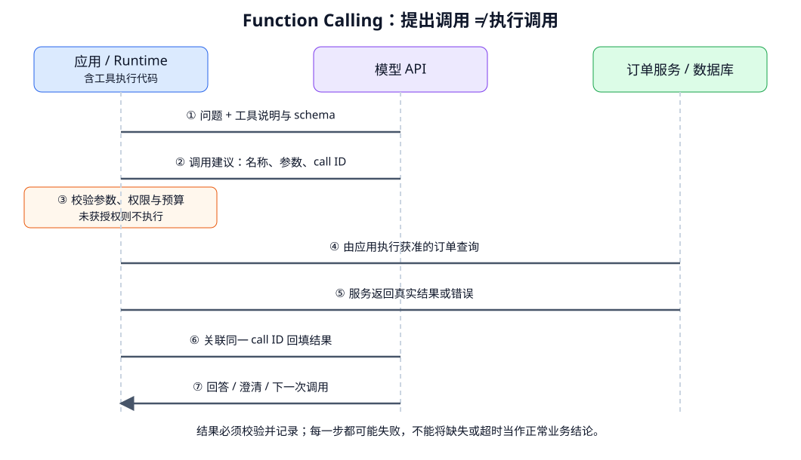

# Function Calling 与工具契约：从调用建议到可验证结果

- 学习日期：2026-10-15。
- 每日概览：[topics_by_date](topics_by_date.md)。
- 路线位置：Agent 阶段 A，第 2 个 Topic。
- 前置阅读：[Agent 总体架构](2026-10-15_01_agent_architecture_and_boundaries.md)、[结构化输出](2026-10-11_03_generation_and_structured_output.md)。
- 状态：讲义已提供，阅读与掌握情况待反馈；没有调用业务接口、安装 SDK 或实现工具。

先读第 1～4 节的往返与双工具案例，再看校验、错误与并行。JSON 示例除明确注明外都是自定义教学契约，不是可原样提交给所有供应商的请求。

## 1. Function Calling：模型提出结构化调用

模型拿到工具定义，可以输出：

> 调用 get_order，参数是 order_id=A123。

对应用自定义的客户端工具，模型 API 通常不会直接运行你的函数。应用收到建议，检查后通过自己的代码执行，再把结果发回模型。

```text
给模型看的：名称 + 功能说明 + 输入 schema
应用持有的：函数实现 + 服务凭据 + 校验与授权逻辑
```

模型不需要看到数据库密码，也不需要看到全部函数源码。名称和 schema 本身没有执行能力。

托管网页搜索等服务端工具可以由供应商代执行，这是另一种执行边界；不能把自定义工具和所有服务端工具都解释成同一种部署方式。

## 2. 一次调用的完整往返



自绘流程，读图顺序为 ①～⑦。主要区别：

- 第 ② 步只有模型建议，没有执行。
- 第 ③ 步由应用决定是否允许。
- 第 ⑤ 步才取得外部结果，也可能是超时或业务失败。
- 第 ⑦ 步可能继续调用，并非每次回填都直接得到最终答案。

应用还需要用户身份、任务约束、预算与状态。这些不能只靠模型参数中的字符串决定。

## 3. 工具契约包含什么？

契约不仅是参数类型，还要约定前提、结果与失败语义：

| 部分 | 要说明什么 |
|---|---|
| 名称 | 清楚、稳定，能与实际实现对应 |
| 描述 | 何时使用、能做什么、不能做什么，是否写入 |
| 输入 schema | 字段、类型、必填、枚举与其他支持约束 |
| 返回值 | 数据结构、字段含义、来源 / 时间、缺失状态 |
| 错误 | 参数错、无权限、不存在、超时等如何区分 |
| 执行规则 | 超时、预算、重试、副作用、确认与幂等 |

### 3.1 工具一：get_order

以下采用类似 OpenAI Responses 自定义函数定义的写法，真实 API 仍需完整请求与支持模型：

```json
{
  "type": "function",
  "name": "get_order",
  "description": "只读查询一个订单的商品类别、地区和状态。不提交退款，不修改订单。缺少订单编号时先询问用户。权限由后端根据当前登录身份检查。",
  "parameters": {
    "type": "object",
    "properties": {
      "order_id": {
        "type": "string",
        "description": "用户提供的订单编号，例如 A123。不得猜测不存在的编号。"
      }
    },
    "required": ["order_id"],
    "additionalProperties": false
  },
  "strict": true
}
```

这里不让模型填写 `user_id` 来决定访问身份。可信身份从应用认证上下文取得；模型提供订单号，不代表它已证明用户有权查询。

`strict` 等能力需按供应商核对。即便参数满足 schema，也不能保证编号真实或有权限；执行前仍由后端检查。

### 3.2 工具二：find_refund_policy

作为教学定义，输入为：

```json
{
  "product_category": "headphones",
  "region": "CN"
}
```

工具契约：只读返回适用于指定类别与地区的当前政策片段及版本、来源；无匹配时明确返回无匹配，不猜规则。具体适用日期或历史版本需要时应另设字段与规则。

关键描述不能只有“搜索政策”：应说明类别与地区的来源、结果是否完整、怎样处理无匹配。若实际工具只是近似检索，不能在描述中承诺它返回的一定是适用政策。

返回可采用多片段列表，不限制为 D1：

```json
{
  "ok": true,
  "data": {
    "matches": [
      {
        "evidence_id": "D1",
        "policy_id": "refund_headphones_cn",
        "version": "v2",
        "source_uri": "knowledge-base://refund/headphones/CN/v2",
        "text": "符合期限且未拆封的标准申请可进一步办理；其他条件须核对完整政策。"
      }
    ],
    "coverage": "excerpt_not_full_policy"
  }
}
```

政策内容为虚构例子。片段支持初步判断，不代表已完成完整退款资格校验。`ok=true` 只表示工具完成查询，不表示申请一定可办理。

## 4. 双工具案例：调用 ID、依赖与结果回填

用户：

> 帮我确认订单 A123 是否能退款，先不要提交。

### 4.1 模型提出第一项调用

下面是 OpenAI Responses 风格的关键字段摘录，不是完整 API 响应：

```json
{
  "type": "function_call",
  "call_id": "call_order_01",
  "name": "get_order",
  "arguments": "{\"order_id\":\"A123\"}"
}
```

此处 arguments 是 JSON 字符串，需要解析；其他协议可能直接给对象。

应用按允许工具映射找到实现，解析与验证参数、校验身份和订单访问权限，再执行。不要根据模型给的名称动态执行任意代码。

假设获准查询得到：

```json
{
  "ok": true,
  "data": {
    "order_id": "A123",
    "product_category": "headphones",
    "region": "CN",
    "status": "delivered",
    "package_opened": null
  }
}
```

`null` 在本契约中表示未知，不是“未拆封”。查到订单不等于符合退款条件。

### 4.2 按同一个调用 ID 回填

OpenAI Responses 风格关键字段示意：

```json
{
  "type": "function_call_output",
  "call_id": "call_order_01",
  "output": "{\"ok\":true,\"data\":{\"order_id\":\"A123\",\"product_category\":\"headphones\",\"region\":\"CN\",\"status\":\"delivered\",\"package_opened\":null}}"
}
```

调用 ID 将结果关联到具体调用，不是工具名称或订单号。一轮两次调用 get_order 时，工具名相同，调用 ID 仍要区分。

真实请求要保留或正确续接必要的模型输出与对话状态；某些推理模型要求保留相关 reasoning items。不能只凭这个结果对象就假设任何 API 都能无上下文继续。

### 4.3 第二项调用与澄清

模型根据订单类别与地区提出政策查询。应用执行后回填对应结果。若政策涉及拆封条件，而订单接口未提供，模型应询问用户或使用获准的额外验证流程。

本例不能直接回答“已批准退款”：

- 政策片段不是完整资格检查。
- 拆封状态仍未知。
- 用户明确禁止提交。

正确推进可能是：“已查到订单与对应政策片段；目前还不能确认资格，需要补充拆封信息并核对其他条件，尚未提交申请。”

## 5. 不同供应商的调用格式不是同一个 JSON

2026-10-15 核对的官方资料说明：

| 范围 | 契约 / 执行特点 |
|---|---|
| OpenAI Function Calling | 自定义函数提供参数定义；输出关联到具体 call ID；Responses 和 Chat Completions 的消息格式不同 |
| Anthropic 自定义客户端工具 | 定义通常使用 name、description、input_schema；结构化调用交给应用执行 |
| 供应商托管工具 | 可由服务端执行，可能在一次外部请求内完成工具往返，需另查权限与可观测范围 |

学习重点先放在共同的数据流，再由适配层转换协议。不要自己发明 `role="tool"` 就认为所有 API 接受，也不要把 API 对话关联与业务幂等键混用。

## 6. 三层校验：能解析、有权做、做成了

| 层次 | 示例检查 | 失败时 |
|---|---|---|
| 结构 | 工具存在、JSON 可解析、类型与必填正确 | 明确拒绝或返回参数错误，不执行 |
| 授权与业务前提 | 当前用户能读 A123、任务只允许查询 | 拒绝未授权动作，必要时请求确认 |
| 结果与完成 | 返回业务状态是否成功，数据是否足够 | 记录真实失败 / 不足，不宣称完成 |

注意结构正确不等于安全：字符串字段可能携带恶意路径、SQL 或命令。工具实现应采用参数化查询、路径限制与明确允许范围，而不是拼接模型文本执行。

工具返回的网页、政策与错误文字也可能包含不可信指令。回填作为数据，不提升为应用规则；敏感凭据和无关个人信息不应放入模型上下文。

## 7. 错误契约：别把运行失败变成业务结论

可以约定统一的成功 / 失败结构，但具体格式由应用定义。例如：

```json
{
  "ok": false,
  "error": {
    "code": "UPSTREAM_TIMEOUT",
    "message": "订单服务超时，尚未取得状态。",
    "retryable": true
  }
}
```

`retryable=true` 是工具提供的重试线索，不代表可以无限重试；runtime 仍执行重试次数与时间预算。

至少区分：

- 参数错误：修参数或请求澄清。
- 权限拒绝：不通过换编号、换工具等方式绕过。
- 不存在 / 无匹配：按已授权接口的业务语义处理，必要时对用户隐藏敏感存在性信息。
- 上游超时：状态未知，不推断“不存在”。
- 工具返回格式异常：显式处理并记录，不让模型替服务编造成功对象。

运行错误需要日志或通知；面向模型的错误信息可去除敏感堆栈，但不能悄悄转成空对象、默认金额或成功状态。

## 8. 串行、并行与写操作

订单查询结果决定政策输入，本例这两步有依赖，应先取得类别与地区。若输入已经由可信上下文确定、调用之间又无冲突，才考虑并行。

一轮模型可以提出零个、一个或多个调用：

- 零个：可能可以回答，也可能需要澄清；不强制每轮用工具。
- 多个独立读调用：可由程序并行，并分别关联结果。
- 有依赖、共享状态或写入冲突：按规则串行或拒绝不合理组合。

当请求涉及写入，超时可能表示“操作没发生”，也可能表示“已发生但响应丢失”。不能盲目重试提交。需业务幂等键、操作状态核查和必要审批；tool call ID 主要用于对话关联，不自动提供跨重试的业务幂等。

权限按工具、资源和动作细分。“读工具”也可能返回敏感信息或调用高成本服务，不等于无需治理。

## 9. 怎样让模型更容易选对工具？

- 名称与描述清晰区分相似工具，写明读 / 写、前提和返回内容。
- 只向本任务暴露必要工具，并在执行端保持相同授权限制。
- 固定枚举与类型，能从可信应用状态得到的参数不让模型猜。
- 约定缺失值、分页、无匹配、部分结果与错误。
- 工具很多时可以做受控发现 / 筛选，后续 MCP 与上下文专题展开。

“强制调用工具”或 `tool_choice` 只改变调用选择行为，不补齐缺失信息，也不授权动作。相关选项与并行支持依模型、端点和模式核对。

## 10. 最小测试清单与技术总结

下一实现应至少验证：

1. 正常订单查询，返回值按调用 ID 正确回填。
2. 缺少编号，澄清而不是猜测。
3. 不存在工具、错误 JSON、错误字段，未触发执行。
4. 非本人订单或写操作建议，被程序阻止。
5. 超时与业务无匹配分别处理。
6. 多调用结果乱序返回，仍能正确关联。
7. 工具文字含指令，不改变授权与用户限制。
8. 成功查询但资格条件不足，不能将任务标成已批准。

技术总结可以这样组织：

> Function Calling 是模型与外部能力之间的结构化交互。模型提出名称与参数，runtime 校验和授权后执行，将真实结果关联回填，再让模型继续。工具契约要覆盖返回值、错误和副作用；schema 正确、工具成功和任务完成是三个不同判断。

## 11. 资料与进度

2026-10-15 核对：

- [OpenAI：Function calling](https://developers.openai.com/api/docs/guides/function-calling)，调用与结果关联、参数 schema 等。
- [Anthropic：Define tools](https://platform.claude.com/docs/en/agents-and-tools/tool-use/define-tools)，工具定义与描述。
- [Anthropic：Tool use overview](https://platform.claude.com/docs/en/agents-and-tools/tool-use/overview)，客户端 / 服务端执行边界。

本篇是文档核对与自编案例，不是付费 API 调用测试，不保证所有模型接受同一 schema 子集。

记录：

- 已提供：往返图、双工具契约、call ID、结果回填、三层校验、错误与并行边界。
- 阅读反馈 / 答疑：待补充。
- 已验证掌握：暂无；未实现或实测工具。
- 下一专题：最小 Agent loop 与控制流，先用可控双只读工具构建失败测试，再考虑接真实模型 / 框架。
