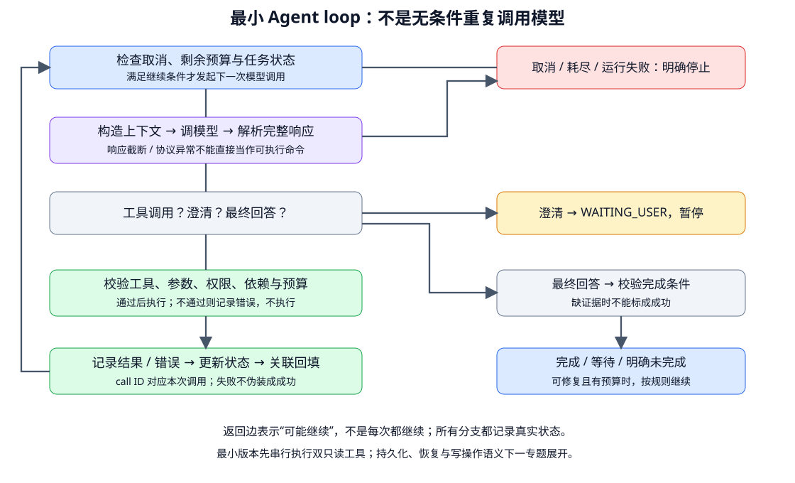

# 最小 Agent loop：控制流、预算与终止

- 学习日期：2026-10-15。
- 每日概览：[topics_by_date](topics_by_date.md)。
- 路线位置：Agent 阶段 A，第 3 个 Topic。
- 前置阅读：[总体架构](2026-10-15_01_agent_architecture_and_boundaries.md)、[工具契约](2026-10-15_02_function_calling_and_tool_contracts.md)。
- 状态：教材与实现设计已提供，未创建可执行 Agent、调用模型 API 或运行测试。

先读第 1～4 节的一条完整任务轨迹，再看伪代码与测试设计。这里不安装框架，不恢复暂停的 SFT 实验。

## 1. 一次 Function Calling 为什么还不够？

上一篇解释了一次往返：

```text
模型提出调用 → 程序执行 → 结果回填 → 模型继续
```

但真实任务可能还缺信息、工具会失败、结果会改变下一步。Loop 是把这些步骤组织起来的控制程序：

> 每轮读取当前状态，构造模型输入，处理行动或回复，记录真实结果，再决定是否进入下一轮。

它不是简单 `while true`，也不是一次把所有路径都写进 prompt。工具、授权、预算与完成检查由程序落实；模型在允许范围内提出下一步。

## 2. 先看图：循环与停止分支



自绘简化流程。工具校验失败可以作为错误观察回填，让模型修正，但受次数限制；协议损坏等无法安全处理的失败则显式停止。

图中的“最终回答”只是候选结果，不等于自动通过完成检查。达到模型 EOS 也只是本次生成结束，不等于任务完成。

## 3. 先固定一个可理解的最小版本

沿用请求：

> 确认订单 A123 是否可退款，先不要提交申请。

工具：

- `get_order(order_id)`：只读查询订单。
- `find_refund_policy(product_category, region)`：只读取得政策片段及来源。

第一版只支持串行执行，使用可控模拟工具；不接真实退款写接口。不引入多 Agent、长期记忆或复杂规划，先把循环与失败路径做对。

### 3.1 状态至少有两层

| 层 | 例子 |
|---|---|
| 模型对话状态 | 工具定义、必要消息、模型的调用记录与关联结果 |
| 应用任务状态 | 当前用户、目标、禁止提交、订单证据、未知项、预算和结束状态 |

模型返回文本不能直接覆盖可信身份与授权。工具结果进入应用状态，也应按结构和业务语义验证。

初始状态可概括为：

```text
目标：检查 A123 退款资格
允许：查询订单、查政策
禁止：提交或修改
已知：用户给了订单号
未知：订单详情、适用规则、必要用户信息
运行状态：RUNNING
```

## 4. 一条任务可能经过哪些轮次？

| 轮次 | 模型 / 程序动作 | 本轮后状态 |
|---|---|---|
| 1 | 模型提出查订单，程序校验授权并执行 | 取得类别与地区；拆封状态未知 |
| 2 | 模型提出查政策，程序执行并回填 | 有政策片段，但缺少资格条件 |
| 3 | 模型询问是否拆封，程序返回给用户 | WAITING_USER，暂停，不继续空转 |
| 恢复后 1 | 用户补充，程序记录为用户声明并重新构造上下文 | 有新的信息，不自动视为外部核验 |
| 恢复后 2 | 按规则核对必要条件，模型给出有依据判断 | 验证通过则 COMPLETED；不足则明确说明 |

以上仅为教学轨迹，不代表真实资格规则。工具查询完成、判断完成、退款提交是不同任务目标；用户只允许前两者，不得把最后一步偷偷执行。

### 4.1 为什么模型第三轮不能继续查到一切？

工具没有的事实，不一定能靠更多调用获得。如果确实需要用户提供，应该澄清并暂停。无限重复查询可能只增加成本，不增加信息。

### 4.2 如果订单服务超时？

记录“尚未取得订单”，按重试策略决定有限重试、等待或失败。不能将超时变成“无此订单”，再把后续回复标为正常完成。

## 5. 模型返回后，控制器要判断什么？

### 5.1 先检查响应是否完整可用

区分 API 失败、预算截断、协议错误、拒绝和正常响应。未完成的流式参数不能立即执行；应等待所用协议标明的完整调用，再解析与校验。

不要把半段 JSON 自动补齐成高风险参数后执行。是否重试和怎样报告，需要显式策略。

### 5.2 一轮可以包含哪些内容？

| 返回情况 | 程序处理原则 |
|---|---|
| 一个调用 | 校验、执行、关联回填 |
| 多个调用 | 先核对整批依赖与预算；最小版串行，有效调用分别处理 |
| 文本 + 调用 | 文本可能是进度说明，不因它写“完成”就跳过未处理调用 |
| 需要用户输入 | 通过约定的响应类型或澄清机制进入等待状态 |
| 最终回答 | 按任务完成条件验证，不只看措辞 |
| 空响应 / 无法分类 | 显式异常，不默认成功 |

“工具 / 澄清 / 最终回答”是应用的处理分类，不是所有供应商原生都有三种互斥返回字段。澄清可设计为结构化决策或专用输入请求工具，不通过搜索“请问”两个字猜状态。

模型续接要保留供应商要求的消息、调用及状态项，推理模型可能还有特殊要求。适配层负责协议；业务状态负责任务，两者不要混为一个可随意删改的字符串列表。

## 6. ReAct 在这里是什么？

ReAct 常被解释为推理与行动交替。应用中可理解为：根据观察决定动作，用真实动作结果更新后续判断。

```text
观察：订单类别已知，政策未知
决定：查对应政策
行动：执行允许的政策工具
新观察：政策提到拆封条件，当前状态未知
下一步：询问用户
```

这不要求在用户界面或日志里输出完整内部思维链。应记录可核验的调用、参数、观察、状态和结果，而不是把模型的自述当执行证据。

原始 ReAct 的文本 `Action / Observation` 格式是研究与实现方式之一。现代原生工具协议可承载类似控制流，不必手写文本标记来解析所有调用。

## 7. 语言无关伪代码：先理解分支

下面是设计骨架，**不是可直接运行的代码**。其中函数需要协议适配、授权、日志与状态存储的具体实现。

```text
初始化任务状态、对话上下文、可信身份和预算

当任务处于 RUNNING：
    如果用户取消或预算不足：
        记录对应终止状态，返回明确的未完成说明

    构造必要上下文，预留本轮调用预算
    请求模型，处理超时 / 截断 / 协议失败，记录实际用量
    保留续接所需的完整模型响应

    如果有工具调用：
        检查整批调用的协议、依赖与剩余预算
        对每个可处理调用：
            再次检查取消、调用 ID、工具、参数、权限与执行预算
            如果未通过：
                记录错误；按协议回填安全的错误结果，不执行
            否则：
                预留一次工具调用，执行受超时限制的动作
                验证并记录真实返回或错误
                更新可信任务状态，按调用 ID 回填
        根据错误策略决定继续或明确终止

    否则如果需要澄清 / 审批：
        标记等待，保存当前状态，返回问题

    否则如果有最终回答：
        验证证据与任务完成条件
        通过：标记完成并返回
        不通过：根据原因等待用户、有限修复或明确停止

    否则：
        记录不可处理响应，明确失败
```

回填的“安全错误结果”不是隐瞒失败：保留错误类别和必要信息，敏感细节留在受控日志。若无法建立合法调用关联，不能伪造一个成功结果续接。

本篇只在一个进程内组织循环。跨进程保存、用户恢复与操作后断线的持久化语义，下一专题展开，不声称伪代码已解决。

## 8. 预算不能只有 max_steps

先定义计数单位：

| 限制 | 数什么 |
|---|---|
| 模型轮数 | 允许发起多少次模型请求，失败 / 重试另明确计数 |
| 工具调用数 | 实际执行尝试次数，包括受控重试 |
| 总时间 | 整个任务截止时间与单次调用超时 |
| Token / 金额 | 各次输入、输出、思考及其他计费累计，依供应商口径 |
| 无进展次数 | 重复动作 / 错误后没有新信息的连续次数 |

一次模型请求可能提出 20 个调用，限制 5 轮并不等于最多 5 次工具执行。一次工具也可能内部重试，必须计入相应执行预算。

发请求前检查并预留预算，结束后核对实际用量。不承诺仅用历史 token 数就能严格预测下次成本；硬上限需结合输出限制、调用调度和供应商计费规则。

预算到达不意味着任务成功，只意味着必须停止或暂停并说明现状。

## 9. 循环检测：重复不总是错误，但无进展很重要

可以记录“工具名 + 规范化参数 + 结果状态”等动作特征，结合是否获得新事实判断：

```text
get_order(A123) → 超时
get_order(A123) → 超时
get_order(A123) → 超时
```

应受明确的重试 / 无进展上限约束，而不是继续到模型偶然换个说法。

但再次读取可能合理：用户补充、外部状态变化、获准重试都可能需要相同参数。不能简单规定“同名工具只能调用一次”。

不要依靠模糊文本“我已经完成”判断进展。也不要让模型自行重置计数器或扩大权限绕过限制。

## 10. 从模拟器验证控制流，再接真实模型

下一步实现可以先准备可编排的模型响应和双只读工具模拟器，测试 runtime，而不是依赖真实 LLM 每次随机走到同一路径：

| 场景 | 预期断言 |
|---|---|
| 正常先查订单、再查政策 | 调用与结果匹配，状态包含真实证据 |
| 未知工具 / 错参数 | 对应实现执行次数为 0，错误被记录 |
| 用户只读请求却提出写入 | 写操作次数为 0，权限没有被模型扩大 |
| 多调用超预算 | 不超额执行，明确停止或按已定义策略处理 |
| 连续超时无进展 | 到达策略上限后结束，未编造订单状态 |
| 请求澄清 | 状态为 WAITING_USER，不反复调用模型 |
| 文本说完成但仍有调用 | 不遗漏待处理调用，不提前宣布成功 |
| 预算耗尽 | 状态不是 COMPLETED，说明哪些未完成 |
| 最终答案缺必要证据 | 完成验证不通过，不返回假成功 |

这些是**待实现测试**，不是本次已通过的测试。模拟器验证程序分支，不证明真实模型会选对工具；接入后仍需独立任务集上的工具选择、参数与端到端评测。

## 11. 知识总结与资料

可用以下结构回答“如何实现 Agent”：

> 我会从一个有界单 Agent loop 开始。保留任务状态与协议状态，模型提出下一步，runtime 做工具和授权校验、预算调度与结果回填。澄清时暂停，调用失败按明确策略处理，最终完成由证据或业务条件验证。先用模拟器做控制流和故障测试，再用真实模型测任务成功与成本。

资料入口：

- [ReAct 原论文](https://arxiv.org/abs/2210.03629)：交替行动与观察的研究背景，不代表必须输出思维链。
- [工具契约讲义](2026-10-15_02_function_calling_and_tool_contracts.md)：具体调用与结果 JSON。
- [应用评测](2026-10-11_05_application_evaluation.md)：独立数据与成功条件。

学习记录：

- 已提供：循环图、双工具轨迹、响应分支、语言无关伪代码、预算与故障测试设计。
- 阅读反馈 / 答疑：待补充。
- 已验证掌握：暂无；未实现或运行 loop。
- 下一专题：状态、持久化与恢复，深入 checkpoint、取消、幂等以及“工具已执行但响应未收到”的处理。
