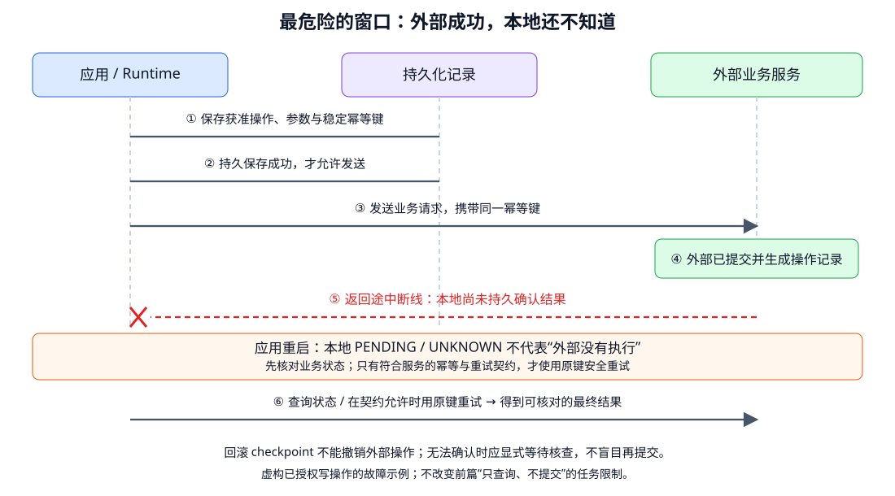

# 状态、持久化与恢复：任务中断后如何安全继续

- 学习日期：2026-10-15。
- 每日概览：[topics_by_date](topics_by_date.md)。
- 路线位置：Agent 阶段 A，第 4 个 Topic。
- 前置阅读：[工具契约](2026-10-15_02_function_calling_and_tool_contracts.md)、[最小 Agent loop](2026-10-15_03_minimal_agent_loop.md)。
- 状态：讲义和故障测试设计已提供；未实现存储、恢复或真实业务操作。

先读第 1～5 节的状态与故障时间线，再看恢复规则。重点是应用可靠性，不展开分布式数据库实现。

## 1. 为什么保存聊天记录还不够？

最小 loop 在一个进程里运行。但进程可能退出、网络断开、用户隔天回复，或者工具执行了一半。

只保存“模型说自己做了什么”，不能判断实际进度：

```text
模型说：已提交
实际：可能只是提出调用，尚未执行

本地记录：没有结果
实际：可能外部已执行，只是返回丢失
```

需要持久保存模型交互和可核验的任务执行状态。持久化表示进程重启后仍可读取；普通内存变量或内存型 checkpointer 不具备这种保证。

## 2. 保存什么？区分四类对象

| 对象 | 记录什么 | 用途 |
|---|---|---|
| 模型协议状态 | 消息、调用与结果关联、供应商要求的续接项 | 继续正确的模型对话 |
| 任务状态 | 目标、限制、事实 / 来源、未知项、等待原因、预算 | 决定任务是否可以继续 |
| 操作记录 | 动作参数、授权、尝试、业务操作 ID、结果与核查状态 | 区分“建议做”与“已经做” |
| 事件 / trace | 谁在何时提出、执行、失败、批准或取消 | 审计、诊断与重建线索 |

Snapshot / checkpoint 是一个状态快照；事件日志按发生顺序记录变化。可组合使用，但不要求第一版实现完整 event sourcing。

写日志成功不等于业务状态与快照都已可靠提交；应用必须明确哪些写入需要原子提交，哪些是辅助观测。

### 2.1 常见 ID 不要混用

| ID | 作用 |
|---|---|
| task_id | 一项持续任务，可能跨多次运行 |
| run_id | 某次执行 / 恢复尝试 |
| checkpoint_id / state_version | 某个已保存状态与版本 |
| tool_call_id | 模型协议中调用与结果的关联 |
| action_id | 应用识别的逻辑操作，跨重试保持关联 |
| idempotency_key | 外部服务识别“同一次业务操作重试”的键 |

同名工具可能多次调用；新的 run 或 tool_call_id 也不一定意味着新的业务动作。幂等键由可信程序管理，不让模型随意更换来绕开重复检测。

## 3. 状态机：停止、等待、失败不是同一种情况

一种教学状态设计：

```text
RUNNING → WAITING_USER / WAITING_APPROVAL
    ↑                 ↓ 有效补充或批准，重新检查条件
    └─────────────────┘

RUNNING → COMPLETED / FAILED / BUDGET_EXHAUSTED / CANCELLED
```

状态名称不是行业统一接口。还可存在“外部操作待核查”等子状态。

- 等待用户：没有新输入前不继续调用模型空转。
- 等待审批：未获有效授权前不执行写操作。
- 完成：有证据满足目标，不只是生成了最终文本。
- 取消：停止允许停止的后续工作，不等于已经发生的动作被撤销。

任务级停止状态与外部操作状态可能不同。例如任务收到取消，仍需跟踪之前已发出的业务请求，不能把它遗忘。

## 4. Checkpoint 能做什么，不能做什么？

它记录某个时刻应用已经保存的状态。例如：

```text
任务：只检查 A123，不提交
订单查询：已取得并保存结果
政策查询：尚未完成
拆封状态：未知
剩余预算：已保存累计用量
```

恢复后可从尚未完成的阶段继续，不必从头再查询所有内容。

但要注意：

- 快照之后、崩溃之前的操作可能没有写进去。
- 外部订单或政策可能已经变化，需要按时效要求重新读取。
- 修改 prompt、工具 schema 或代码版本后，旧状态未必兼容。
- 恢复预算不能清零，否则可以无限“重启”绕过任务上限。

checkpoint 不是保存 Transformer 每层激活或 KV Cache，也不必复制模型权重。它保存的是应用 / 框架状态；具体续接依所用协议与服务能力。

## 5. 最危险的情况：工具执行成功，响应却丢了

下面另设一个**已经获得明确授权**的虚构写任务，用于讲故障；不改变前篇“只查询、不提交”的限制。



假设用户已批准创建一张申请：

1. 应用持久记录操作、固定参数、有效授权与幂等键 K。
2. 发出创建请求，带 K。
3. 外部服务创建成功。
4. 返回途中断线，应用尚未保存成功结果。

此时本地只能说“结果未确认”，不能说“没执行”。

若恢复时新建一个 K2 再提交，可能创建第二张申请。正确方向是：

- 按原操作标识查询服务的权威状态。
- 服务支持可靠幂等重试时，在其有效范围内使用原键 K 和相同请求重试。
- 查不到可靠结论、也没有安全重试保证时，暂停核查，必要时人工处理。

写入本地 `PENDING` 再调用外部服务，也不能消除这个不确定窗口。即使记录了“发送前”，崩溃点仍可能发生在请求发出之后、结果保存之前。

## 6. 幂等不是“工具只能调用一次”

幂等的直觉是：同一次逻辑操作重复提交，不应产生额外业务效果。

对服务支持的幂等请求：

```text
同一操作 + 同一键 + 相同参数 → 服务按契约去重 / 返回已有结果
```

依赖条件：

- 去重作用域：账户、端点或租户等。
- 键的有效期与服务实际语义。
- 相同键不同参数如何处理。
- 并发、失败、部分成功与重试的规则。

这些由外部服务保证，不能只在 prompt 中写“不要重复”。本地先查一遍“没做过”再发送，也不自动防止并发与中途崩溃。

幂等键不能永久只用订单号：同一订单可能有两次合法不同操作。应区分用户意图对应的逻辑动作；改变金额或对象时不能沿用旧批准或冒充相同请求。

“任务最终完成一次”也不等于严格的 exactly-once 外部执行。没有覆盖本地与外部系统的共同保证，不应承诺仅靠 checkpoint 就能做到 exactly-once。

## 7. 恢复时怎么决定下一步？

| 已保存信息 | 优先处理 |
|---|---|
| 完整结果已保存，尚未回填模型 | 验证结果与时效后回填，不重复执行原写操作 |
| 工具执行状态未确认 | 查询权威状态，或依服务契约用原键重试；不先生成新操作 |
| 已确认未执行，业务前提仍成立 | 重新检查授权、预算与条件后执行 |
| 等待用户 | 接收匹配任务的新输入，保留其“用户声明”的来源 |
| 等待审批 | 检查批准范围、参数与时效；条件变化则重审 |
| 已取消 / 耗尽预算 | 不恢复普通行动；必要核查按专门策略受控处理 |

恢复前至少检查可信身份、资源权限、状态版本、依赖版本与累积预算。旧 checkpoint 不能恢复已撤销权限或过期批准。

先处理未确认的外部动作，再让模型自由重规划；否则它可能用不同描述再次提出同一个业务动作。

### 7.1 多个 worker 同时恢复怎么办？

即使只有一个 Agent 角色，也可能有两个后台进程同时处理同一任务。

需要可靠的任务归属 / 锁、租约或版本检查等机制，避免同时修改同一状态。租约过期后旧 worker 可能仍在运行，必要时使用 fencing 或服务端条件更新等防止过期执行者继续写入。

第一版可限制为单执行者，但仍应声明并测试该假设。简单“先读取状态再写回”不能自动防并发；外部副作用仍需自己的保护。

## 8. 暂停、取消、回放与回滚

| 动作 | 意义 | 不保证什么 |
|---|---|---|
| 暂停 | 保存状态，等待输入或审批 | 原有外部事实一直有效 |
| 取消 | 请求停止后续行动，尽力终止可取消调用 | 在途请求一定没生效 |
| 回放 | 重现记录或重新执行某些步骤 | 两种回放效果相同；真实重执行可能有副作用 |
| 回滚 checkpoint | 恢复本地逻辑到较早状态 | 外部数据库 / 文件 / 已发送消息自动还原 |
| 补偿动作 | 另发合法业务操作抵消部分影响 | 完全可逆、无需授权或没有成本 |

调试时优先使用已记录结果或模拟器。若要重执行外部操作，明确其权限与副作用；不能因为框架叫“time travel”，就认为现实环境也跟着回到过去。

## 9. 最小实现应先准备什么？

不急着上复杂框架，先定义：

1. task 与 checkpoint 的 schema / 版本、事实来源与状态转换。
2. 操作记录：固定参数、授权关联、逻辑动作键、结果或未知状态。
3. 原子保存边界：相关本地状态与操作结果尽量一致提交；失败显式暴露。
4. 恢复规则：按第 7 节处理，不让模型猜动作是否执行。
5. 数据保留与权限：状态含敏感资料时需要访问控制、脱敏、加密与清理策略。

开发时可以研究本地 SQLite 等持久存储；进程内字典不够。是否适合生产取决于并发、部署和可靠性要求，不因数据库存在就自动可靠。

模型输出可缓存为已完成步骤的结果，避免恢复时重新生成出不同动作。缓存使用仍需检查上下文、版本与权限，不将旧结果无条件复用。

## 10. 故障测试：在关键位置主动中断

| 注入故障 | 必须检查 |
|---|---|
| 保存动作意图后、发送前退出 | 恢复不会丢掉目标，执行前重新检查条件 |
| 外部已提交、返回丢失 | 不盲目新建请求，进入核查 / 安全幂等重试 |
| 结果持久保存后、模型回填前退出 | 可回填已记录结果，不重复写入 |
| 本地持久写入失败 | 不谎称已保存或可恢复，停止不安全后续 |
| 用户审批等待期间重启 | 保留等待状态，不直接执行 |
| 参数改变、旧批准仍在 | 旧授权不能覆盖新动作 |
| 两个 worker 同时恢复 | 状态与外部操作不因竞争重复执行 |
| 取消与工具成功同时发生 | 如实核对结果，不把取消当撤销 |
| 多次恢复 | 累计预算和重试次数不被重置 |

这是待实现测试清单，不是本次已运行结果。恢复成功还要验证业务结果和日志，而不只是程序没有报错。

## 11. 框架参考、技术总结与进度

2026-10-15 核对：

- [LangGraph Persistence](https://docs.langchain.com/oss/python/langgraph/persistence)：区分 thread checkpoint 与跨 thread store；文档明确内存型 saver 重启会丢状态。
- [LangGraph Checkpointers](https://docs.langchain.com/oss/python/langgraph/checkpointers)：框架按 super-step 保存与恢复的机制。具体恢复粒度由框架决定，不保证任意函数中间都精确续接。
- [Stripe Idempotent requests](https://docs.stripe.com/api/idempotent_requests)：外部服务幂等契约实例。文档区分 API v1 / v2，并有键清理与参数一致性规则，不能泛化成所有服务的行为。

资料是原理与契约参考；本次没有调用支付 API 或安装这些工具。未读完所有框架机制，不据此承诺生产兼容。

设计复盘框架：

> 我将协议历史、任务状态和操作结果分别建模，用持久 checkpoint 保存进度。恢复时先处理结果不确定的动作，再决定继续；外部写操作使用业务支持的幂等和状态查询，不把超时当未执行。取消和本地回滚不自动撤销外部效果，授权与预算在恢复时仍需检查。

记录：

- 已提供：状态分类、ID、checkpoint、故障时间线、幂等、恢复表、并发与待执行测试。
- 阅读反馈 / 答疑：待补充。
- 已验证掌握：暂无，未运行持久化或恢复实验。
- 下一专题：任务分解、规划与重规划。阶段 A 的双工具 loop 与故障测试仍待实践，不因教材已提供而标为完成。
