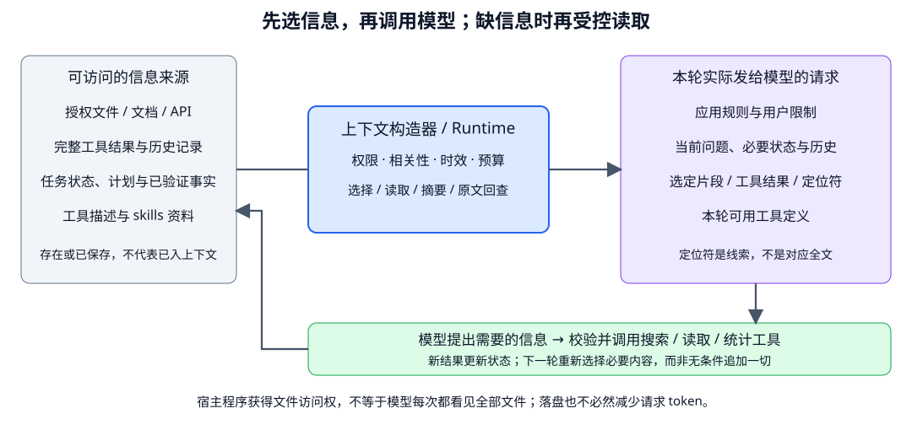

# Agentic retrieval 与上下文工程：本轮模型到底看到了什么？

- 学习日期：2026-10-15。
- 路线位置：Agent 阶段 B，第 6 个 Topic。
- 每日概览：[topics_by_date](topics_by_date.md)。
- 前置阅读：[任务规划](2026-10-15_05_task_planning_and_replanning.md)、[RAG 查询与压缩](2026-10-12_06_query_optimization_and_context_compression.md)、[Prompt / 上下文](2026-10-11_04_prompt_and_context_design.md)。
- 状态：通用概念教材与图示；没有访问个人文件或处理真实表格。
- 相邻补充：[Skills 与渐进式披露](2026-10-15_06a_skills_and_progressive_disclosure.md)，展开方法包、目录 / 正文 / 资源分层、加载与执行边界；2026-10-19 补写，之后可接 [Memory](2026-10-15_07_agent_memory.md)。

沿用办公任务：合并 sales.csv 和 returns.xlsx，按确认口径统计季度净销售额，交付报告。先看第 1～4 节的信息流，再看输出与历史处理。无需了解具体 Harness 的模块；源码细节留待独立项目阅读。

## 1. 从固定 RAG 走向任务中主动找信息

固定 RAG 基线常按预设流程“检索 → 重排 → 提供证据 → 生成”。Agentic retrieval 则允许模型根据任务进展，提出不同的信息获取动作：

```text
不知道文件在哪 → 列文件 / 搜索文件名
不知道列结构 → 读取表头与少量样例
不知道单位 → 读说明 / 查询可信元数据 / 询问用户
不知道总额 → 调用数据处理程序计算
发现未匹配订单 → 查询对应记录并检查规则
```

不只是把向量检索反复调用。文件搜索、符号查询、浏览、数据库条件查询与计算工具都可能参与；计算工具还会产生新观察，而非只返回现成文档。

模型可以建议下一步，runtime 仍控制允许来源、工具、预算与结果处理。缺信息不自动授权读取用户全部文件或发送资料到外部服务。

## 2. 三个范围必须分开



自绘示意。把每轮模型调用理解为一次有选择的信息装配：

| 范围 | 例子 | 不能推断什么 |
|---|---|---|
| 工具可访问的数据 | 获准工作区里的两张表与说明 | 模型已看过文件全文 |
| 系统已保存的状态 / 产物 | 完整日志、历史、表格统计、错误报告 | 这些内容都进入了本轮输入 |
| 本轮实际提供的上下文 | 表头、聚合结果、确认口径、必要历史与工具定义 | 磁盘上还有的内容也被模型理解了 |

模型可能有预训练知识，但针对本任务的金额、文件状态与执行结果，不能据此推断已知。

把一大段工具输出移到文件，只给路径时，模型只收到路径与预览。若随后发送前又自动载入全文，则本轮 token 并没有因为“落盘”必然下降。

## 3. 用办公任务走一遍：每一步只取需要的信息

| 阶段 | 信息缺口 | 适合动作 | 本轮有用观察 |
|---|---|---|---|
| 定位 | 哪些文件属于当前任务？ | 在授权目录列出匹配文件 | 文件 ID、版本、大小，不是全部内容 |
| 理解 | 表头、类型、单位、时间范围是什么？ | 结构化读取 / profiling | schema、行数、少量样例、缺失统计 |
| 核对 | 退款金额单位未明确 | 搜索说明、读取相关章节；仍不明则澄清 | 来源证据或明确未知 |
| 合并 | 关联是否可靠？ | 程序做关联并输出诊断 | 匹配、未匹配、重复键统计与结果位置 |
| 汇总 | 净额与地区合计是否一致？ | 计算与校验 | 汇总数、核对结果和可回查产物 |
| 写报告 | 如何表达结论与限制？ | 提供已核对数据与口径给模型 | 可信汇总、限制、出处和输出约定 |

**不要让 LLM 阅读十万行表格后靠自然语言“心算”总额。** 先用程序处理，给模型看统计、异常样例和来源；但这些程序本身的字段、单位与逻辑也要验证。

读取前几行只是探索，不证明全表都符合推断。少量样本全部非空，也不能当成全列无缺失的统计结果。

这里的工具名与操作是设计例子，不表示候选 Harness 默认已经实现专用表格分析工具。

## 4. 怎样控制检索与读取粒度？

### 4.1 先定位，再细读

文件很多时先搜索文件名 / 标题，得到候选；再读相关范围。全文读取前确认格式与规模，避免一个大日志占满上下文。

搜索命中“金额”只能说明有词项命中。还要读附近表头、单位定义和适用版本，不能把命中行直接升级为完整事实。

### 4.2 代码任务的同类流程

```text
报错 → 搜索异常文本 / 符号
     → 读定义、调用与相关测试
     → 定位假设
     → 执行测试验证
```

代码智能、文本搜索和运行结果提供不同证据。一个符号被找到，不代表完整调用路径已确认；“测试通过”也要说明实际运行了哪些测试。

### 4.3 查询历史要有进展

记录查过什么、返回什么、还缺什么。相同查询可能因文件更新而合理重复；没有变化却反复读相同段落，应检查无进展限制。

文件不可访问、读取超时、搜索无命中是不同结果。不要在工具失败时改换路径去绕过访问限制，也不将失败说成“资料不存在”。

## 5. 工具输出太大：四种处理不要混为一谈

| 方式 | 改变什么 | 风险 / 后续 |
|---|---|---|
| 结构化筛选 | 只返回必要字段、统计与有限样例 | 需要知道遗漏什么，保留完整数据定位 |
| 有界读取 / 分页 | 每次取得部分原文 | 说明范围、是否还有下一页、是否截断 |
| 落盘 / offload / spill | 把完整结果保存，向模型提供预览与定位符 | 需要可用的读回工具、权限与版本 |
| 摘要 / compaction | 以压缩表达替代部分内容或旧历史 | 有损；可能漏事实或改变条件 |

例如合并产生 30,000 行未匹配记录，可以保存完整表，先返回计数、分类与样例。Agent 需要进一步调查时，对完整产物做受控查询，而不是一次把整表读回来。

保留原始文件不保证摘要正确；保留路径也不保证重启后文件仍存在。需要关联生命周期与恢复策略。

保存失败时不能返回一个假的成功路径。可以按明确策略保留原结果或返回显式错误；若仍超预算，继续受控处理或停止，不静默截断后声称完整。

## 6. 长历史怎么压缩，哪些不能只靠摘要？

摘要优先保留：

- 当前目标和用户限制，如禁止改原件、禁止发邮件。
- 已确认口径及来源，未知单位和未解决冲突。
- 计划进度与实际完成证据。
- 关键错误、有效产物定位、待核查外部操作。
- 下一步所需信息。

但授权、任务预算、业务操作结果等可信状态，不能只剩一份模型生成摘要。它们由程序维护；每轮按需要把准确表示加入请求。

特别避免：

```text
原记录：用户尚未确认退款单位。
错误摘要：退款已按元统一。
```

这会把缺口变成伪事实。恢复时需要能回查来源，而不是因为“摘要已经这么写”就继续计算。

压缩不能随意删除尚未对应结果的工具调用，破坏协议关联。保留哪些消息、如何续接，需服从具体模型和框架协议。

## 7. Skills / 指令文件：按需加载，不是全部常驻

可以先让模型知道可用能力的名称与简短用途，需要时再读操作说明、模板或脚本。这是一种渐进披露思路。

例如：

```text
初始：知道“表格核对”“报告导出”两类能力
需要核对时：读取表格能力的具体约定
核对完成后：报告阶段仅带必要结果与导出说明
```

真实实现可能是专用工具、中间件或文件读取，不要求同一种文件名或 API。

不要将 skill 描述视为执行授权，也不要让任意检索文档自称高权限指令。工作区指令文件也需要明确来源、加载范围与信任边界。

变更指令后，是否下一次调用自动刷新、旧内容如何失效，是具体实现问题，要看代码与测试，不由“文件已修改”直接推断。

## 8. 把方法串起来：下一轮模型收到什么？

假设合并工具得到 30,000 行未匹配记录，下一轮需要判断应如何调查：

```text
完整记录：保存为可回查产物，模型本轮不接收全部行
本轮输入：
  目标与限制：核对净销售额，不修改原件，不发邮件
  已确认口径：退款金额单位为分，按规定换算
  新观察：未匹配 30,000 行，分类计数与少量样例
  定位信息：完整记录的位置、版本与查询方式
  待解决：未匹配原因是否影响统计
```

模型据此可以提出“按异常类别统计”“查询某订单记录”或澄清，而不是假装已逐条阅读所有数据。

三种效果要分开：

- 把全文从内存移到磁盘，但请求前又载入全文：可能节省应用存储，却不减少本轮模型输入。
- 只发送摘要和定位信息：减少本轮内容，但可能丢细节，需要读回能力。
- 由工具计算必要统计后返回：可减少无关原始行，但计算口径与统计正确性需验证。

不能只看“已落盘”“已压缩”的提示就判断质量或成本；要检查本轮实际输入和最终任务结果。

## 9. 怎样验证上下文工程有用？

用同一办公任务设置三个可归因方案：

1. 小数据范围内直接提供足够信息的基线。
2. 有界读取 + 结构化统计 + 原文回查。
3. 在方案 2 上增加历史摘要或工具输出落盘，分别比较。

记录实际每次模型请求的内容或受控快照、输入 token、工具次数、检索范围、压缩事件与费用。日志遵守隐私和保留策略，不公开原始敏感内容。

检查：

- 单位、用户限制与未确认事项是否保留。
- 计算结果能否回查、异常是否被遗漏。
- 是否少读无关内容，还是只是把成本转为更多工具调用。
- 压缩后是否出现重复执行、错误完成或引用失效。
- 回查文件不存在、无权限或已变更时，是否明确处理。

这些是待实现的对照，不是本篇已跑实验。对数据正确性的检查由实际计算 / 测试支持，不以模型自评“上下文已足够”代替。

## 10. 复习与后续

一句话：

> 上下文工程管理“当前决策需要的信息”，Agentic retrieval 决定“缺的信息去哪里取”；原始数据、持久状态和本轮输入始终是不同层。

可选复习：

1. 文件在工作区里，模型是否就知道全文？
2. 工具结果落盘后，是否一定减少模型输入 token？
3. 读取 5 行样例，能否确定整列无缺失？
4. 摘要说“已确认”，是否可以替代授权与事实来源记录？

<details>
<summary>参考答案</summary>

1. 不是，要看本轮实际输入与工具读取。
2. 不一定，后续可能重读 / 恢复全文，也可能只优化存储。
3. 不能，需要全表统计或明确抽样结论。
4. 不能，可信状态和来源需单独维护。

</details>

可复习 [RAG 查询与压缩](2026-10-12_06_query_optimization_and_context_compression.md)，本篇更关注多轮任务中的信息选择与生命周期。此前源码细节已移到 [后续 Harness 阅读笔记](../harness_implementation_notes_2026-10-15.md)，不是本阶段前置。

记录：

- 已提供：上下文分层图、办公任务信息获取轨迹、输出处理与压缩、按需加载及验证设计。
- 学习方式调整：项目内部对象与源码细节已从概念正文移出，改用通用任务例子。
- 阅读反馈 / 答疑：待补充。
- 已验证掌握：暂无；未运行 Harness 或上下文对照。
- 下一专题：Memory 的写入、检索、纠错、过期与隔离，进一步区分任务状态、历史摘要与长期记忆。
