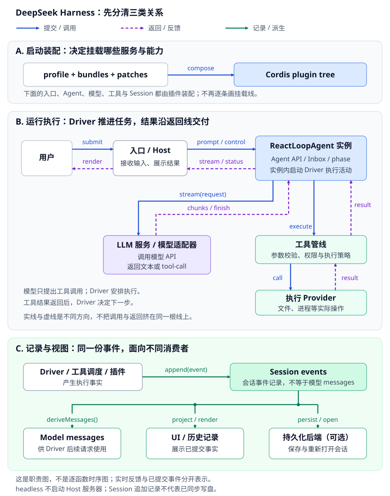

# 第 1 站：系统全貌与插件架构

[专题入口](README.md) · 下一站：[消息、事件与请求](2026-10-17_02_messages_events_requests.md)

## 1. 是什么：模型外部的执行与管理系统

**Harness 的职责不是“让模型多想几步”，而是把生成、执行、状态、约束和交付接成一个可管理的系统。**

模型返回“调用 read”，不等于文件已经读到；模型说“完成”，也不等于任务已经验收。中间这些责任必须由程序承担。

[单独放大](../images/deepseek-harness-system-layers.svg)。A 决定挂载什么，B 执行任务，C 记录事实并提供视图；不要把它们当成三个依次运行的函数。

### 1.1 系统职责

| 对象 | 负责什么 | 不负责什么 |
|---|---|---|
| 入口 / Host | 接收输入、调用 Agent、向用户反馈 | 不决定模型请求在哪个 step 接纳新输入 |
| Agent 接口与 registry | 暴露输入、取消、查询和创建入口 | 不把默认循环实现绑定给所有调用者 |
| AgentLoop 服务 | 提供默认 Agent 工厂，创建、恢复并管理实例生命周期 | 不是某一个会话的执行活动 |
| Agent 实现类 ReactLoopAgent | 持有 Session、Inbox、scope 和运行状态，启动内部执行活动 | 不实现每一种模型协议、文件系统或权限策略 |
| Driver 执行活动 | 在同一实例上运行 kick → turn → step，协调模型、工具和终止 | 不是另一个类实例，也不等于一次 turn |
| LLM 服务 / adapter | 统一请求与流，转换 provider 协议 | 不自行管理整个任务 |
| Tools / provider | 管理调用规则，执行实际能力 | 不把模型建议直接当成授权 |
| Session | 记录事实、派生模型历史 | 单靠内存记录不保证重启后存在 |

**Agent 是接口，ReactLoopAgent 是默认实现类；Driver 是该实例内部启动的一次异步执行活动。** 源码有时也用 driver 泛指默认执行实现，但讨论 `wakeDriver()` 和生命周期时，必须区分“实例”和“本次活动”，不能直接把两者画等号。

### 1.2 实例、执行活动和作用域

- **AgentLoop 服务**
  - 一个服务可创建多个 ReactLoopAgent，例如分别服务两个会话。
  - 服务卸载时，负责停止并清理它创建的实例；创建者也持有自己的生命周期责任。
- **ReactLoopAgent 实例**
  - 对应一个 Session，持有自己的 Inbox、Agent scope / ctx 和运行状态。
  - 普通任务结束回到 idle，不等于实例销毁；历史、注册和队列归属仍在。
- **Driver 活动**
  - `wakeDriver()` 在真正的内部 idle 阶段启动 `kick()`，后者循环执行 turn。
  - 活动结束后实例可以继续存在，以后再启动下一次活动。一个活动可连续处理多个 turn。

| 生命周期 / 范围 | 由什么界定 | 何时结束 |
|---|---|---|
| Agent 实例与 Agent scope | factory 创建，handle / provider 拥有 | dispose 等待活动退出，再释放 scope 等资源 |
| Driver 活动 | 一次 wakeDriver 启动的 kick 调用链 | 不再继续执行或因错误 / 取消收尾 |
| turn / step | 活动内的执行边界 | 相应工作结算并记录结束事件 |
| AbortController | 当前 running turn 或 maintenance 的取消范围 | 可以在同一次 Driver 活动的 turn 之间换新，不是 Agent 永久信号 |

`withInitiator(this, ...)` 为调用链设置“当前发起 Agent”的上下文；它不是再创建一个 Agent scope，也不是启动新线程。Agent scope 管注册与资源归属，异步发起者上下文管调用归因，两者不同。

### 1.3 Cordis 的最小概念

| 概念 | 直观含义 | 例子 |
|---|---|---|
| plugin | 一份可挂载和卸载的能力实现 | 模型适配器、工具、Agent loop |
| ctx | 服务和作用域的访问入口 | `ctx.tools`、`ctx.llm`；不是 LLM 上下文窗口 |
| inject | 声明插件依赖哪些服务 | 工具插件等 tools 服务就绪再启动 |
| event | 在指定位置观察、协调或拦截处理 | `agent/created`、`tools/pre-execute` |
| effect / disposer | 注册时同时定义如何撤销 | 工具卸载后，注册和监听一起清掉 |

profile、bundle、plugin 的关系：

- **profile**：选一套运行方式及配置层，例如 headless 或 web。
- **bundle**：交付一组可继续被覆盖的配置与插件代码。
- **plugin**：真正提供服务、事件监听和能力。
- 不是每个 profile 都启动 Host；`sdk-minimal` 也不要求先套共享 base。

### 1.4 服务与事件的区别

| 意图 | 合适方式 |
|---|---|
| 调用一个明确能力并拿到结果 | 服务方法 |
| 发布一个不要求所有观察者完成的通知 | `emit`，不能当初始化完成屏障 |
| 按顺序等待初始化处理 | `serial`；失败能否继续按具体事件约定 |
| 包装一次处理，或决定是否继续 | `waterfall`，通过 `next()` 委托下游 |

**waterfall 的同步调用入口不等于下游不异步。** 它可以返回 Promise，由调用方 await。本课程关心的是“谁等谁、谁能短路”，不是只记模式名。

## 2. 为什么要做：生成能力不能代替执行系统

- 模型输出调用建议，但不负责可靠地读文件、取消工作或保存会话；没有执行层，建议无法变成可管理的操作。
- 不同模型、工具和入口会变化；全部写进一个循环，新增能力就容易影响无关行为。
- 插件和任务会退出或重载；没有明确所有权，旧监听、工具和后台工作会残留。

这些是要解决的问题；是否采用完整插件框架，是第 4 节讨论的方案选择。

## 3. 怎么做：装配、注册、执行与退出

### 3.1 从服务装配到实例执行

- **装配**
  - 启动器合并 profile 的 bundles 和 patches，构造 Cordis 插件树。
  - 关键设计点：部署配置决定用哪个实现；读取架构图不代表所有插件已启用。
- **注册与依赖就绪**
  - 插件提供服务、注册工具或监听事件；依赖满足后再激活消费者。
  - 关键设计点：注册同时绑定释放责任，不靠“退出时统一扫一遍”猜哪些资源要清。
- **执行与退出**
  - 入口通过 Agent 发起任务；Driver 使用服务和扩展点推进；退出沿所有权释放。
  - 关键设计点：异步工作没退出时，不能先卸载它还需要的服务。第 3、6 站展开。

### 3.2 什么情况下创建多个 ReactLoopAgent

| 场景 | 创建关系 | 注意 |
|---|---|---|
| 配置中声明多个 Agent | AgentLoop 遍历配置，为不同身份创建或恢复实例 | 不是一个配置条目创建所有会话 |
| 应用创建多个不同会话 | 多次调用 registry 的 create，由默认工厂分别创建 | 同一会话后续发消息通常复用活跃实例，不逐消息创建 |
| 使用进程内子 Agent 能力 | 子 Agent manager 通过 registry 创建独立子实例 | 有独立 Session / scope；外部委派 provider 不必采用此实现 |
| 恢复不再活跃的历史会话 | resume 从存储恢复并构造新的运行实例 | 恢复历史不等于复活旧 JS 对象；不能同时重复占有同一活跃身份 |

这里的多个实例不表示每个都有独立线程、独立模型进程或完整复制的服务。Agent-local 状态和 scope 分开，模型服务等依赖仍可共享；具体能力由装配决定。

默认 base 的启动列表是空的：Web 按会话请求创建实例；headless 在已有具体任务后创建；只有显式非空配置才预创建指定会话。LLM / Tools 服务可先于 Agent 就绪。角色配置、Team 示例和父子复用详见[Multi-Agent 扩展章](2026-10-18_08_multi_agent.md)。

### 3.3 什么情况下同一实例有多个 Driver 活动

这里的“多个”指**先后多次启动，不是多个循环同时推进同一个 Agent**。

| 当前阶段与输入 | 动作 | 是否启动新 Driver |
|---|---|---|
| 真正 idle，收到 followup / steer | 排队，切到 running，启动 kick | 是 |
| 正常 running，收到 followup / steer | 由已有活动继续 claim 和处理 | 否；后续 turn 也可能由同一活动执行 |
| 任意阶段，仅 inject | 加入 next-step 队列 | 不因 inject 自行启动 |
| maintenance 期间收到唤醒输入 | 设置 wakeRequested，结束后有待处理输入且非销毁时再启动 | 延后启动；maintenance 本身不是 Driver |
| 已取消的活动正在收尾，又收到唤醒输入 | 登记延后唤醒，保留输入到下一次活动 | 收尾交接时启动，不与旧活动并行推进 |
| 销毁收尾 | 不登记新的唤醒 | 不能把已销毁实例当成可继续使用的对象 |

例子：A 实例处理完问题 1 后已 idle，过一分钟收到问题 2，就启动 Driver 活动 2。反过来，问题 2 在活动 1 正常运行时已排队，活动 1 可以继续下一个 turn，不必创建活动 2。**重试一个 attempt、进入新 step 或新 turn，都不自动创建新 Driver。**

实现细节：`kick()` 的 finally 可以在旧 Promise 完全 settle 前启动替代活动，此时旧活动只剩收尾，不再推进 turn / step。`whenIdle()` 等待 `activityDone` 后会检查它是否被替换，避免新活动已开始却提前报告空闲。公开 status 也不能完全代替内部 phase：maintenance 对外可显示 idle，但必须等维护退出后才能启动 Driver。

### 3.4 Driver 与实例怎样协作

**不是两个对象之间发消息。** `kick()`、`turn()`、`step()` 都是同一个 ReactLoopAgent 的方法，通过 `this` 读写同一份状态：

| 通道 / 状态 | 外部操作或实例方法 | 执行活动如何使用 |
|---|---|---|
| Inbox | followup / steer / inject 入队 | preStep 在 claim 边界接纳 |
| phase | wakeDriver 切换阶段；setPhase 更新状态 | turn / step 读取和更新编号、唤醒标记 |
| AbortSignal | cancel 对当前 phase.abort 发出取消 | 活动检查 signal，向模型 / 工具传播 |
| activityDone | wakeDriver 保存本次完成 Promise | kick 结束时结算；whenIdle 等待并追踪替代活动 |
| Session / dispatch | 实例提供日志与事件分发器 | 执行时写入事实，发布状态和流事件给外部消费者 |

`const driver = Promise.withResolvers<void>()` 中的 driver 只是 `{ promise, resolve, reject }` 完成凭据；真正启动执行的是 `this.kick()`，不是 `new Driver()`。

因此，调用 agent.cancel() 时，不是在给独立 Driver 对象发送 RPC；它改变同实例上的取消信号，让正在 await 模型 / 工具的执行活动观察到停止请求。

## 4. 为什么这么做：把变化点与执行主干分开

| 原文明确的原则 | 本文分析：收益与代价 |
|---|---|
| [架构文档](../../projects/deepseek-harness/docs/architecture.md)说明各能力均可通过插件替换，新行为优先落在扩展点 | 能换模型或加策略而不改循环；但阅读代码时必须同时了解装配和事件顺序 |
| [Cordis 入门](../../projects/deepseek-harness/docs/cordis-primer.md)要求注册有对应 disposer | 卸载和重载不会不断累积旧注册；代价是资源归属必须显式设计 |
| [核心说明](../../projects/deepseek-harness/docs/subsystems/core.md)将 Agent 接口与默认执行类 ReactLoopAgent 分开，使扩展只依赖接口 | 能替换执行策略；但 Agent 接口、ReactLoopAgent 实现类、AgentLoop 工厂与生命周期服务需要分清 |

这些是已写出的设计原则。**“插件越多越好”不是结论。**

**生命周期取舍（分析）**：保留 Agent 实例可以延续 Session、作用域注册和待处理输入；把执行活动按需启动 / 收束，则不需要每次用户发言都重建实例。代价是必须区分实例状态、当前活动的完成凭据和 turn / step 边界，不能用一个“正在运行”标志解释所有生命周期。

### 4.1 用统一工具超时说明方案取舍

需求：“给所有声明了时限的工具加超时处理。”

- 不把定时器分别写进 read、web、shell 的每个调用分支。
- 在工具执行扩展点包装一次调用，向下游传递带截止时间的 signal。
- 真正怎样停止 I/O 或进程，仍由实际执行能力负责。

这展示了**通用策略与具体能力分离**。也展示代价：只装超时包装器，不能让不响应取消的代码自动停止。

## 5. MVP 与验收：保留职责，暂不复制全部机制

- **保留**：Driver、模型接口、工具执行、Session 各有明确职责；资源有创建者和释放者。
- **暂不复制**：完整插件树、HMR、桌面启动和几百个包；显式模块组合也能实现第一版。
- **落到验收**：D01 检查状态所有权，D05 检查清理顺序，D08 检查更换实现是否需要改 Driver。见[统一清单](../2026-10-17_03_harness_acceptance_checklist.md)。

读到能解释“调用 read 的是 Driver，真正读文件的是 provider，负责约束的是执行策略”，本站就够了。

原文与源码入口：需要核对时再展开

- [架构中文](../../projects/deepseek-harness/docs/architecture.zh.md)：Profile、核心包、事件、新行为归属。
- [Cordis 入门中文](../../projects/deepseek-harness/docs/cordis-primer.zh.md)：核心概念、分发、waterfall、effect。
- [Agent registry](../../projects/deepseek-harness/packages/core/agent/src/index.ts)、[默认 factory](../../projects/deepseek-harness/packages/core/agent-loop/src/index.ts)：接口与实现怎样连接。
- [ReactLoopAgent](../../projects/deepseek-harness/packages/core/agent-loop/src/agent.ts)：构造函数、send、wakeDriver、kick、whenIdle、turn 及 runMaintenance。
- [会话创建入口](../../projects/deepseek-harness/packages/api/session-controller/src/agent.ts)、[子 Agent manager](../../projects/deepseek-harness/packages/subagent/subagent/src/manager.ts)：不同实例的实际创建 / 恢复调用。
- 本站是结构与机制解释，未启动 profile，未验证本机插件装配。

